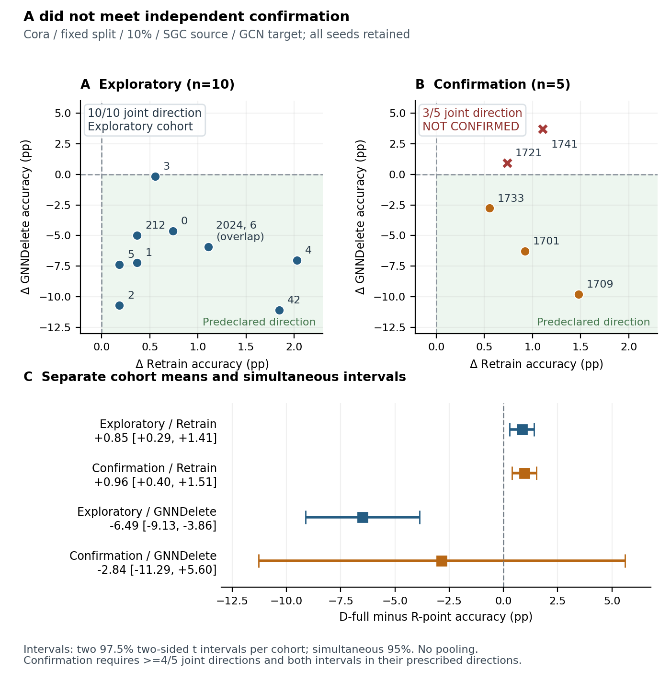

# A 两阶段完整证据：独立确认未通过

正式判定为 not_confirmed，writing_gate=not_met。技术与来源检查通过：30 个端点、61 个返回文件、15 个 GNNDelete validation 选模 checkpoint 全部验收；科学判定与这些技术验收分开。

主要对比固定为 D-full−R-point。探索十 seed 同方向 10/10；独立五 seed 只有 3/5，低于冻结的至少4/5要求。新 seed 的 Ret 差为+0.9594 pp，同时区间[+0.4046,+1.5142]；GNNDelete 差为−2.8413 pp，同时区间[−11.2859,+5.6033]，跨零。两个主判据都必须满足，不能通过选择其中一个来确认。

新 seed1721、1741 的 GNNDelete accuracy 差分别为+0.9225、+3.6900 pp，与预期方向相反。全部五个 Ret accuracy 差均为正。图保留所有15个seed，并将探索与确认分栏，既不合并估计，也不删去反向点。

CE 的五个新 seed 在预期方向上全部一致，但它是预先规定的描述性补充，不能取代 accuracy 主判据，也不改变 not_confirmed。当前证据支持“探索发现具有明显 seed 依赖，未通过独立确认”的陈述，不支持将稳定的双向效用反转作为已确认主结论。

A 诊断 gate/full 的条件分支未触发，状态为 not_required_after_failed_confirmation；没有派发，没有实际attempt，不记作失败或已完成。原始完整情景预算27225秒保留，不根据未运行分支计算预算偏差。

A 的正式执行耗时为 gate123秒、main416秒、confirmation527秒，合计1066秒；确认执行时间08:45:50–08:54:37，队列230秒。确认的独立只读checkpoint审计为13.9348507秒，08:56:03.8899609+08:00完成，producer_calls=0且index不变；该审计不计入527秒执行耗时。

Figure. All paired-seed outcomes of the corrected GNNDelete experiment on the fixed Cora split at 10% node deletion. Each point in A/B is one joint request/training seed; both axes show D-full minus R-point accuracy. The shaded region denotes the predeclared joint direction (Retrain > 0 and GNNDelete < 0). A shows the ten exploratory seeds (seeds 6 and 2024 coincide); B retains all five independent confirmation seeds, with reverse-direction seeds marked as crosses. C reports separate cohort means and two 97.5% two-sided t intervals per cohort, yielding Bonferroni simultaneous 95% coverage for the two primary contrasts. The confirmation fails the frozen rule: 3/5 joint directions rather than at least 4/5, and the GNNDelete interval crosses zero. The cohorts are not pooled; no result is omitted. Degree controls remain in the endpoint tables but are not part of this predeclared primary contrast.

| cohort | seed | ΔRet pp | ΔGNN pp | joint direction |
| --- | --- | --- | --- | --- |
| Exploratory (10 seeds) | 42 | +1.8450 | -11.0701 | True |
| Exploratory (10 seeds) | 212 | +0.3690 | -4.9815 | True |
| Exploratory (10 seeds) | 2024 | +1.1070 | -5.9041 | True |
| Exploratory (10 seeds) | 0 | +0.7380 | -4.6125 | True |
| Exploratory (10 seeds) | 1 | +0.3690 | -7.1956 | True |
| Exploratory (10 seeds) | 2 | +0.1845 | -10.7011 | True |
| Exploratory (10 seeds) | 3 | +0.5535 | -0.1845 | True |
| Exploratory (10 seeds) | 4 | +2.0295 | -7.0111 | True |
| Exploratory (10 seeds) | 5 | +0.1845 | -7.3801 | True |
| Exploratory (10 seeds) | 6 | +1.1070 | -5.9041 | True |
| Independent confirmation (5 seeds) | 1701 | +0.9225 | -6.2731 | True |
| Independent confirmation (5 seeds) | 1709 | +1.4760 | -9.7786 | True |
| Independent confirmation (5 seeds) | 1721 | +0.7380 | +0.9225 | False |
| Independent confirmation (5 seeds) | 1733 | +0.5535 | -2.7675 | True |
| Independent confirmation (5 seeds) | 1741 | +1.1070 | +3.6900 | False |

来源：各自 e84r1/e84c1 的 DECISION.json、paired_contrasts.csv、contrast_summary.csv；全部30个新端点含Degree见 e84c1/endpoints.csv。
