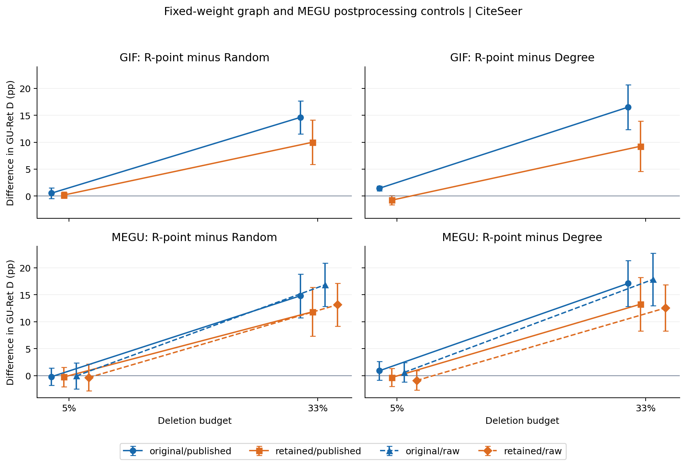
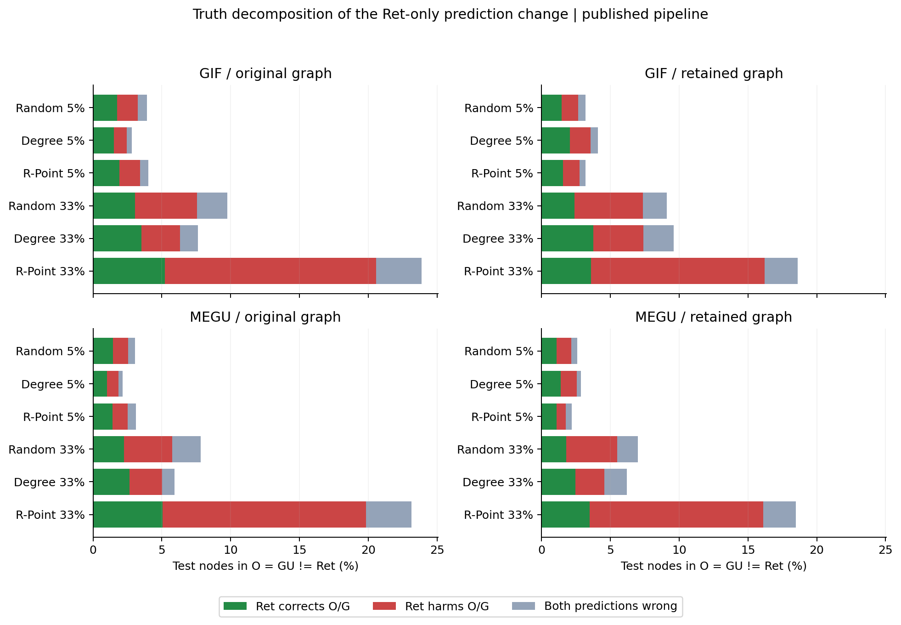
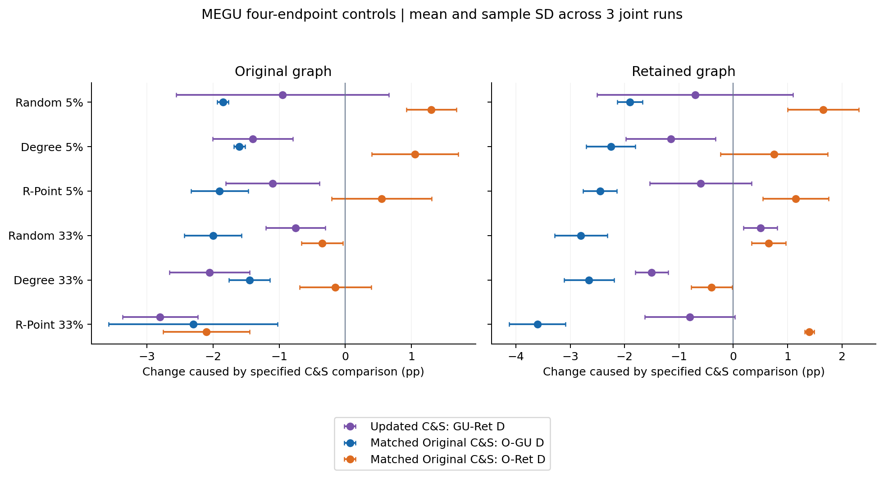

# B完整两图与C&S诊断：关系保留范围及端点解释

本分析仅消费accepted e85gr1以及独立整数复核通过的checks.json。36个GU引用对应18个请求×seed与18个配对Ret引用；CiteSeer、5%/33%、Random/Degree/R-point、三联合seed、GIF/MEGU。每端点666个相同test节点。两图、raw/published/matched C&S共180组三角、7200个真值联合格通过重建；这些表格行不是独立科学重复。

主要判断：33%下R-point相对Random和Degree的额外GU–Ret分歧，在两种评价图、GIF与MEGU raw/published的12个条件比较中均保留为三个seed同方向。但评价图会改变幅度，5%下的排序并不稳定。O=GU≠Ret占据R-point大预算分歧的主要部分，其中Ret由共同正确转为错误的节点多于Ret纠错节点。这支持“必须解释参照端点如何变化”的审计发现；不能据此把大D直接命名为GU新增效用损害或已证实的遗忘失败。

建议论文采用：把策略×预算响应、同权重评价图敏感性和Original–GU–Ret真值分解连成同一结果链。主文展示图1及图2；图3和完整逐seed表作为后处理控制。保留小预算反转、图依赖幅度和Ret质量尚待独立确认三项边界。

## 1. 策略×预算关系：逐图与后处理检查

| method | graph | triangle | right | gu_retrain_disagreement_delta_pp_mean | gu_retrain_disagreement_delta_pp_sd | gu_retrain_disagreement_delta_pp_positive_seeds |
| --- | --- | --- | --- | --- | --- | --- |
| GIF | original | published | degree | 15.065 | 4.508 | 3 |
| GIF | original | published | random | 14.064 | 2.308 | 3 |
| GIF | retained | published | degree | 10.010 | 5.290 | 3 |
| GIF | retained | published | random | 9.810 | 3.722 | 3 |
| MEGU | original | published | degree | 16.216 | 2.553 | 3 |
| MEGU | original | published | random | 15.015 | 2.605 | 3 |
| MEGU | original | raw | degree | 17.267 | 3.103 | 3 |
| MEGU | original | raw | random | 16.917 | 1.779 | 3 |
| MEGU | retained | published | degree | 13.614 | 3.308 | 3 |
| MEGU | retained | published | random | 12.112 | 2.982 | 3 |
| MEGU | retained | raw | degree | 13.463 | 2.478 | 3 |
| MEGU | retained | raw | random | 13.514 | 1.568 | 3 |

上表为[33%的R-point−baseline D差]−[5%的R-point−baseline D差]，单位pp；误差为三个联合运行的样本SD，不是总体区间或假设检验。所有限定scope均完整列出，没有按方向删行。完整逐seed配对在父目录CSV，原始端点在endpoint_summary.csv；两个预算的本次控制不能代替历史七预算曲线。

GIF published、33%：R-point−Random由14.615降至10.010 pp（降低4.605 pp）；R-point−Degree由16.517降至9.259 pp（降低7.257 pp）。这表示高预算方向跨图保留，数值强度存在评价图依赖。

MEGU published、33%：R-point−Random由14.815降至11.862 pp（降低2.953 pp）；R-point−Degree由17.117降至13.263 pp（降低3.854 pp）。这表示高预算方向跨图保留，数值强度存在评价图依赖。

低预算反例必须保留：GIF的5% R-point−Degree在原图为1.451 pp，保留图变为-0.751 pp，后者三个seed均为负。MEGU 5%相对Random的平均差在两图和raw/published下均略为负。不能写R-point在所有预算稳定占优。所有12个不重复控制条件的预算差扩张均为三个seed同方向正值，限于这两个冻结预算。

图1：两个固定预算下的请求差。颜色区分original/retained图，MEGU线型区分raw/published；点为三seed均值，误差为样本SD。GIF的raw=published只画一次。MEGU matched C&S不改变GU和Ret，因此其GU–Ret D与published完全相同，这是定义关系，不能当作额外稳健性确认。

## 2. O=GU≠Ret内部究竟是谁变对或变错

| method | graph | triangle | original_accuracy_pct | gu_accuracy_pct | retrain_accuracy_pct | original_gu_disagreement_pct | original_retrain_disagreement_pct | gu_retrain_disagreement_pct | ret_only_share_of_D_pct | ret_only_corrects_pct | ret_only_harms_pct |
| --- | --- | --- | --- | --- | --- | --- | --- | --- | --- | --- | --- |
| GIF | original | published | 74.625 | 74.374 | 64.715 | 3.504 | 27.027 | 24.625 | 96.890 | 5.205 | 15.365 |
| GIF | retained | published | 74.875 | 73.824 | 65.065 | 2.803 | 21.071 | 19.269 | 96.450 | 3.604 | 12.613 |
| MEGU | original | matched_cs | 74.825 | 74.274 | 64.715 | 2.603 | 24.925 | 24.925 | 93.621 | 5.105 | 14.865 |
| MEGU | original | published | 74.625 | 74.274 | 64.715 | 4.905 | 27.027 | 24.925 | 92.545 | 5.055 | 14.765 |
| MEGU | original | raw | 74.625 | 74.074 | 64.715 | 3.403 | 27.027 | 27.728 | 91.596 | 5.956 | 15.916 |
| MEGU | retained | matched_cs | 74.775 | 74.174 | 65.065 | 2.302 | 22.472 | 22.573 | 92.744 | 4.404 | 13.664 |
| MEGU | retained | published | 74.875 | 74.174 | 65.065 | 5.906 | 21.071 | 22.573 | 81.149 | 3.504 | 12.613 |
| MEGU | retained | raw | 74.875 | 74.174 | 65.065 | 4.655 | 21.071 | 23.373 | 82.670 | 3.804 | 13.313 |

GIF published、R-point 33%：O=GU≠Ret占GU–Ret分歧的平均份额为96.890%（原图）和96.450%（保留图）。其中Ret纠错/损失分别占全test节点5.205%/15.365%与3.604%/12.613%。份额先逐seed计算再等权平均，不是把所有条件计数混合。

MEGU published、R-point 33%：O=GU≠Ret占GU–Ret分歧的平均份额为92.545%（原图）和81.149%（保留图）。其中Ret纠错/损失分别占全test节点5.055%/14.765%与3.504%/12.613%。份额先逐seed计算再等权平均，不是把所有条件计数混合。

图2：published流水线中O=GU≠Ret的全部三策略、两预算和两图。每段为666个test节点中的比例，再按seed等权平均；绿色表示Ret纠正共同的O/GU错误，红色表示Ret错而O/GU对，灰色表示两种预测均错。这是结果分类，不是因果分解；所有五类×真值原值均保留。

表与图应共同决定如何叙述“谁在改变”：大GU–Ret D不能直接写成GU新增破坏，GU accuracy高于Ret也不能写成遗忘更好。匹配C&S的Original是O+C&S，不能仍称未经后处理的原模型；其O=GU≠Ret分类改变是参照端点改变。Ret训练质量和选模诊断由独立证据检查，当前图表不替代它。

## 3. 后处理及评价图改变了哪些量

| graph | selector | ratio | cs_no_update_accuracy_change_pp_mean | cs_update_accuracy_change_pp_mean | cs_gu_ret_D_change_pp_mean | matched_minus_published_OG_D_pp_mean | matched_minus_published_OR_D_pp_mean |
| --- | --- | --- | --- | --- | --- | --- | --- |
| original | degree | 0.05 | 0.100 | 0.400 | -1.401 | -1.602 | 1.051 |
| original | degree | 0.33 | 0.050 | 0.851 | -2.052 | -1.451 | -0.150 |
| original | r_point | 0.05 | 0.150 | 0.450 | -1.101 | -1.902 | 0.551 |
| original | r_point | 0.33 | 0.200 | 0.200 | -2.803 | -2.302 | -2.102 |
| original | random | 0.05 | -0.150 | -0.150 | -0.951 | -1.852 | 1.301 |
| original | random | 0.33 | -0.250 | -1.051 | -0.751 | -2.002 | -0.350 |
| retained | degree | 0.05 | -0.150 | 0.050 | -1.151 | -2.252 | 0.751 |
| retained | degree | 0.33 | -0.901 | -0.701 | -1.502 | -2.653 | -0.400 |
| retained | r_point | 0.05 | 0.200 | -0.050 | -0.601 | -2.452 | 1.151 |
| retained | r_point | 0.33 | -0.100 | 0.000 | -0.801 | -3.604 | 1.401 |
| retained | random | 0.05 | 0.050 | -0.050 | -0.701 | -1.902 | 1.652 |
| retained | random | 0.33 | -0.100 | -0.951 | 0.501 | -2.803 | 0.651 |

MEGU R-point 33%：给Original加入匹配C&S后，O–GU D从4.905降至2.603 pp（原图），从5.906降至2.302 pp（保留图）；O=GU≠Ret对D的份额分别变为93.621%和92.744%。对近Original的描述在一致后处理下更明确，但它仍不是更新机制无效的因果证明。

不能把C&S影响概括成零：MEGU R-point 33% updated+C&S相对raw的GU–Ret D平均变化为-2.803 pp（原图）与-0.801 pp（保留图）。也不能说C&S始终降低D：Random 33%保留图的均值变化为+0.501 pp。匹配Original后的O–Ret变化在R-point 33%两图中分别为-2.102和+1.401 pp，符号不同。

图3：MEGU同权重四端点控制。紫色是updated+C&S相对updated raw的GU–Ret D变化；蓝/橙色是给Original加入匹配C&S后O–GU/O–Ret D的变化。使用相同保存pseudo labels、retained监督anchors和冻结参数；横向误差为三seed样本SD。不同坐标不代表相互独立验证。

两图都使用保存权重，无训练。Original图的argmax和已有三角整数精确复现；CE按冻结阈值核验。跨图预测变化和四端点原始配对在父目录graph_changes.csv/cs_effects.csv，身份在endpoint_identities.csv。轻量回传没有逐节点logits，三角联合计数可独立重建，但全部六对端点和跨图逐节点连接不能在本地重新构造；相关检查依赖运行端冻结复现记录并辅以整数/距离界限，不能写成全payload复验。

| method | endpoint | changed_test_nodes_pct | retained_minus_original_accuracy_pp |
| --- | --- | --- | --- |
| GIF | no_update_raw | 7.057 | 0.250 |
| GIF | retrain_raw | 7.407 | 0.350 |
| GIF | updated_raw | 6.657 | -0.551 |
| MEGU | no_update_cs | 4.254 | -0.050 |
| MEGU | no_update_raw | 7.057 | 0.250 |
| MEGU | retrain_raw | 7.407 | 0.350 |
| MEGU | updated_cs | 4.204 | -0.100 |
| MEGU | updated_raw | 6.256 | 0.100 |

同权重换图的预测变化率与accuracy变化不能混用。上表为R-point 33%各端点；例如Original与Ret在约7%的test节点更改预测，但accuracy只小幅变化。完整三策略和两预算的均值/SD已保存为graph_change_summary.csv。

## 4. 采用与未闭合项

这些结果只支持固定CiteSeer范围、给定请求及所用实现的条件描述。单Random/Degree请求跨训练seed复用，三seed不是随机请求总体；原图和保留图、MEGU raw与C&S都必须按实际效应报告，不能只写“控制PASS”。A确认失败后核心地位已撤下，本报告不恢复A或调用A20。是否达到Weak Accept仍须结合Ret有效性、相对近邻的具体增量和三类复审，不由技术通过自动推出。
