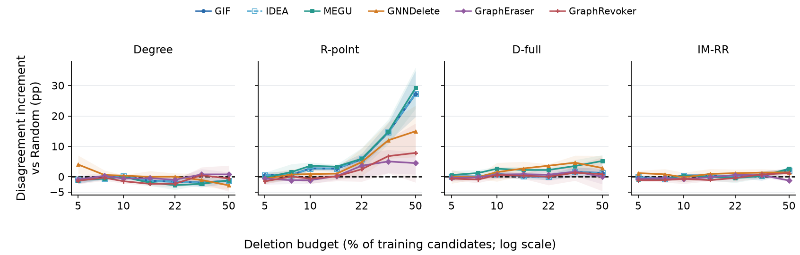

# Fig. 4：EXP-080 比例响应图与论文分析

2026-10-25 · 论文采用与归档快照 · CiteSeer · 五种 Selector · 三个训练 seed

**Fig. 4 保留现有两行五列、准确率与原始预测不一致率两类指标。** 分析分为两个层面：selector 所选请求在 GU 上是否仍有作用，以及不同 GU 如何响应这些请求。脆弱性的落脚点是 GU 与同请求 Retrain 的预测偏离；准确率曲线解释请求效应及 GU 的响应方式。

[论文图 PDF](../../overleaf/figures/citeseer_selector_responses.pdf) · [绘图脚本](../../../../scripts/plot_exp080_selector_response.py) · [完整 EXP-080 分析](../../../../self/research/analyses/EXP-080/full-20261021/REPORT.html) · [五策略专题](../../../../self/research/analyses/EXP-080/full-20261021/STRATEGY_REPORT.html) · [科学状态](../../../../self/research/analyses/EXP-080.json)

## 图和文字统一采用的口径

- 数据集固定为 CiteSeer；列为 Random、Degree、R-point、D-full（`gt_full`）、IM-RR。命名与展示顺序的后续统一见 [AAGU-123](../../../../.workblock/items/AAGU-123/WORKITEM.md)。
- 横轴是删除训练候选节点的比例，使用真正的对数刻度；七个观测点为 5%、7.5%、10%、15%、22%、33%、50%。
- 上排准确率显示 45–80%；超界曲线及 SD 带自然裁切。完整数值仍在来源表中，R-point / GraphRevoker 的 50% 准确率为 42.69%，低于显示范围。
- 下排 D 是固定测试节点上 GU 与同请求 Retrain 的类别预测不一致百分比。它不是遗忘前后的预测翻转率、准确率损失或隐私攻击 AUC。
- 训练 seed 为 42、212、2024，固定 split seed 为 2024。曲线为三个训练 seed 的均值，阴影为 ±1 样本 SD，不是置信区间。IM 的三个请求 draw 先在训练 seed 内平均。
- GIF 与 IDEA 分别读取各自的方法结果，独立画线、标记和图例；数值重合不构成两份独立证据。Retrain 为黑色虚线，下排零线是自比较定义参照。

## 两个层面的主要发现

**1. Selector 层面：R-point 的效用损伤效果在多种 GU 上延续，预算曲线提供主要证据。** 随预算增大，R-point 下 Retrain、GNNDelete、GraphEraser、GraphRevoker 的准确率出现明显下降轨迹，其他 selector 的均值响应整体较弱。方法之间的分离沿预算曲线逐步显现；33% 和 50% 的数字用来量化轨迹幅度，而不是用单个高预算端点代替曲线。

| 方法 | R-point 相对 Random 的额外准确率损失，33% / pp | 50% / pp |
|---|---:|---:|
| Retrain | +8.46 | +21.17 |
| GNNDelete | +7.61 | +10.81 |
| GraphEraser | +11.56 | +25.68 |
| GraphRevoker | +16.37 | +26.83 |

这里的额外损失是同方法、同预算下 Random 准确率减去 R-point 准确率。它支持请求选择效果在多种 GU 上保留；其跨方法幅度不同，尚不应把效用损伤幅度直接当作预测对齐脆弱性的排序。

**2. 响应层面：部分 GU 未复现重训练所呈现的请求诱导效用损耗，预测分歧随预算扩大。** R-point 下，GIF / MEGU 在 10% 时准确率为 75.03% / 74.27%，接近同请求 Retrain 的 74.92%；到 50%，两者仍为 74.42% / 74.22%，Retrain 降至 50.90%。两者的 D 同时从 7.41% / 9.21% 升至 40.19% / 40.94%。因此，高准确率伴随的是未复现 Retrain 响应及更大的预测偏离，不能仅凭准确率平稳解释为更好的遗忘表现。

| Selector / GU | Acc 10% | Acc 50% | D 10% | D 50% | D(50%) − D(10%)，均值 ± 样本 SD / pp |
|---|---:|---:|---:|---:|---:|
| R-point / GIF | 75.03 | 74.42 | 7.41 | 40.19 | +32.78 ± 7.48 |
| R-point / IDEA | 75.03 | 74.42 | 7.41 | 40.19 | +32.78 ± 7.48 |
| R-point / MEGU | 74.27 | 74.22 | 9.21 | 40.94 | +31.73 ± 8.50 |
| IM-RR / GIF | 74.74 | 74.51 | 5.07 | 14.98 | +9.91 ± 0.57 |
| IM-RR / MEGU | 74.56 | 74.34 | 6.02 | 14.41 | +8.39 ± 0.10 |

R-point 下 GIF / MEGU 的 D 增量在三个训练 seed 中都为正，最小增量分别为 25.83 / 24.02 pp。这是当前三次训练重复内的方向一致性，不是跨 split 或普适阈值证据。表中 ΔD 的 SD 来自逐 seed 配对差，不能用两个端点的 SD 相减。

## 独立补充图：相对 Random 的有符号分歧增量

Fig. 4 的下排继续显示原始 D（非负）。下图单独显示 ΔD = D(selector) − D(Random)，不替换 Fig. 4，也不自动进入论文主文。

[补充图 PDF](disagreement_increment.pdf) · [绘图脚本](../../../../scripts/plot_exp080_disagreement_increment.py) · [逐 seed 配对数值](disagreement_increment_seed_values.csv)

- 四列为 Degree、R-point、D-full、IM-RR；Random 的自比较定义上恒为零，作为黑色虚线。六种 GU 均独立读取，GIF 与 IDEA 保留各自曲线。
- 正值表示比同预算 Random 更偏离各自的同请求 Retrain，负值表示分歧更小。它比较的是两个请求条件下的 GU–Retrain 分歧大小，不是两个 GU 预测向量之间的直接距离。
- 先在训练 seed 内计算相对 Random 的差，再计算三个 seed 的均值和 ±1 样本 SD；IM 请求 draw 已先在训练 seed 内平均。不能相减两个端点的 SD，也不能把三个 IM draw 当作三个额外训练重复。
- 共 504 个配对 seed 差、168 个均值／SD 点；62 个均值为负。显示范围保留全部均值和 SD 带，零以下不裁切。
- R-point / 50% 的 GIF、MEGU 增量分别为 +27.28、+29.18 pp。该比较把 selector 额外扩大预测偏离的幅度从预算本身引起的变化中区分出来。

补充图的 ΔD 是相对 Random 的差；上表 D(50%) − D(10%) 是预算变化，二者定义不同。

## 与论文正文一致的英文段落

Figure 4 examines selector effects and GU responses across deletion budgets on CiteSeer. The upper-row trajectories show that R-point's utility-damaging effect carries over to several GU methods: as the budget increases, matched Retrain, GNNDelete, GraphEraser, and GraphRevoker exhibit pronounced accuracy declines, while the other selectors generally produce weaker mean accuracy responses. The separation develops along the budget curves. Relative to same-budget Random, R-point reduces GNNDelete, GraphEraser, and GraphRevoker accuracy by 7.61, 11.56, and 16.37 pp at 33% deletion; these losses reach 10.81, 25.68, and 26.83 pp at 50%. Thus, the selected requests retain utility effects across multiple GU methods, with different response magnitudes.

The lower row exposes a second response: some GU methods do not reproduce the request-induced utility degradation observed under retraining, and increasingly disagree with that target. From 10% to 50% R-point deletion, matched Retrain accuracy falls from 74.92% to 50.90%, whereas GIF/IDEA and MEGU stay near 74--75%. Their prediction disagreement with the matched Retrain rises from 7.41% to 40.19% and from 9.21% to 40.94%, respectively, with positive paired increases in all three training seeds. At 50%, their disagreement also exceeds the same-budget Random values by 27.28 and 29.18 pp. High retained accuracy therefore coexists with substantial deviation from the retraining response. We assess this prediction-alignment vulnerability through disagreement, using accuracy to explain how each GU responds to the selected request.

## 采用边界与后续待办

本次统一论文表述与补充图，不改变 EXP-080 的正式科学接受状态；该状态仍由原分析记录维护。

- 主文可采用 CiteSeer 这组完整 5%–50% 案例；Cora 的逐数据集图与反例保留在完整 EXP-080 分析中。Cora 两种分片方法缺少可行的 50% 端点，不能补成零或拿 PubMed 的 EXP-079 结果补线。
- 本图沿用 EXP-080 的历史实现与训练协议。GraphRevoker 是当时的 GPA+optimal 实现；分片方法与共享 full-graph GCN Retrain 有模型家族差异。该批不能与修正聚合损失、分片 300 轮的后续批次合并为同一样本。
- 三个训练 seed 和一个固定 split 只支持这里的描述性结论。预算点及方法坐标不是额外独立重复，SD 不能当显著性或等效性证据。
- 当前没有独立 Retrain--Retrain 自然波动校准，也没有足以区分更新不足、过度更新或其他优化机制的直接证据。D 增大不单独证明遗忘失败；准确率平稳不证明模型没有更新。
- 后续只需继续处理已登记的 Selector 命名与顺序、最终排版及科学审阅；不因归档自动扩大结论或安排新 GPU 实验。

## 证据与复现

数值来源：[逐训练 seed 表](../../../../self/research/analyses/EXP-080/full-20261021/seed_values.csv)、[原始条件表](../../../../self/research/analyses/EXP-080/full-20261021/cells.csv)、[条件汇总](../../../../self/research/analyses/EXP-080/full-20261021/condition_summary.csv)。构建脚本独立复算主图均值／SD、预算变化、R-point 相对 Random 的效用损失，以及补充图逐 seed 配对增量，并将当前图表、文字与输入哈希保存到 [verification.json](verification.json)。这不是重新核验远端全部文件哈希；原始回传身份核验仍由 [verification.json](../../../../self/research/analyses/EXP-080/full-20261021/verification.json)拥有。

原执行身份保持不变：base `e80r305` / `a217daf5c67b485afed63c393b5e8bb23820b237`；Cora high `e80r302` / `9d24b46ff14156685c62d8cdb59df1840d9e2c22`；CiteSeer high `e80r306` / `8fb8169475b015ac4cc6dd1a61c6d26ee5ff7670`。论文采用快照仅消费 CiteSeer 数据，不将归档或论文提交 SHA 替换为原实验执行 SHA。

复现：在仓库根目录，使用已安装 `mistune` 的 Python 运行 `python -X utf8 report/paper/figures/exp080-ratio-response-20261025/build_report.py`。补充图先用已安装 `matplotlib` 的 Python 运行 `scripts/plot_exp080_disagreement_increment.py` 生成。HTML 从本 Markdown 生成，两张图像内嵌；预览由论文图 PDF 渲染，源图和绘图脚本仍由原位置拥有。
