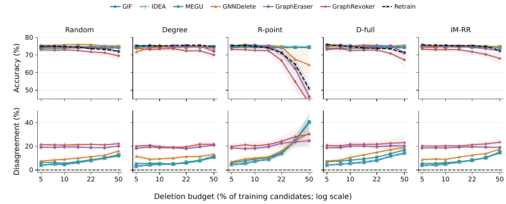

# Fig. 4：EXP-080 比例响应图与论文分析

2026-10-25 · 论文采用与归档快照 · CiteSeer · 五种 Selector · 三个训练 seed

**建议：保留当前 Fig. 4 进入论文初稿，并将两类比例图与分析文字一并归档。** 上排是测试准确率，下排是 GU 与同请求 Retrain 的预测不一致率。它们共同回答：当删除请求对重训练模型产生更强影响时，GU 的效用与预测响应是否同步变化？删除比例是观察条件，不是独立的最终研究目标。

本文保存已有 EXP-080 结果的论文读法；不启动新实验，不把图形采用或代码提交视为科学接受。EXP-080 的正式科学决定仍由其分析记录维护。

[论文图 PDF](../../overleaf/figures/citeseer_selector_responses.pdf) · [绘图脚本](../../../../scripts/plot_exp080_selector_response.py) · [完整 EXP-080 分析](../../../../self/research/analyses/EXP-080/full-20261021/REPORT.html) · [五策略专题](../../../../self/research/analyses/EXP-080/full-20261021/STRATEGY_REPORT.html) · [科学状态](../../../../self/research/analyses/EXP-080.json)

## 图和文字统一采用的口径

- 数据集固定为 CiteSeer；列为 Random、Degree、R-point、D-full（`gt_full`）、IM-RR。命名与展示顺序的后续统一见 [AAGU-123](../../../../.workblock/items/AAGU-123/WORKITEM.md)。
- 横轴是删除训练候选节点的比例，使用真正的对数刻度；七个观测点为 5%、7.5%、10%、15%、22%、33%、50%。
- 上排准确率显示 45–80%；超界曲线及 SD 带自然裁切。完整数值仍在来源表中，R-point / GraphRevoker 的 50% 准确率为 42.69%，低于显示范围。
- 下排 D 是固定测试节点上 GU 与同请求 Retrain 的类别预测不一致百分比。它不是遗忘前后的预测翻转率、准确率损失或隐私攻击 AUC。
- 训练 seed 为 42、212、2024，固定 split seed 为 2024。曲线为三个训练 seed 的均值，阴影为 ±1 样本 SD，不是置信区间。IM 的三个请求 draw 先在训练 seed 内平均。
- GIF 与 IDEA 分别读取各自的方法结果，独立画线、标记和图例；数值重合不构成两份独立证据。Retrain 为黑色虚线，下排零线是自比较定义参照。

## 三条可写进初稿的观察

**1. 单看低比例端点，会漏掉效用与预测对齐的分离。** R-point 下，GIF / MEGU 在 10% 时的准确率为 75.03% / 74.27%，接近同请求 Retrain 的 74.92%；到 50%，两者仍为 74.42% / 74.22%，Retrain 却降至 50.90%。GIF / MEGU 的 D 同时从 7.41% / 9.21% 升至 40.19% / 40.94%。

| Selector / GU | Acc 10% | Acc 50% | D 10% | D 50% | 同训练 seed 的 ΔD，均值 ± 样本 SD / pp |
|---|---:|---:|---:|---:|---:|
| R-point / GIF | 75.03 | 74.42 | 7.41 | 40.19 | +32.78 ± 7.48 |
| R-point / IDEA | 75.03 | 74.42 | 7.41 | 40.19 | +32.78 ± 7.48 |
| R-point / MEGU | 74.27 | 74.22 | 9.21 | 40.94 | +31.73 ± 8.50 |
| IM-RR / GIF | 74.74 | 74.51 | 5.07 | 14.98 | +9.91 ± 0.57 |
| IM-RR / MEGU | 74.56 | 74.34 | 6.02 | 14.41 | +8.39 ± 0.10 |

R-point 下 GIF / MEGU 的 D 增量在三个训练 seed 中都为正，最小增量分别为 25.83 / 24.02 pp。这是当前三次训练重复内的方向一致性，不是跨 split 或普适阈值证据。表中 ΔD 的 SD 来自逐 seed 配对差，不能用两个端点的 SD 相减。

**2. 强分离依赖 Selector，不能概括为“删除到 50% 就会这样”。** 同为 50% 预算，Retrain 在 Random、Degree、R-point、D-full、IM-RR 下的准确率依次为 72.07%、74.87%、50.90%、71.17%、72.72%。因此，R-point 对请求本身的重要性也产生了强影响；GU 准确率更低不能全部归于 GU 特有的近似误差。

**3. 其他 Selector 也有较弱的预测偏离，不能把该现象命名为 R-point 或 IM 独有指纹。** IM-RR 下 GIF 从 10% 到 50% 的准确率仅变化 −0.23 pp，D 却增加 9.91 pp。Random、Degree、D-full 的对应轨迹需同时保留。当前图展示条件性的响应差异，不给 Selector 或 GU 作普遍强弱排名。

## 与论文正文一致的英文段落

Figure 4 compares the utility and prediction-alignment responses to deletion requests across five selectors on CiteSeer. Under R-point, increasing deletion from 10% to 50% reduces the matched Retrain accuracy from 74.92% to 50.90%, while GIF/IDEA and MEGU remain near their earlier accuracy levels (75.03% to 74.42%, and 74.27% to 74.22%, respectively). Yet their disagreement with the matched Retrain rises from 7.41% to 40.19% and from 9.21% to 40.94%. The paired increases are positive in all three training seeds. Utility stability therefore coexists with increasing prediction disagreement; a low-budget endpoint alone would miss this separation.

The separation depends on request selection. At the same 50% budget, Retrain accuracy is 72.07% under Random, 74.87% under Degree, 71.17% under D-full, and 72.72% under IM-RR, compared with 50.90% under R-point. The request itself thus has a substantial retraining response, which must be distinguished from a GU-specific deficit. Smaller utility--alignment separations also appear elsewhere: under IM-RR, GIF accuracy changes by only −0.23 pp between 10% and 50%, while its prediction disagreement increases by 9.91 pp. These conditional responses motivate reporting both endpoints across selectors, rather than ranking methods by accuracy stability alone.

## 采用边界与后续待办

- 主文可采用 CiteSeer 这组完整 5%–50% 案例；Cora 的逐数据集图与反例保留在完整 EXP-080 分析中。Cora 两种分片方法缺少可行的 50% 端点，不能补成零或拿 PubMed 的 EXP-079 结果补线。
- 本图沿用 EXP-080 的历史实现与训练协议。GraphRevoker 是当时的 GPA+optimal 实现；分片方法与共享 full-graph GCN Retrain 有模型家族差异。该批不能与修正聚合损失、分片 300 轮的后续批次合并为同一样本。
- 三个训练 seed 和一个固定 split 只支持这里的描述性结论。预算点及方法坐标不是额外独立重复，SD 不能当显著性或等效性证据。
- 当前没有独立 Retrain--Retrain 自然波动校准，也没有足以区分更新不足、过度更新或其他优化机制的直接证据。D 增大不单独证明遗忘失败；准确率平稳不证明模型没有更新。
- 后续只需继续处理已登记的 Selector 命名与顺序、最终排版及科学审阅；不因归档自动扩大结论或安排新 GPU 实验。

## 证据与复现

数值来源：[逐训练 seed 表](../../../../self/research/analyses/EXP-080/full-20261021/seed_values.csv)、[原始条件表](../../../../self/research/analyses/EXP-080/full-20261021/cells.csv)、[条件汇总](../../../../self/research/analyses/EXP-080/full-20261021/condition_summary.csv)。构建脚本独立复算图中均值、SD 和配对变化，并将当前图表、文字与输入哈希保存到 [verification.json](verification.json)。这不是重新核验远端全部文件哈希；原始回传身份核验仍由 [verification.json](../../../../self/research/analyses/EXP-080/full-20261021/verification.json)拥有。

原执行身份保持不变：base `e80r305` / `a217daf5c67b485afed63c393b5e8bb23820b237`；Cora high `e80r302` / `9d24b46ff14156685c62d8cdb59df1840d9e2c22`；CiteSeer high `e80r306` / `8fb8169475b015ac4cc6dd1a61c6d26ee5ff7670`。论文采用快照仅消费 CiteSeer 数据，不将归档或论文提交 SHA 替换为原实验执行 SHA。

复现：在仓库根目录，使用已安装 `mistune` 的 Python 运行 `python -X utf8 report/paper/figures/exp080-ratio-response-20261025/build_report.py`。HTML 从本 Markdown 生成，图像内嵌；预览由论文图 PDF 渲染，源图和绘图脚本仍由原位置拥有。
