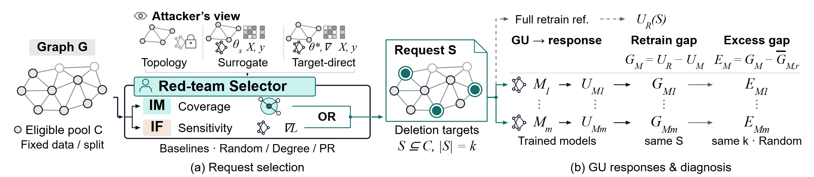

# teaser · Git 存档

2026-10-25。用户认可当前视觉版本，并要求先用 Git 存档。此目录保存该检查点。

[矢量 PDF](teaser.pdf) · [可编辑 SVG](teaser.svg) · [可编辑 draw.io](teaser.drawio)

## 当前版式

- 两个分图标题位于各自图块下方：(a) Request selection；(b) GU responses & diagnosis。
- 图下标题采用正文字号 19 个图形单位、常规字重，所有文字为黑色。
- 右侧保留同一删除请求对应各 GU 方法的 U、G、E；诊断分隔线与公式下标错开，Excess gap 列头上方留白已调整。
- 画布 1280 × 280；指定纸面尺寸 174 × 38.0625 mm。最终 PDF 为单页矢量，栅格图像数为 0。

## 存档核验

四个图稿文件的 SHA-256 与用户认可的独立制图版本逐字节一致。复制的生成器仅调整输出目录边界检查，以适配本目录名 teaser；在独立暂存目录重建 SVG 与 draw.io 后，四个图稿哈希仍与原图一致。

现有渲染记录为 42 个文本对象、15 条箭头，未检出文字越界、文字碰撞或箭头穿字。[核验记录](verification.json) 与 [渲染记录](teaser-render-check.json) 随图保存。

[文件清单与哈希](artifact-manifest.json) · [后续修改规则](TEASER_RULES.md)

本次为图稿检查点存档。论文当前工作区中的正文、teaser 引用及其他图表改动由各自工作继续管理；该存档未将那些改动纳入提交。指标扩展建议尚未写入此图，不据此声明新的实验结论。

## 可编辑源

[生成器](source/build_f01.py) · [SVG / draw.io 原生图元](source/vector_primitives.py) · [PNG / PDF 导出器](source/render.mjs)

在本目录运行 source/build_f01.py，再运行 source/render.mjs teaser 可重建图稿；运行器路径沿用当前本地环境。导出通过离线 headless Edge setContent 完成。draw.io 验证限于原生对象和 XML，未做应用内往返渲染。
