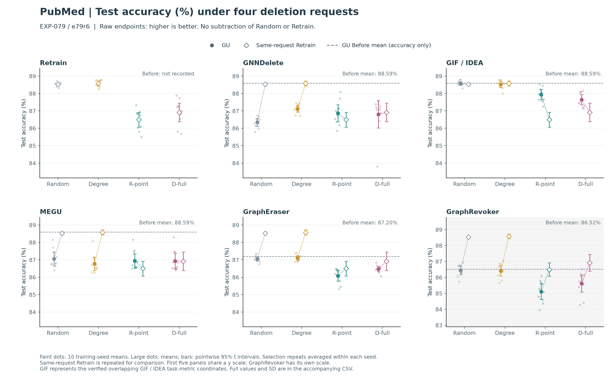

# WWW 论文主线、章节与证据落位建议

2026-10-24 · 供作者讨论的组织方案  
Stage Decision：Single-turn complete · Output Language：zh-CN  
依据：已同步的 WWW27 稿件、DocMap 当前章节，以及 EXP-011/e11r1、EXP-079/e79r6、EXP-080 和选点/校准分析。新批次的科学接受状态保持原记录；本文件是写作建议，不更新正式章节和实验决定。

## 1. 推荐的 framing

**用策略性删除请求探查图遗忘的条件性响应，并分别判断任务效用、相对同请求重训的效用变化和预测对齐。**

英文中心句候选：

> We study how strategic deletion requests change graph-unlearning outcomes under explicit information constraints, distinguishing task utility, request-induced changes relative to matched retraining, and prediction-level agreement.

现有标题 **Auditing Strategic Deletion Requests in Graph Unlearning** 可以保留。也可采用 **Auditing Graph Unlearning under Strategic Deletion Requests**；改题目不是当前主要工作。

请求选择是实验中的可控输入，GU 与同请求 Retrain 是观察对象，预算和选点模型来源是条件变化，效用及预测分歧是互补输出。整篇文章沿这条链条展开，读者才能看出选择机制、评价协议和经验发现之间的联系。

不建议把主论点预先固定为“importance-based selectors 通常不能放大 GU gap”。这个判断过于依赖批次、指标符号与统计范围。也不建议以普遍策略指纹、统一方法脆弱性排名或新遗忘质量指标为主线，当前证据没有建立这些结论。

### 与其他可选 framing 的取舍

| 方向 | 当前适配程度 | 原因 |
| --- | --- | --- |
| 以新攻击和最强攻击效果为中心 | 较弱 | IM/IF 主要优化重要性代理目标；GU 额外损害并不普遍，缺专门 GU-aware 攻击目标与全面优势证据。 |
| 以更全面的 GU benchmark 为中心 | 较弱 | 最近 benchmark 已有多维诊断与非随机删除；覆盖量本身难以构成区别。 |
| 以请求条件下的审计与具体响应发现为中心 | 最适配 | 可连起选择机制、匹配参照、预算变化和跨代理模型检验，并保留方向反转与失败结果。 |

这一 framing 的成败仍取决于新增经验认识是否足够具体。仅展示“不同条件结果不同”或一组代数恒等式，无法自动构成有竞争力的贡献。

## 2. 核心论证应怎样推进

建议用三个层次回答同一个问题：一次策略性删除到底改变了什么？

1. **请求层**：不同信息和目标构造了什么删除集合？源定义、曲率近似和拓扑覆盖如何改变请求？
2. **输出层**：同一请求如何分别影响 GU 与 Retrain？效用变化、相对 Random 的增量及预测对齐能否支持同一个判断？
3. **条件层**：改变预算或移除目标模型访问后，哪些响应保留，哪些反转，哪些仍不确定？

选择集合不同不是攻击成功；GU 准确率下降不等于 GU 特有损害；GU 高于 Retrain 不等于遗忘正确；预测不一致也不等于隐私失败。正文以一两个具体案例说明这些区别，完整面板和后续条件检验限定案例的适用范围。

### 适合在引言提出的具体发现候选

**发现 A：同一请求对任务效用和相对 Retrain 的效用产生不同响应。** e79r6/PubMed/GCN-source/10% 下，R-point 相对 Random 让 Retrain 从 88.528% 降至 86.496%；GraphEraser 从 87.051% 降至 86.083%，GraphRevoker 从 86.429% 降至 85.114%，GNNDelete 则从 86.346% 升至 86.869%。因此两种分片实现虽出现效用下降，其有符号 Retrain 效用缺口反而下降。正式稿需使用逐 seed 配对结果和区间，不能仅依赖这些四舍五入后的均值。

**发现 B：预算改变可使效用稳定与预测对齐出现明显分离。** 独立 EXP-080 中，CiteSeer/R-point 的 GIF 从 5% 到 33% 删除时 accuracy 约下降 0.50 pp，但与 Retrain 的预测不一致率上升约 20.02 pp；MEGU 对应 accuracy 约增加 0.05 pp、预测不一致率上升约 18.72 pp。50% 端点给出更明显实例，但不能只用极端预算作为全部证据。完整方法面板中，分片方法还存在大幅效用下降。

**发现 C：响应的跨选点模型保留是条件性的。** 新 e79r6 中，Cora 的整体响应区分主要由 GNNDelete 驱动，去掉该维度后区间跨零；CiteSeer 与 PubMed 的整体五维效用分析未建立普遍区分。它们限定信息访问层面的外推范围，不支持稳定全局指纹。

A 与 B 回答不同评价量能否支持相同解释；C 检验这种响应描述在访问条件变化后的边界。它们是待作者科学审阅的候选发现，不因本写作方案而获得接受。

## 3. 实验应分别承担什么职责

| 材料 | 建议角色 | 主文怎么用 | 不能怎样用 |
| --- | --- | --- | --- |
| EXP-011/e11r1：1449 条件，1242 配对，3 训练 seed | 固定 10% 的广度主矩阵 | 完整比较 Random、Degree、PageRank、R-point、D-full 和 IM；区分方法和数据集响应。 | Random 十次和 IM 三次先在训练 seed 内平均；不把请求重复当训练重复。 |
| EXP-079/e79r6：2520 条件，2160 配对，10 训练 seed | 核心案例的更充分训练随机性分析及访问条件检验 | GCN-source 的完整面板说明配对解释；GCN/SGC/GAT/GIN 来源分析回答条件性迁移。 | 目标仍是 GCN 设置；选点模型变更不等于目标 backbone 泛化。与011有公共条件，不累计成13 seed。 |
| EXP-080：2016 主条件，1722 配对，Cora/CiteSeer | 独立预算研究 | accuracy 与 disagreement 曲线、完整策略对照、IM/Degree 局部转向及反例。 | 旧分片协议不能与011/079新协议拼接成统一曲线。没有PubMed；Cora50%分片端点不可行，不补点。 |
| EXP-031、EXP-032 | 选择机制与 IF 近似的支撑分析 | 一张紧凑选集/源定义消融表，说明为何保留相应策略；详细结果放附录。 | Retrain-only 结果不充当 GU 效果；不能由高重合推出数值等效或 GU 等效。 |
| EXP-053 | IM 配置诊断 | 附录解释 RR 参数及采样敏感性，正文用主矩阵比较 IM。 | RR 采样量不是独立机制轴；不能宣称 RR65536 最优或充分。 |
| EXP-051 | Random 请求分布补充 | 按匹配协议辅助解释请求随机性，优先分析新主矩阵自带重复。 | 固定训练 seed 的旧分布不代表训练/数据划分泛化，也不自动匹配所有新协议。 |
| EXP-059、061、062、065–068 | 实现与数值可信度 | 设置中简述冻结参数、校准和验证，附录提供完整证据与失败诊断。 | 数值稳定和参数交付不证明遗忘正确；不把诊断经历写成主结果。 |
| EXP-012、013 的早期结果 | 来源和历史背景 | 对已被新批次覆盖的部分，以新分析作为正文入口；历史记录保留原身份。 | 不把旧三seed和新十seed合并，也不继承原决定到新批次。 |
| EXP-039、058、大图可行性等未完成分析 | 限制及可选未来工作 | 如有必要说明尚未建立的范围。 | 不以已登记、已运行或部分完成替代结果；selector大图计时不证明大图GU有效性。 |

“充分使用”指每个实验有明确的论证职责，不是把所有历史数字塞入主文。全文优先使用能回答核心问题的最合适批次，其余材料在附录支撑定义、实现和边界。

## 4. 推荐的正文结构

保持现有三个结果问题的基本分工，更新证据与展开方式；预算分析并入 Q2，选择机制作为结果的前置支撑，不另建一套四五个平行 RQ。

| 章节 | 主要内容与段落职责 | 建议篇幅 |
| --- | --- | --- |
| 1 Introduction | 具体 Web 请求场景 → request selection 问题 → 一组判断变化的案例 → 最近工作未回答的具体问题 → 贡献及两项明确发现。 | 约1.1页 |
| 2 Related Work | GU update/benchmark；adversarial unlearning/requester；结构/影响力选点。直接比较最近工作的控制权、选择目标及评价问题。 | 约0.4页 |
| 3 Problem and Threat Model | 候选池权限、目标/代理模型、信息表、预算；训练图/删除后图/推理图。将压力测试权限上界说清。 | 约0.55页 |
| 4 Request Construction and Audit Protocol | IM/IF实际目标与代表设置；同请求配对与Random参照；效用差分和预测分歧；解释边界。 | 约0.95页 |
| 5 Experimental Design | 数据、划分、训练协议、实现变体、实验模块表；请求/训练随机性及探索性统计。 | 约0.7页 |
| 6 Results | 选择机制简短支撑 + Q1效用与参照 + Q2跨方法/预算响应 + Q3跨选点模型条件检验。 | 约3.6页 |
| 7 Discussion and Limitations | 对审计实践的含义、现有替代解释、原图评价/固定split/实现范围/缺少隐私证明等。 | 约0.5页 |
| 8 Conclusion | 一句明确回答、最有证据的范围与边界。 | 约0.2页 |

合计约8页，仅作篇幅预算；浮动图表会改变分页。可合并3/4或7/8减少碎片，但每项信息仍需在前8页自足。不能依赖末页附录解释核心定义。

### 结果章的详细顺序

**6.0 请求是否确实不同：短段或小表。** 用源定义/曲率近似的选集对照说明选择器提供了不同探针。10%下 R-point/D-full 重合率为37.9%/51.6%/65.7%，而特定 Hessian-free 对照超过99%；限定 last-layer、finite shifted solve 等配置。这是请求构造的支撑，不能据此直接认定近似GU的效果或理论性质。

**Q1：策略性请求改变了什么？** 先用 e11r1 给完整策略×方法视野，随后用 e79r6 的完整方法面板展开两个端点的变化。保留原值、方法自己的Before、Retrain、Random，以及 `A_M/A_R/E_M` 和预测分歧。PubMed主例旁边明确呈现CiteSeer反向条件。不要让一个数据集或方法代表全体。

**Q2：不同策略是否形成不同 GU 响应，预算会怎样改变它？** 先问同一策略影响了哪些GU，再用EXP-080预算曲线检查固定10%观察能否外推。共同33%端点保留完整方法/策略；50%作为拓展端点。IM的Cora/GNNDelete转向同时画Random原始准确率及CiteSeer反例，避免把参照下降说成模型恢复。不同实验模块在图注和设置表明确标注协议。

**Q3：更换选点模型后还能保留什么？** 使用e79r6十seed。先给逐GU的直接策略/来源比较，再给总体模式和去坐标敏感性。GIF/IDEA去重，完整面板保留；把Cora由GNNDelete驱动、CiteSeer/PubMed整体不确定作为主要回答的一部分。它是信息条件边界检验，不能替代目标backbone泛化或独立split验证。

## 5. 主图与表格安排

| 图表 | 要让读者读出的唯一问题 | 数据与展示建议 |
| --- | --- | --- |
| Table 1 实验模块与协议 | 哪些结论可以比较、哪些范围不同？ | 三行列011/079/080：数据、预算、训练seed、请求重复、source、分片协议；附近补实际方法配置。 |
| Figure 1 首页或引言案例 | 为什么只看GU下降会误读请求影响？ | 来自同一e79r6案例的GU与Retrain原值、Random对照及对应差值；旁边用短流程表达请求进入GU和Retrain。完整相关方法仍在正文主结果展示。 |
| Figure 2 固定预算完整响应 | 结构化请求分别改变哪些GU与Retrain？ | e11r1三数据集的紧凑完整面板/配对变化。RR65536可作IM展示代表；其他RR预算附录，标明其配置诊断性质。不要把删掉两个RR配置说成完整八条件图。 |
| Figure 3 预算与多维响应 | 相同请求原则随预算变化时，效用与预测对齐是否同向？ | EXP-080 accuracy/disagreement两行曲线，覆盖Cora/CiteSeer及完整方法；分片不可行处停线。 |
| Figure 4 跨来源与敏感性 | 策略差异在移除目标模型访问后保留到什么程度？ | e79r6逐方法关键配对对照及总体margin/去GNNDelete敏感性；完整距离矩阵附录。 |
| Table 2 小型消融或案例表 | 请求构造差异是什么，或两个参照为何改变判断？ | source/curvature选集小表，或`GU/Retrain/A_M/A_R/E_M/D`表；避免与Figure1重复，可按版面二选一。 |

图表不是越多越完整。优先保留每个核心问题的一幅可读主图；主文必须呈现反例和适用范围，附录提供全量数值与复算。原始效用不能全部被热图或差值替代；`E_M<0`只表示signed utility gap下降，不保证绝对差距或预测分歧下降。

### 一个可直接复用的图形入口

这张现有图可以作为 Figure 1/2 的素材入口。正式版需要统一可比尺度和字体、保留Before与Retrain、写清误差线含义及GraphRevoker变体；不要把图册中独立纵轴造成的视觉距离解释为跨方法损害大小。

## 6. 主文、附录与不采用材料

附录建议按读者核查任务组织：

- **A 实现与复现**：数据划分、图语义、方法变体、冻结参数、数值校准、匿名配置/运行身份映射。
- **B 请求构造与代理验证**：IF源、求解器、参数子空间、选集/排名、RR配置诊断；成本推导与未完成实测明确分开。
- **C 固定预算完整结果**：三数据集全部请求与方法的accuracy、CE、分类AUC、Retrain gap及prediction disagreement。
- **D 预算完整结果**：全部策略/方法曲线、不可行端点、IM抽样、逐seed和请求层敏感性；单列080协议。
- **E 信息访问与统计**：全部surrogate对比、完整比较家族、去坐标/去重敏感性和统计方法。

当前正文中的旧315格主表、032/053单seed分解案例、孤立更新检测AUC，不再同时承担新的主结论。前两类若被最终批次覆盖，正文让位；更新检测只有在确实回答论文中的独立问题时才保留，否则作为明确限定的附录诊断。未完成CP3/CP6、backbone、大图和效率分析不写成结果。

## 7. 引言与贡献怎样写得具体

引言建议五段：

1. 具体图服务中，删除请求的目标选择为什么会影响模型更新；说明可请求范围和研究中采用的权限假设。
2. 请求可由不同信号构造，但信号针对的目标与最终GU输出是不同对象；引出同请求Retrain及Random参照。
3. 用一个绑定新批次的实际案例说明效用变化与相对响应如何给出不同判断，不把代数恒等式作为发现。
4. 对照最近benchmark、注入后删除攻击及请求者建模工作，明确本文新增的选择机制、访问条件和经过验证的具体认识。区别仍需作者审阅，不写“首次”或“只有本协议”。
5. 列出三项贡献，并预告两项最具体结果与主要边界。

三项贡献候选：

| 贡献 | 可写内容 | 需要避免 |
| --- | --- | --- |
| 请求构造与问题设定 | 在明确候选池、预算和信息条件下，构造拓扑覆盖与损失敏感性请求，说明所采用实例及源定义。 | 把既有IM/IF本身称新算法；把“合法候选”自动等同真实个人所有权。 |
| 贯穿实验的审计设计 | 同请求GU/Retrain、同预算Random、实际方法起点和预测对齐共同支撑具体判断。 | 把加减参照等式当理论创新，或声称该设计测出了完整遗忘质量。 |
| 可复核的经验发现 | 报告任务效用与相对响应的分离、预算下响应转向/预测差异、以及访问条件的保留与失败范围。 | 用实验规模、图谱数量、通用异质性替代科学增量；把局部案例变普遍规律。 |

第一、二项主要说明研究对象和设计；第三项必须回答“研究之后新增了什么认识”，否则贡献仍可能显得增量。每项经验发现至少包含适用范围、一个有代表性的比较、配对不确定性或明确描述性定位、以及关键反例。

## 8. 让稿件追上实验的实际修改顺序

1. **冻结证据选择。** 审阅新011/079结果，确定作为主批次的范围及状态；080作为独立预算模块。决定是否需要关键语义/实现对照，不以追加实验数量代替判断。
2. **更新正式写作源。** DocMap结果章现有Q1–Q3仍绑定e79r5；逐项改为审阅后的e79r6发现、数值、图和范围，不能只把3改成10或替换图片路径。同步实验设计、方法定义和统计协议。
3. **先形成结果与设置。** 做三模块协议表、完整主图和少量关键配对案例；统一指标为实际accuracy，明确macro分类AUC与隐私攻击AUC不同。
4. **据结果重写引言和摘要。** 摘要写出具体发现和条件；当前作者摘要“暂不提surrogate”等约定是否调整，在真正改稿时由作者决定，本方案不擅自改原文。
5. **转入英文TeX。** 保留正确的选择器核心公式，压缩长成本推导；用新结果结构替换旧表和旧分解案例，交叉检查正文/附录/图注。
6. **完成图与投稿材料。** 首页占位图、内部工作备注、匿名复现材料、引用、页数和版面在统一证据后处理。清理备注不代表自动接受其科学结论。

完成度的判断是：每个研究问题有直接回答，每个主要回答有同批次证据，每个解释有明确参照与反例，每项外推都有边界。完整性不要求所有登记过的实验都成为正文结果。

## 9. 证据入口

- [当前论文写作与论证导航](../../../../../../OpenGU-DocMap/40_论文写作/40_论文写作.md)
- [现有结果章及其版本提示](../../../../../../OpenGU-DocMap/40_论文写作/06_结果.md)
- [新011/079联合分析](../../../../self/research/analyses/EXP-011_EXP-079/REPORT.md) · [011图册](../../../../self/research/analyses/EXP-011_EXP-079/EXP011_REPORT.html) · [079图册](../../../../self/research/analyses/EXP-011_EXP-079/EXP079_REPORT.html)
- [080预算报告](../../../../self/research/analyses/EXP-080/full-20261021/REPORT.md) · [080五策略专题](../../../../self/research/analyses/EXP-080/full-20261021/STRATEGY_REPORT.md)
- [032/053支撑分析及范围](../../../../self/research/analyses/AAGU-032-AAGU-053-3000-only-paper-analysis-20260923.md)
- [上一轮投稿审查](REPORT.html)

本方案没有修改原始结果、正式章节、Overleaf正文、实验状态或科学决定；后续是否采用及如何定稿由作者判断。
