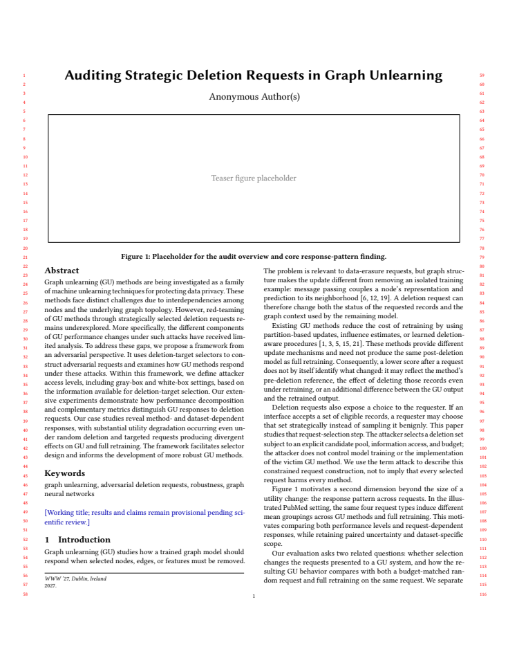

# WWW 2027 投稿前审查

审查日期：2026-10-24（Asia/Shanghai）  
Stage Decision：Single-turn complete · Output Language：zh-CN  
对象：Overleaf 当前稿《Auditing Strategic Deletion Requests in Graph Unlearning》  
结论：**研究问题值得继续，当前稿件尚未达到我会建议直接提交的状态。模拟审稿倾向为 Reject，判断信心中等。** 这是对当前稿件的学术判断，不是录用概率或会议实际评分。现有实验资产比稿件展示的更充分；主要任务是确定证据版本、形成有区别的实证贡献并补齐协议。

## 1. 同步与审查范围

- 已从[远端 Overleaf 项目](https://www.overleaf.com/project/6ab3c34131990d0250f3d05d)下载源码，将 `report/paper/overleaf/` 同步为云端的 17 个文件；逐文件验证与 ZIP 字节一致。同步方向为远端到本地。
- 同步前该目录仍是旧 NeurIPS 稿件。旧目录已保存到[同步前快照](../../../../output/paper-review-20261024/pre-sync-overleaf.zip)，本地现行目录不再保留旧模板和旧 `sec/` 路径。
- [同步清单与 SHA-256](../../../../output/paper-review-20261024/sync-manifest.json)记录来源、时间、文件身份和编译状态；[下载的源码 ZIP](../../../../output/paper-review-20261024/overleaf-source.zip)可复核。
- 云端重新编译：**Errors 0、Warnings 59、typesetting 11，共 12 页**。复编译 PDF 与首次下载 PDF 的逐页提取文字一致。主文在第 6 页结束，参考文献从第 6 页开始，附录从第 7 页开始。
- 已检查全部章节源码和全部 12 页缩略版面，保存[审查 PDF](../../../../output/paper-review-20261024/overleaf-current.pdf)。源码静态核对无缺失引用键、无重复 label、无未定义的实际 ref；有 **3 处有效 TODO、4 处 draftnote**，另有 teaser 占位图。
- 审查同时参考 EXP-011/e11r1、EXP-079/e79r6 与 EXP-080 已保存分析。新分析仍待科学验收；本报告不改变任何实验或开发项的决定，不把旧接受决定转移到新批次。
- 本轮修改为本地稿件同步及本审查报告；未修改云端正文、未提交 Git、未启动新 GPU 实验。未重新审计每一个远端原始 Output；数值核对基于现有分析和有限源码检查。

## 2. A：问题、必要性与 WWW 定位

研究问题有价值：合法原有图元素的删除请求可以经过策略选择，而数据移除本身的影响、GU 更新的影响和模型起点差异需要分别解释。同请求 GU–Retrain 配对及同预算 Random 参照，是合理的研究设计。

目前第一页主要使用数据擦除和图依赖动机，尚未给出一个具体 Web 服务中的请求权限、图数据可见性与后续模型使用流程。仅使用 citation-network 数据集不足以自动建立 Web 贡献。建议明确一个真实可对应的图服务场景，说明参与者如何有权提交候选池中的请求，以及审计输出会改变平台的什么判断；没有部署证据时，将其写成研究动机和受限压力测试。

WWW 2027 官方要求第一页说明 Web 与 track 相关性；长文主文最多 8 页、含参考文献及附录最多 12 页，匿名双栏。当前格式和页数满足这一表面约束，内容完整性尚未满足。较适配的方向是 Graph Algorithms and Modeling for the Web。用户已确认注册摘要；全文截止 2026-10-25 AoE，即北京时间 **2026-10-26 19:59:59**。依据：[官方 Research Track CFP](https://www2027.thewebconf.org/research-track-papers/)。

### 最接近工作与创新边界

| 工作 | 已核实的相关内容 | 本文需要解释的区别 |
| --- | --- | --- |
| [Is Graph Unlearning Ready for Practice?，ICLR 2026](https://proceedings.iclr.cc/paper_files/paper/2026/file/a89d228d9489814b98050a1f7b43ccdd-Paper-Conference.pdf) | 已比较效用、预测/输出/参数对齐及隐私诊断，并研究 degree-based、label-skewed 删除。 | “非随机删除暴露问题”“accuracy 不够，应比较 Retrain”不能单独承担新颖性。需要展示新增机制、访问条件和可复核的新响应发现。 |
| [Attack by Unlearning，2026 预印本](https://arxiv.org/abs/2603.18570) | 先注入经过优化的节点，随后请求删除，利用近似 GU 放大性能下降。 | 本文限制为选择已有目标、无注入；必须进一步说明候选池控制权。 |
| [Modeling Deletion Requests in Machine Unlearning，2026-10-03 预印本](https://arxiv.org/html/2610.04310v1) | 建模请求者的自适应与协作行为，并构造数据价值等驱动的选择器。 | 不能泛称首次系统研究“谁来选删”；可能的区别是图结构特定选择、同请求 GU–Retrain 响应及其条件性迁移。 |

这是最小邻近工作核查，不是完整综述。现有 `.bib` 包含 ICLR 2026 benchmark，但只在预测分歧定义处引用，相关工作没有实质比较；另两篇需要作者核对并纳入定位讨论。这里指出重叠，不等于已经证明本文缺乏所有新意。

## 3. B：方法、公式与贡献判断

### 能保留的技术优点

1. 同请求、同测试集合、同预算参照使响应可解释；保留正负号比只报告 drop 更有信息。
2. 明确区分 canonical 原模型与分片方法自己的起点，避免把架构差异直接称为遗忘误差。
3. D-full 的删除源、求解器 shift、参数子空间与运行成本描述具体，没有把局部近似冒充原论文完整保证。
4. 对效用、预测不一致、更新检测和隐私的边界较克制，应保留。

### 分解正确，但还没有证明新增诊断价值

`G_M = U_R − U_M`；`A_M = mean(U_M(Random)) − U_M(Selected)`；`E_M = A_M − A_R`。式 (3)–(6) 是准确的加减参照恒等式。它们提供记录和解释框架，本身不是新的理论结果或因果识别。附录也承认代数闭合不足以证明经验价值。

当前结果章主要展示 endpoint 与 gap，没有完整展示 `E_M` 及三项分解如何改变一个实际审计判断。最小补强是在一个有代表性的同批次案例中，列出 `A_M、A_R、E_M` 和逐 seed 配对不确定性，说明只看 GU utility 会漏掉什么。

已有新分析中的例子能说明这种判断：e79r6/PubMed/R-point 下，GraphEraser 的准确率相对 Random 下降约 **0.97 pp**，Retrain 下降约 **2.03 pp**，因此 `E_M` 约为 **−1.06 pp**。GU 确实下降，但没有相对 Retrain 放大有符号效用缺口。此处由报告中四舍五入后的均值作说明性相减，不替代正式配对区间；新批次仍待验收。来源：[联合报告的 PubMed 原值表](../../../../self/research/analyses/EXP-011_EXP-079/REPORT.md)。

### 必须闭合的威胁模型

- `problem.tex:11–41` 中候选池是 eligible training nodes，但没有说明一个请求者为什么能选择全部训练节点的 10%。需要具体交代个人所有权、协作群体、授权红队或压力测试上界。
- 灰盒允许图结构、特征及训练/验证标签，属于较强信息设定。应说明标签来源及其现实意义。
- “target-direct white-box”需要逐实验绑定 checkpoint 与实际 GU 起始模型；用统一 GCN 选点不能自动视为访问每个 shard ensemble 的白盒参数。
- IM 优化传播覆盖，IF 优化局部目标损失代理；两者不直接优化 GU 特有损害。审计定位可成立，但若宣称新攻击，需要额外的 GU-aware 目标及效果证据。当前不建议为赶稿临时扩展成另一条攻击研究线。

## 4. C：实验证据与可信度

### 影响投稿判断的主要问题

| 优先级 | 问题及证据 | 最小处理 |
| --- | --- | --- |
| P1 | **主证据版本未统一。** `experiments.tex:16–20`、`results.tex:20–34` 仍是 315 格旧矩阵；现有推荐分析是 e11r1/e79r6。旧表 Cora/R-point 的 GNNDelete 为 75.71%、GraphRevoker 为 65.38%；新 e11r1 汇总分别为约 78.106%、75.215%。 | 先选最终主批次，再成套更新设置、表、图与解释。两者属于不同协议，不能称旧表数字抄错，也不能把全部变化归因于单一修复。 |
| P1 | **方法与结果没有闭环。** 方法把 IM/IF 作为两条主轴，但旧主矩阵没有 IM；结果章没有跨 surrogate 对照，也没有实际预测分歧结果。 | 按 Q1 请求改变什么、Q2 多 GU 响应、Q3 条件性迁移组织结果；接入已核验的对应分析，或收缩研究问题。 |
| P1 | **删除/推理语义影响结论。** `experiments.tex:13` 写移除监督和 incident edges、保留特征行、原图评价；`experiments/node_deletion.py:9–40` 与 `unlearning_outputs.py:208` 的当前实现支持这一读法。 | 分别定义训练原图、删除后图、推理图，以及 mask/特征是否保留。当前结果是删后参数在原图上下文上的效用，不能直接代表删后图部署。若需该部署结论，先查已有 retained-graph 对照是否可用，再决定最小补验。 |
| P1 | **实现变体缺少显著披露。** 当前 GraphRevoker 是 GPA + optimal；IDEA 配置含 `gaussian_std=0`；GIF/IDEA 在已分析任务指标上近重复。 | 增加实现表及适用范围；GraphRevoker 显式标注变体。响应几何合并 GIF/IDEA 坐标并报告敏感性；不宣称两种原算法等价。 |
| P1 | **关键设置仍是占位文字。** `experiments.tex:20` 尚未填 split、候选池、信息访问和训练超参数；复现链接与表格运行身份未完成。 | 从选定批次的 YAML/manifest 生成一张设置表及匿名材料清单，绑定 run ID、执行 SHA、split、选择身份、优化参数和训练协议。 |
| P2 | **指标命名误导。** `experiments.tex:28` 把 primary F1 与 032/053 accuracy 分开；当前 `utility()` 是 argmax accuracy，历史主表报告注明 micro-F1=accuracy。 | 统一写 test accuracy 或明确 micro-F1；没有证据表明数字算错。若要写 macro-F1，需要原预测重新计算。 |
| P2 | **随机性和泛化范围有限。** 旧静态请求跨训练 seed 复用；011 为 3 训练 seed，079 为 10；仍为固定 split，部分公共条件重叠。 | 选择少量事先确定的主比较、按训练 seed 配对；Random/IM 先在 seed 内平均。不能记为 30/9 独立训练 seed，不能把 011/079 合并成 13 seed。 |

最新批次与状态入口：[EXP-011](../../../../self/research/analyses/EXP-011.json)、[EXP-079](../../../../self/research/analyses/EXP-079.json)、[EXP-080](../../../../self/research/analyses/EXP-080.json)。协议和结果差异详见[011/079 联合报告](../../../../self/research/analyses/EXP-011_EXP-079/REPORT.md)。上述批次身份不应在正文中混用。

### 理论预期与证据对照

| 待检验主张 | 观察量及范围 | 现有支持及边界 |
| --- | --- | --- |
| 不同选择机制形成不同请求 | Common@k、Jaccard；同候选池/预算/checkpoint | 附录在 10% 下报告 R-point/D-full 重合率 37.9%、51.6%、65.7%。支持该范围的集合差异，不证明攻击有效。 |
| 曲率近似影响小于 source choice | P-point/R-point、P-graph/D-full 的集合重合率 | 当前 last-layer、有限 shifted IHVP 配置中均超过 99%。可形成具体观察；不能推广为完整 IF 无需曲率，也不证明 GU 端点等效。 |
| 策略删除放大 GU 特有缺口 | `A_M、A_R、E_M`，以及同请求 `G_M` | 当前结果章未完整检验；一些案例为缺口缩小。需要展示正负两类而非只挑有害案例。 |
| 不同请求形成跨 GU 可辨认响应 | 每方法原值、Random 配对差、去均值响应及敏感性 | 新分析支持局部结构；Cora 区分主要由 GNNDelete 驱动，删除该维后区间跨零。 |
| 换 surrogate 后形成普遍稳定策略指纹 | 同策略跨来源 vs 异策略跨来源距离，按训练 seed 推断 | e79r6 不支持全数据集普遍声明。CiteSeer 及 PubMed 五维整体区间不支持稳定整体区分。 |
| 效用好就意味着正确遗忘 | accuracy、GU–Retrain disagreement、隐私攻击 | 不成立；这些是不同问题。EXP-080 有效用与预测对齐分离的例子，但协议不同，应独立呈现。 |
| 结果证明大图/其他 backbone/边特征删除有效 | 对应新数据和新任务证据 | 当前稿件缺少，不能从三 citation graphs、GCN、节点删除外推。也不要求为完成当前有界论文同时补齐全部维度。 |

### 哪些结果核对通过

032 的 D-full−Degree 三数据集平均差 −0.277/+0.188/−0.922 pp，053 的 GU–Retrain gap 19.027/0.169/2.677 pp，以及更新检测 AUC 0.587/0.731/0.509，与所引 3000-epoch 分析一致。问题不是这些数值已经被证明虚假，而是它们如何与最终论文主协议建立清楚关系。更新检测不能充当一般 MIA 或隐私保证。

## 5. 我会如何组织可投稿的论证

建议主张为：**在明确请求权限与信息条件下，结构化删除请求会让任务效用与同请求 Retrain 对齐呈现不同响应；这些响应依赖方法、数据集和选择来源，需要用配对参照审计。** 这仍须经最终证据选择与作者判断，不自动构成已验证的新颖性。

正文中每一个结果段回答一个具体问题：

1. **选择机制改变了什么。** 一张小型 source/curvature 消融表，说明实际选集改变及近似边界。
2. **效用下降如何分解。** 完整 GU 面板的原值 + `A_M/A_R/E_M`；包含一个方向相反的反例，证明诊断如何改变判断。
3. **效用与预测对齐是否一致。** 一个明确批次的准确率与 disagreement 对照；独立注明 EXP-080 预算扩展的协议与三 seed 范围。
4. **移除目标模型访问后保留了什么。** 十 seed 跨来源比较与去 GNNDelete、GIF/IDEA 去重敏感性；把失败/不确定区间放入结论。

摘要应包含两项具体、带范围的发现及其实际含义。目前“extensive experiments demonstrate”之后仍是较泛的能力描述。引言贡献需回答相对 ICLR 2026 benchmark 和邻近请求建模工作新增了什么，不以框架工程量替代科学增量。

### 一段可供讨论的结果表述

“在固定 PubMed 划分、10% 训练节点删除和十个训练 seed 的 e79r6 批次中，R-point 相对 Random 降低了两种分片实现的平均任务效用；相同请求同时降低 Retrain 效用，因此 GU 的下降不能直接解释为额外遗忘近似损害。CiteSeer 的 GraphEraser 呈相反方向。这些对照支持条件性的请求响应，而非统一的攻击排序。”

这是基于已保存分析的候选表述，尚待科学验收、精确配对量和最终稿协议核对；本轮没有写入正文。

## 6. 截止前的最小工作顺序

| 顺序 | 必须形成的交付物 | 是否必须新 GPU |
| --- | --- | --- |
| 1 | 冻结主批次与实现变体清单；作者审阅新结果及适用范围。 | 否 |
| 2 | 将主表/主图/实验设置/结果解释统一到该批次；不要混接旧表或把不同批次当独立重复。 | 否 |
| 3 | 重写第一页的 Web 场景、具体发现和 closest-work 区别；补请求权限及训练/推理图定义。 | 否 |
| 4 | 加一组实际 `A_M/A_R/E_M` 配对案例、一个 prediction disagreement 案例及迁移敏感性。 | 若已有原预测和可信分析，否 |
| 5 | 填完复现表与匿名材料；核对指标、引用真实性、版本、代码身份和方法标签。 | 否 |
| 6 | 决定 teaser：完成一张可读且绑定已采用结果的图，或调整其占用；清理 TODO/draftnote，检查最终 PDF。 | 否 |
| 条件性追加 | 仅当论文必须主张 retained-graph 部署鲁棒性或 pure shard approximation error 时，先审查已有证据，再设计最小对照。 | 视证据而定，不在本轮自动运行 |

当前最优先的投入是把已有证据变成一篇论证闭合的稿件。没有必要为了显得全面临时扩展全部 backbone、edge/feature 删除或隐私攻击；但保留的每个主张必须有对应实验。若截止前无法统一主协议和完成关键定义，应诚实评估当前版本的高拒稿风险，不能靠删除 provisional 字样把未完成研究变为定稿。

## 7. 版面与提交完成度

首页 teaser 仍为 5.2 cm 高占位框，正文引用其 PubMed 响应发现，但图中并无该结果。页 11 有大面积空白，完整矩阵浮动到页 12；前 8 页需自足，关键支持不能只依赖末页附录。当前主文约六页，页数尚有重组空间，不能因此认为已经写满或必须压缩所有内容。

主要编译警告涉及 BibTeX 缺页码/出版信息，另有公式越界和 underfull vbox。零编译错误证明可以生成 PDF，不证明引用真实、内容完整或科学结论成立。参考文献存在 `and others` 等待核实条目，提交前需与官方元数据逐条核对。

## 8. 审稿人可能给出的决定

| 维度 | 当前判断 | 原因 |
| --- | --- | --- |
| 问题价值 | 较强 | 请求选择与 GU 响应的关系值得研究。 |
| 新颖性呈现 | 偏弱 | 邻近 benchmark 已覆盖非随机删除和多层诊断，新增贡献没有明确闭合。 |
| 技术清晰度 | 中等 | 符号与近似边界认真，但请求权限、目标 checkpoint 和图语义不足。 |
| 实验证据 | 项目资产中等偏强，稿件呈现偏弱 | 有较充分新分析，正文仍是旧批次和未完成设置。 |
| WWW 相关性 | 有潜力，第一页不足 | 需要具体 Web 研究问题，不能只依赖数据集来源。 |
| 投稿完成度 | 未就绪 | 占位图、TODO、内部验收措辞和匿名复现材料尚未完成。 |

我的保留意见集中在科学增量和证据闭环，而不是要求必须提出新 GU 算法。以扎实的新观察和可复现审计方法投稿可以成立；当前版本还没有让这些观察成为读者能判断、能复核的核心贡献。
