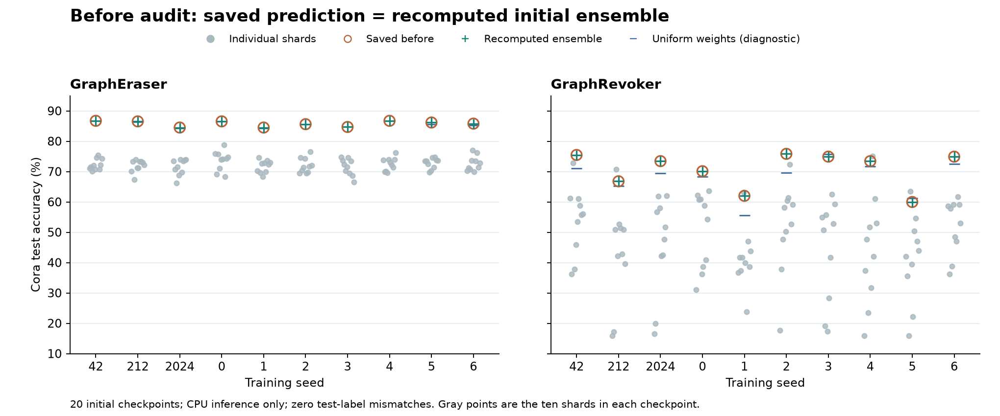

# Before 来源核验：单 shard，还是完整 ensemble？

2026-10-18 · EXP-079/e79r5 · 只读核验，未训练或修改缓存

**结论：当前 70.68% 能从完整初始 ensemble 复算，但初始模型质量审计仍未完成。旧 Shard Protection 表中的 GraphRevoker 当时实际调用了 GraphEraser，不能与当前真实 GraphRevoker 作前后性能比较。** 当前图保留为诊断，不据此作方法优劣或固有机制结论。新增分区检查发现明显类别偏斜，但尚未证明低精度的根因。

## 1. 本轮实际核验了什么

1. 按 run.json 的精确 Output 身份读取两种分片方法、三数据集、十 seed 的 60 个 D-full/GCN 条件，核对 Output 文件哈希与绑定 Dataset/Split，直接从保存的 logits_before 和测试标签计算准确率。60 个结果均与回传 metrics.json 一致。
2. 按 Output 内的 ensemble_state_hash 查找对应初始 checkpoint，核对 method、training、parameters 和 data identity，没有用当前默认参数重新训练。
3. 对 Cora 的 20 个初始 checkpoint 核验文件及 state 哈希，加载全部十个 shard、assignment 和聚合 weights，在 CPU 上重新前向。20 组 ensemble 的测试预测均与保存的 before 完全一致（每组 542 个测试节点，类别预测不一致数均为 0）。CPU/GPU 浮点输出最大绝对差为 7.62939e-06，未改变测试 argmax。
4. 同时分别计算每个 shard 的结果，以及使用相同 shard、改为均匀权重的聚合诊断。后者仅用于排查，不替换正式指标、不重训、不写回 Cache。

CiteSeer/PubMed 的 40 组只核对保存预测和初始 checkpoint 身份，未独立前向重算。完整原始证据在 [before_audit.json](before_audit.json)，只读脚本为 [audit_before_remote.py](audit_before_remote.py)。

## 2. 图里的数值与单 shard 数值有明显区别

橙色空心圆是保存的 before，绿色加号是从初始 checkpoint 重算的完整 ensemble；两者重合。灰点是各单 shard，蓝横线是均匀权重诊断。

| 数据集 | 方法 | 十 seed before 均值 | 最低 seed | 最高 seed |
| --- | --- | --- | --- | --- |
| CiteSeer | GraphEraser | 75.195 | 74.024 | 76.426 |
| CiteSeer | GraphRevoker | 72.162 | 68.468 | 74.474 |
| Cora | GraphEraser | 85.775 | 84.502 | 86.716 |
| Cora | GraphRevoker | 70.683 | 59.963 | 75.830 |
| PubMed | GraphEraser | 87.325 | 87.044 | 87.551 |
| PubMed | GraphRevoker | 86.600 | 85.700 | 86.917 |

例如 Cora / seed 42：GraphEraser 的十个 shard 为 70.11%–75.46%，完整 ensemble 为 86.72%；GraphRevoker 的单 shard 为 36.16%–72.88%，完整 ensemble 为 75.46%。这两项 before 都不是最后一个 shard 的值。

## 3. 为什么仍需要检查 GraphRevoker 的初始质量

GraphRevoker 的 Cora before 均值为 70.68%，seed 范围 59.96%–75.83%；GraphEraser 为 85.78%。对同一批 shard 使用均匀权重，GraphRevoker 的均值为 68.03%，没有简单恢复到八十多。这只能排除“换成均匀权重就能普遍修复”的简单解释，不能证明聚合实现无误。

已绑定的配置为十 shard、GCN 2 层/64 隐藏维度、3000 epochs、lr=0.05、weight_decay=0.0001；GraphEraser 使用 lpa_base，GraphRevoker 使用 gpa，后者 gpa_epochs=10；两者当前聚合均为 optimal。应进一步审查分区的节点和类别分布、分区训练充分性、shard 训练与聚合图是否符合 intended protocol，以及与原方法实验设置的差异。上述差异不等同于已确认的 bug，本轮没有改参数或启动重跑。

因此图 1 只能说：**在当前配置和 checkpoint 下，GraphRevoker 的初始 ensemble 性能较低，gap 解释必须考虑这个起点。** 暂不把它写成 GraphRevoker 的固有性质，更不据此宣称它天然不如其他 GU。

## 4. 用户记得的旧 Shard Protection 表，到底比较了什么

用户补充记得的是最初研究 Shard Protection、后来发现结论不成立的那轮。本轮找到了[旧发现文档](../../../analysis/废弃/2026-02-22_新发现_Shard保护效应与新指标.md)：其 Step0 表把 GraphEraser 和 GraphRevoker 都记成 before 71.03%、after 84.13%，并解释成“保护效应”。这张表讨论的是删除后相对自身 before 的提升，不是初始 ensemble 高于其他方法 baseline 的有效证据。尚未定位用户记得的另一句“均值略高”的精确原文。

本轮同时检查了 Git 提交 `6045e4736a999cfb7265ba4739190dc01d9299de`（2026-05-05）的真实 diff：`unlearning_manager.py` 将 `"GraphRevoker": grapheraser` 改成 `"GraphRevoker": graphrevoker`。因此旧表里同为 84.13% 的两行实际不是两个独立方法；旧 GraphRevoker 标签不能证明真正的 GraphRevoker 以前达到该水平。

[旧解析器](../../../../scripts/evaluation/runners/run_round2.py)还保留着“取最后一次 Epoch F1 作为 before”的实现。既有审计记忆记录旧 Step0 的正确聚合 before 约 84.69%、after 84.13%，而 71.03% 是最后一个 shard 的训练输出；本轮未取得那份原始日志重新核算，所以该精确校正数值仍标为历史记录。上一版说明未交代旧 GraphRevoker 路由错误，容易让人误以为 84.69% 是当前 GraphRevoker 应恢复到的基准，现予以纠正。

另一个可核对的时间点是[七月 GraphRevoker 修复后 canary](../../../../docs/graphrevoker_postfix_canary_ACCEPTANCE_REPORT.md)：Cora 四策略 before 为 72.14%–72.69%。本轮读取的是当时验收报告，没有重算其原始预测；它是旧 launcher、单 seed、不同预算的结果，不能与当前十 seed 作受控对比。它只说明低 before 在当前画图之前就已被记录。

## 5. 全部 Cora 逐 seed 核验结果

| 方法 | seed | 保存的 before | 重算 ensemble | 单 shard 最低 | 单 shard 最高 | 最后一个 shard | 均匀聚合诊断 | 测试预测不一致数 |
| --- | --- | --- | --- | --- | --- | --- | --- | --- |
| GraphEraser | 42 | 86.716 | 86.716 | 70.111 | 75.461 | 74.354 | 86.716 | 0 |
| GraphRevoker | 42 | 75.461 | 75.461 | 36.162 | 72.878 | 56.089 | 71.033 | 0 |
| GraphEraser | 212 | 86.531 | 86.531 | 67.343 | 73.985 | 72.140 | 86.347 | 0 |
| GraphRevoker | 212 | 66.790 | 66.790 | 15.867 | 70.664 | 39.668 | 65.314 | 0 |
| GraphEraser | 2024 | 84.502 | 84.502 | 66.236 | 73.985 | 73.985 | 84.317 | 0 |
| GraphRevoker | 2024 | 73.432 | 73.432 | 16.605 | 61.993 | 61.993 | 69.373 | 0 |
| GraphEraser | 0 | 86.531 | 86.531 | 68.266 | 78.782 | 74.723 | 86.531 | 0 |
| GraphRevoker | 0 | 70.111 | 70.111 | 30.996 | 63.653 | 63.653 | 68.266 | 0 |
| GraphEraser | 1 | 84.502 | 84.502 | 68.266 | 74.539 | 73.063 | 84.317 | 0 |
| GraphRevoker | 1 | 61.993 | 61.993 | 23.801 | 63.100 | 43.727 | 55.535 | 0 |
| GraphEraser | 2 | 85.609 | 85.609 | 69.373 | 76.568 | 71.956 | 85.609 | 0 |
| GraphRevoker | 2 | 75.830 | 75.830 | 17.712 | 72.325 | 59.041 | 69.557 | 0 |
| GraphEraser | 3 | 84.686 | 84.686 | 66.605 | 74.723 | 66.605 | 84.686 | 0 |
| GraphRevoker | 3 | 74.908 | 74.908 | 17.343 | 62.546 | 59.225 | 75.646 | 0 |
| GraphEraser | 4 | 86.716 | 86.716 | 69.557 | 76.199 | 76.199 | 86.716 | 0 |
| GraphRevoker | 4 | 73.432 | 73.432 | 15.867 | 75.092 | 52.952 | 71.771 | 0 |
| GraphEraser | 5 | 86.162 | 86.162 | 69.742 | 74.723 | 73.616 | 85.609 | 0 |
| GraphRevoker | 5 | 59.963 | 59.963 | 15.867 | 63.469 | 43.911 | 61.255 | 0 |
| GraphEraser | 6 | 85.793 | 85.793 | 69.926 | 76.937 | 72.878 | 85.240 | 0 |
| GraphRevoker | 6 | 74.908 | 74.908 | 36.162 | 61.624 | 52.952 | 72.509 | 0 |

## 6. 新增排查：分区类别分布与聚合方式

2026-10-18 再次只读加载同一批 Cora 的 20 个初始 checkpoint，逐项匹配 Output、checkpoint 文件与 state 身份，并核对正式聚合的测试 argmax。只增加统计与 CPU 前向，没有训练、优化权重或写回缓存。远端核验 SHA 为 `5bfd9765fa0bedf17b252765e22142b209f06bef`。

| 方法 | 当前聚合准确率 | 同权重概率平均（诊断） | 均匀概率平均（诊断） | 缺类 shard / 100 | shard 最大类别占比均值 % |
| --- | --- | --- | --- | --- | --- |
| GraphEraser | 85.775 | 85.498 | 85.535 | 0 | 29.866 |
| GraphRevoker | 70.683 | 71.107 | 69.077 | 51 | 59.708 |

准确率单位为 %。每种方法为十 seed × 十 shard；100 个 shard 不是 100 次独立实验。最大类别占比先在每个 shard 内计算，再对所有 shard 等权平均。缺类指七个类别中至少一个在该 shard 的训练样本里完全没有出现。

当前实现每个 shard 只用自己分区的训练节点监督，并过滤其他分区训练节点的消息传递边，再组合各 shard 的预测；它不只是将同一完整模型重复做 ensemble。GraphRevoker 的分区表现出更强的类别集中：51/100 个 shard 缺类，最大类别平均占约 59.71%；GraphEraser 为 0/100 和 29.87%。这提供了训练分布差异的线索，但不能单凭缺类判定分区错误：GPA 的现有目标包含最小化 `LabelEntropyLoss`，本身就会鼓励类别集中。

当前正式聚合是加权 log-probability 求和。本轮额外将同一批 shard 的概率加权平均或均匀平均，GraphRevoker 均值分别为 71.11% 和 69.08%，没有恢复到八十多。替代聚合仅作敏感性诊断，权重没有为替代规则重新优化，也没有修改正式结果。它不能证明所有聚合设置都没有问题。

**现在可以确认的是历史方法误标，以及当前分区和子模型质量值得继续检查；不能确认的是 70.68% 已达到合理复现水平，或类别偏斜就是性能差距的原因。** 后续需要对照原方法设置检查分区目标、子模型训练和聚合训练/评估图，并通过受控比较归因。本轮没有启动这些训练对照。

[新增原始诊断 JSON](partition_audit.json) · [全部 200 个 shard 的 CSV](partition_audit_shards.csv) · [只读诊断脚本](audit_partition_remote.py)。

## 复现与影响范围

原运行 SHA：`e02b5fa40ebce66fb45e57ea23b8d6c8d7856685`。核验时远端 SHA：`5bfd9765fa0bedf17b252765e22142b209f06bef`。用于重算的 ShardEnsemble、GCNNet、create_model，以及原始 before 生成/utility 函数已与原运行版本作 AST 对照，均相同；Output 自己的生成 producer 和初始 checkpoint 身份另在 JSON 中逐项保留，不能用当前 checkout SHA 冒充最初生成版本。

本次只读 SQLite、Output、绑定数据和初始 checkpoint；不修改缓存、训练参数、远端源码或科学接受状态。新增 CPU 重算而非 GPU 训练。没有证据将已回传 before 直接替换成某个历史数字；当前数值也尚未通过初始质量审阅，论文不得据此作 GraphRevoker 优劣或机制结论。

[逐 seed CSV](before_audit_cora.csv) · [汇总 CSV](before_audit_summary.csv) · [矢量图](before_checkpoint_audit.pdf) · [渲染脚本](render_before_audit.py) · [返回三张叙事图](STORIES.html)。
