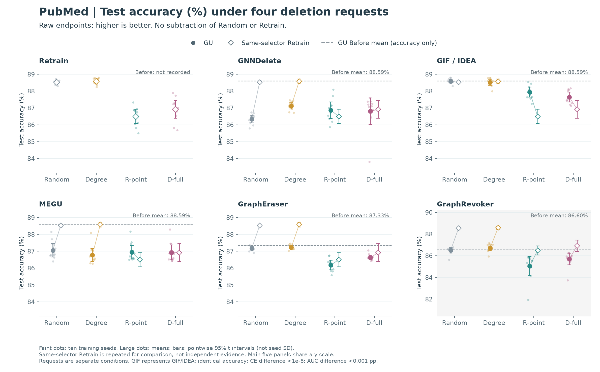
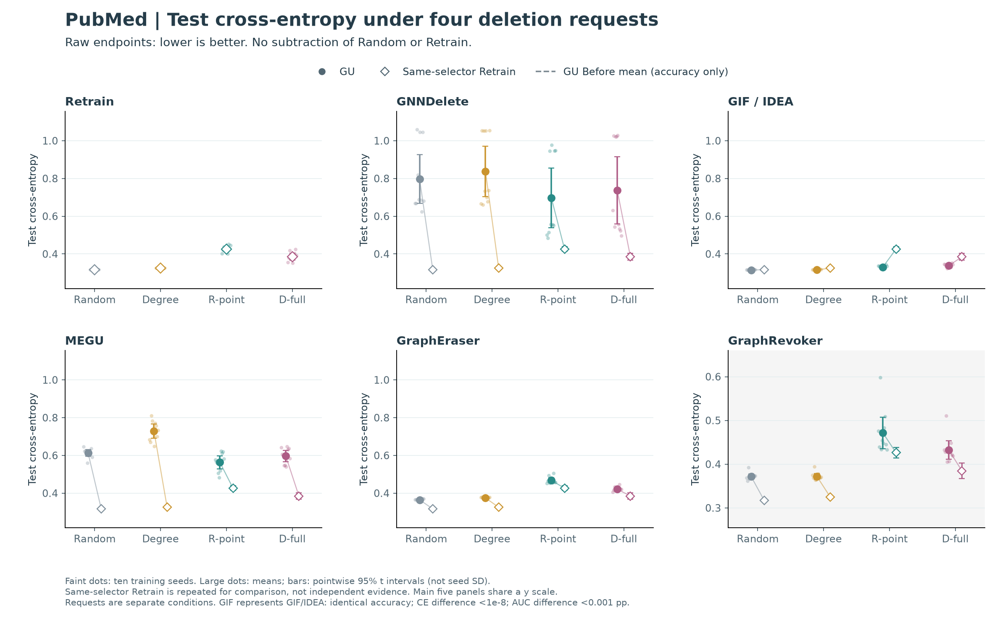
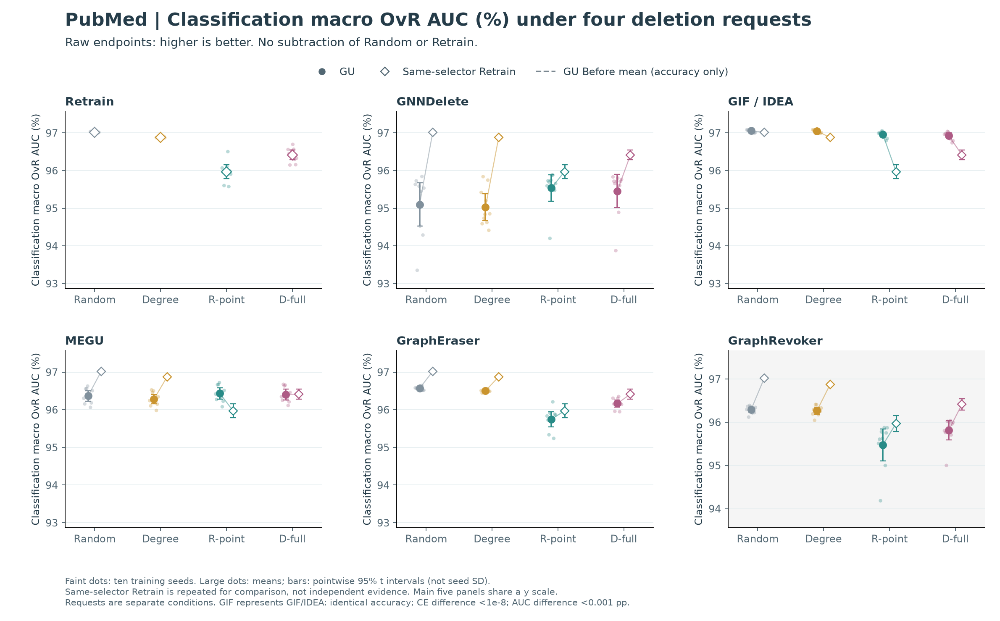
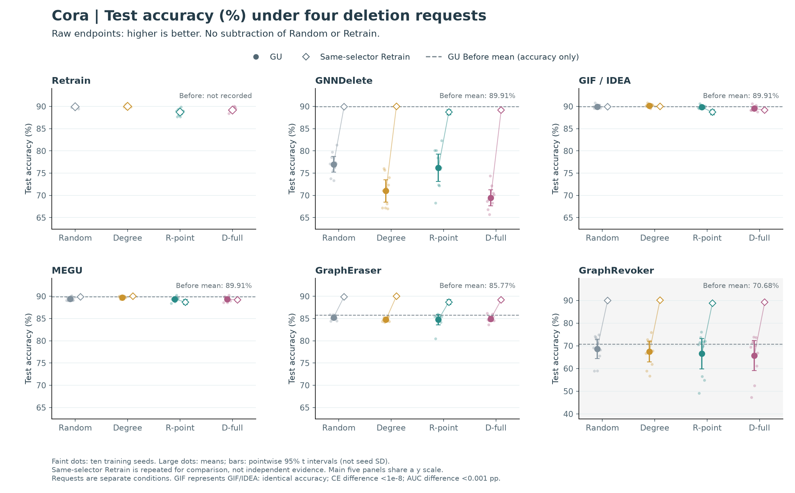
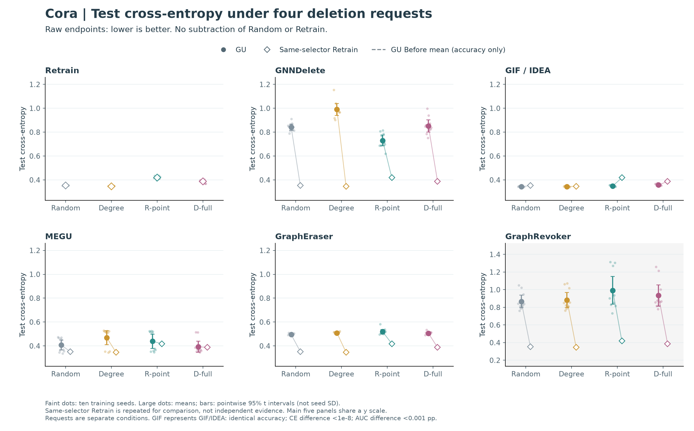
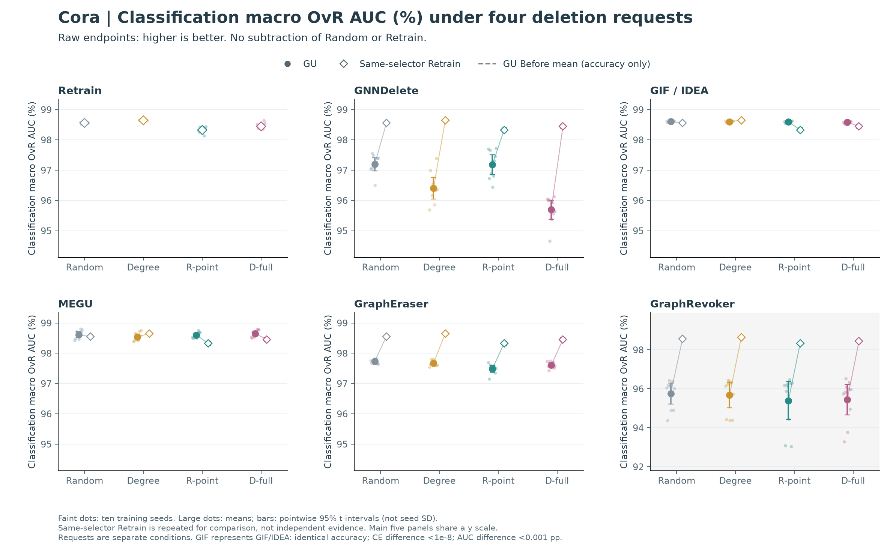
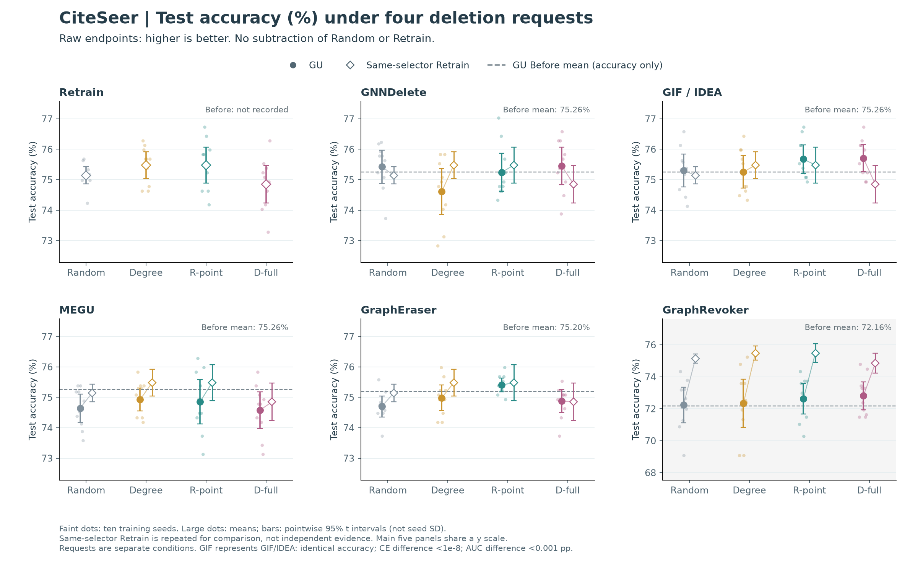
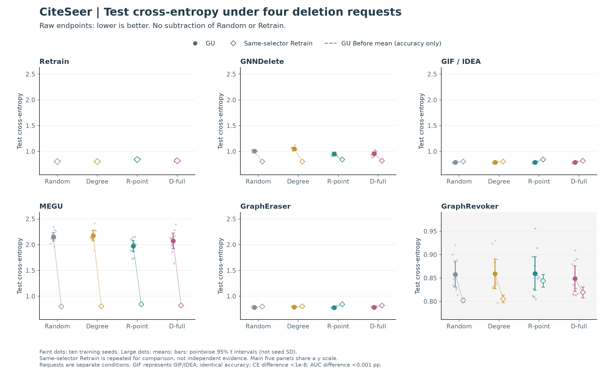
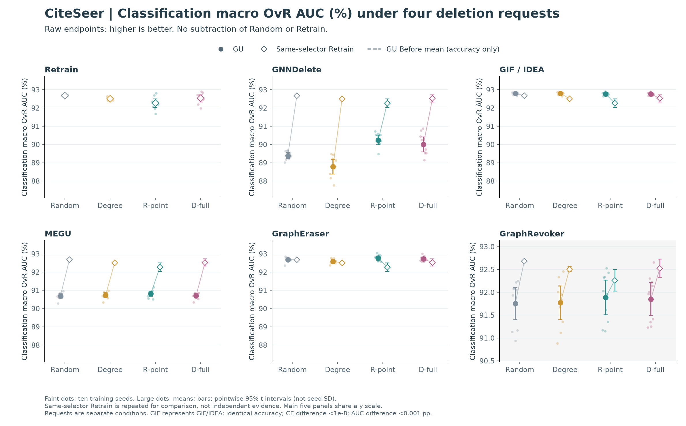

# 问题 2：先比较各 selector 下的原始效用

2026-10-19 · EXP-079/e79r5 · 十训练 seed · GCN 选点 · 固定 split、10% 删除预算

**第一层先问：每种请求之后，模型本身的准确率、交叉熵和分类 AUC 是多少？第二层再问：相对 Random 改变多少，以及这种响应与 Retrain 有何不同。** 原值和参照差值都保留，但主图不要求读者先理解四项相减。

本页展示这批实验在 GCN 来源下的全部四类请求：Random、Degree、R-point、D-full。它不是所有选点算法的完整覆盖；EXP-011 的 IM、PageRank 等属于另一批实验，不能混成十 seed 的同一矩阵。

**IM 做过实验，只是没有纳入这批 EXP-079 十 seed 矩阵。** EXP-011 的 `exp011-t2/0925-v1` 包含 IM/RR-4096、RR-16384、RR-65536，覆盖三数据集、六 GU 和 Retrain；训练 seed 为 42、212、2024，每个训练 seed 内有三次 IM 选点重复。汇总表中 IM 的 n=9 是 3×3，不能读成九个训练 seed。Random 是三个训练 seed 各十次选点。见[EXP-011 原始汇总](../../../../self/research/analyses/EXP-011/table02-v2-summary.csv)及[原汇报第 3 节的完整策略比较](../REPORT.html)。这批原值图的缺席不代表 IM 无效或没跑过。

## 怎样读图

- 每个面板是一个系统，横轴是四种独立请求，纵轴是直接测得的任务指标；横轴顺序不是连续删除过程。
- Retrain 保留一个完整面板，且按 selector 叠加在各 GU 面板：实心圆是 GU，空心菱形是同 selector 的 Retrain。同色短线连接两个均值，只表示同请求的两个原值，不表示先后执行。重复的 Retrain 是同一份参照，不是新增重复实验。
- 浅色小点是十个训练 seed，大点为均值，误差线为均值的点态 95% t 区间。均值区间不是运行稳定性；逐 seed 标准差另存于 CSV。Random 先在每个训练 seed 内平均三次请求，其散布不等于单次随机请求的散布。
- 准确率图中的虚线是该 GU 自己的 Before 均值。Retrain 未保存对应 Before，CE/AUC 也没有保存 Before，不补造数值。
- 前五个面板共享纵轴，便于看效应的实际量级；Cora 的大幅下降会让其他方法的小变化显得紧凑，精确比较读原值表和配对区间。GraphRevoker 当前是 GPA + optimal 配置版，仅在灰色诊断面板保留，使用独立纵轴，不参与完整原方法的判断。
- GIF/IDEA 面板用 GIF 原值代表：两者准确率完全相同，逐 seed CE 差小于 1e-8，分类 AUC 最大相差约 0.00071 pp。CSV 保留两者，不能作为两份独立证据。准确率与当前 f1 字段数值相同，不作为两种独立指标。

## 当前原值已经能回答什么

PubMed 的平均准确率（%）：

| method | Random | Degree | R-point | D-full |
| --- | --- | --- | --- | --- |
| Retrain | 88.530 | 88.580 | 86.500 | 86.920 |
| GNNDelete | 86.350 | 87.120 | 86.870 | 86.800 |
| GIF | 88.580 | 88.520 | 87.940 | 87.650 |
| MEGU | 87.050 | 86.770 | 86.940 | 86.930 |
| GraphEraser | 87.170 | 87.230 | 86.180 | 86.630 |
| GraphRevoker | 86.510 | 86.730 | 85.060 | 85.700 |

**不能说其他 selector 在 GU 上都无效。** GIF/IDEA 和 GraphEraser 的定向请求仍有可见的准确率下降；MEGU 的变化更小；GNNDelete 的 R-point 则高于 Random。是否有额外损伤，需针对方法和 selector 分别说，而不是由“比 Retrain 的变化小”推成“无效”。以下是同 seed 的 Selected − Random，正值表示准确率提高，负值表示降低（注意它与旧图的损失方向相反）：

| method | selector | selected_minus_random [95% CI] |
| --- | --- | --- |
| GIF | gt_full | -0.93 [-1.20, -0.66] |
| GIF | r_point | -0.64 [-0.91, -0.37] |
| GNNDelete | gt_full | +0.46 [-0.39, +1.30] |
| GNNDelete | r_point | +0.52 [+0.06, +0.99] |
| GraphEraser | gt_full | -0.54 [-0.65, -0.43] |
| GraphEraser | r_point | -0.99 [-1.25, -0.73] |
| MEGU | gt_full | -0.12 [-0.24, +0.01] |
| MEGU | r_point | -0.11 [-0.22, -0.00] |

区间跨零表示当前数据没有给出明确方向，不能证明等效或无效。若要声称变化小到可忽略，需要预先定义有意义的效应阈值并做等效检验；本页没有补设事后阈值。上述点态区间未进行全矩阵多重检验校正。

**更小的 selector 响应不等于更稳定。** 前者是不同请求的均值变化，后者需看同条件跨 seed 或跨请求的变异。本页展示 seed 点并保存 SD，但没有完成方差差异推断，不能把更窄的均值误差线直接写成稳定性贡献。

**Selector 可以作为检查 GU 是否保留重训响应的探针。** 当同一批请求在 Retrain 上呈现的效用变化，在 GU 上被削弱或反转时，可以报告“相对于重训参照，效用响应不同”。仅凭这一点不能认定 GU 没有反映真实数据变化、遗忘失败或保留了应删除的信息；效用只是预测行为的一个摘要，而且当前 full-graph Retrain 与部分 GU 的模型结构并不相同。

## 不依赖 Retrain 的简单指标还能看什么

| 指标 | 回答的问题 | 当前可用性 |
|---|---|---|
| 删除后准确率 | 模型实际还能正确预测多少？ | 本页主图；与当前 f1 同值 |
| 删除前后准确率变化 Before − After | 相对该模型自身，删除后损伤多少？ | 已有 U；不依赖 Retrain；各 GU Before 不同 |
| 测试交叉熵 CE | 对真实标签的概率赋值是否变差？ | 本页画原值，越低越好；对自信错误敏感，不是校准误差 |
| 分类 macro OvR AUC | 类别分数排序是否改变？ | 本页画原值，越高越好；不是 membership/update-detection AUC |
| 同 seed 的 Selected − Random | 定向请求相对随机请求额外改变多少？ | 配对 CSV；仍是简单对照，未减 Retrain |
| 模型自身 Before/After 预测翻转、概率变化 | 准确率相近时，预测是否仍在变化？ | 当前指标表未直接记录，需要另核对保存预测、节点和评估图后补算 |

CE/AUC 的作用是检查准确率看不见的任务效用变化，不是再堆一组攻击指标。现有 update-detection AUC 可以作为另一个限定诊断，但它区分 selected 与测试节点，不能代替通用隐私或遗忘正确性结论。

**一个完全不需要 Retrain 的例子：PubMed / MEGU / R-point。** Random 与 R-point 的准确率分别为 87.052% 和 86.940%，CE 为 0.6135 和 0.5635，分类 AUC 为 96.367% 和 96.437%。准确率略降，但概率损失和类别排序改善；不能把三者压成“有效”或“无效”一个标签。Selected − Random 的配对变化分别为准确率 −0.112 pp [−0.223, −0.002]、CE −0.0500 [−0.0791, −0.0210]、分类 AUC +0.0696 pp [+0.0204, +0.1187]。准确率变化很小且区间接近零，仍需保留量级和探索性、多重比较限制，不称为重大退化。

作为不同方向的对照，同一 MEGU 的 Degree 准确率为 86.775%，CE 为 0.7285，分类 AUC 为 96.282%；相对 Random 三项均变差。因此不能泛称“MEGU 对不同 selector 没区别”，也不能泛称“准确率与 CE 必然反向”。

## PubMed：先看原值，再看配对变化

### 准确率：请求后模型实际有多好

[矢量 PDF](primary_pubmed_accuracy.pdf)。

### 交叉熵：正确标签的预测概率是否变差

[矢量 PDF](primary_pubmed_ce.pdf)。

### 分类 AUC：类别分数的排序是否变化

[矢量 PDF](primary_pubmed_auc.pdf)。

## Cora：先看原值，再看配对变化

### 准确率：请求后模型实际有多好

[矢量 PDF](primary_cora_accuracy.pdf)。

### 交叉熵：正确标签的预测概率是否变差

[矢量 PDF](primary_cora_ce.pdf)。

### 分类 AUC：类别分数的排序是否变化

[矢量 PDF](primary_cora_auc.pdf)。

## CiteSeer：先看原值，再看配对变化

### 准确率：请求后模型实际有多好

[矢量 PDF](primary_citeseer_accuracy.pdf)。

### 交叉熵：正确标签的预测概率是否变差

[矢量 PDF](primary_citeseer_ce.pdf)。

### 分类 AUC：类别分数的排序是否变化

[矢量 PDF](primary_citeseer_auc.pdf)。

## 与第二层图如何衔接

读完原值，再看 [跨 GU 的相对 Random 损失，以及效用与预测分歧](STORIES.html)。Random 差值把选择效应单独拎出；GU − Retrain 响应差和 GU–Retrain 预测分歧用于参照诊断。这些量帮助解释原值，不替代原值，也不把 Retrain 自动当作真实世界的因果真值。

## 证据与复现

- [逐 seed 原值](primary_seed.csv) · [均值、点态区间及 seed SD](primary_summary.csv) · [同 seed Selected − Random](primary_paired_vs_random.csv)。
- [生成器](build_primary.py) · [验证记录](primary_validation.json) · [方法实现审计](METHOD_AUDIT.html)。
- 输入为已核验的 metrics_seed.csv，本轮再次核对其 SHA256；同请求 Retrain 的准确率、CE、AUC 在六 GU 引用中一致后只取一份，未把六份引用当六次重复。
- 现有六 GU 加共享 Retrain、三数据集、四请求、十训练 seed，共 840 个汇总条件；Random 的每个条件已平均三请求。未新增模型执行，未改科学接受状态。
