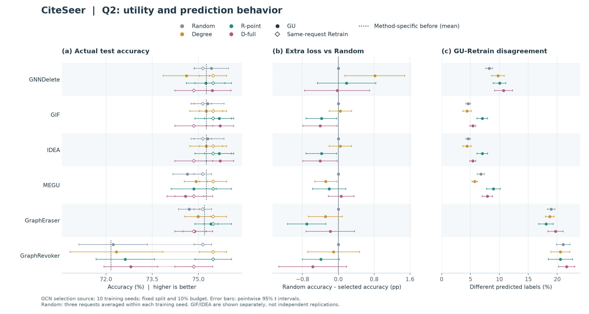
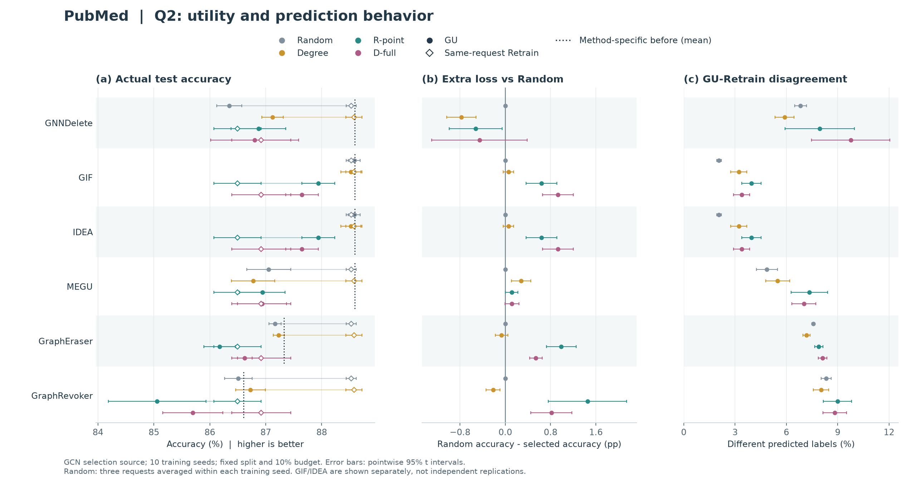
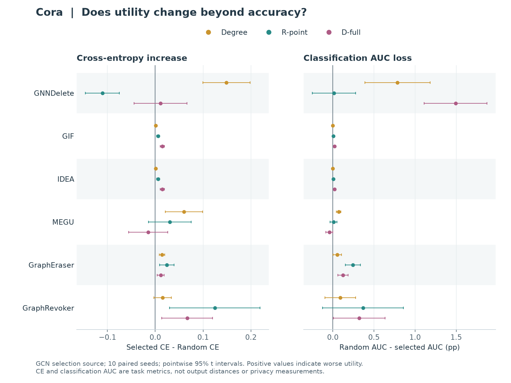
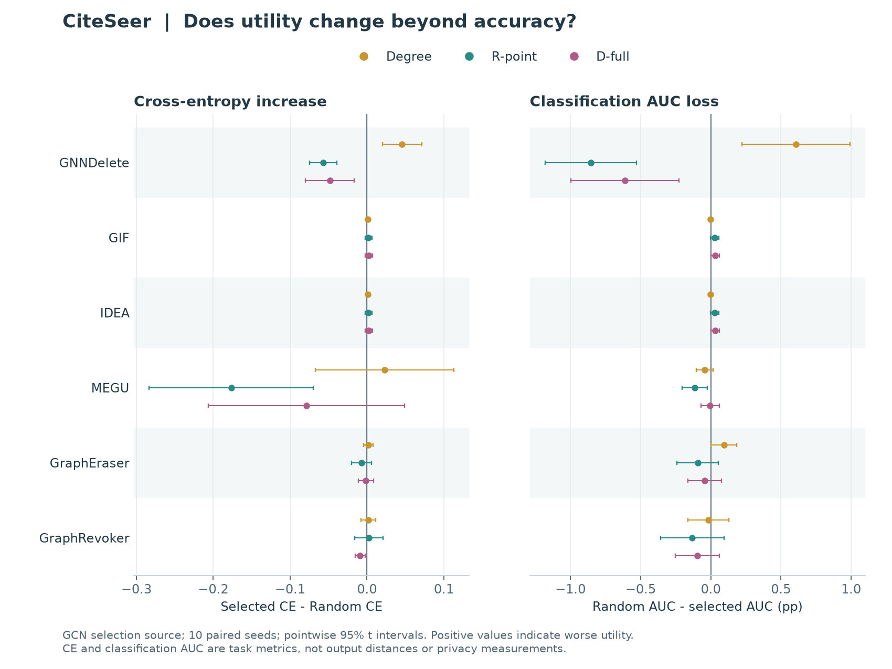
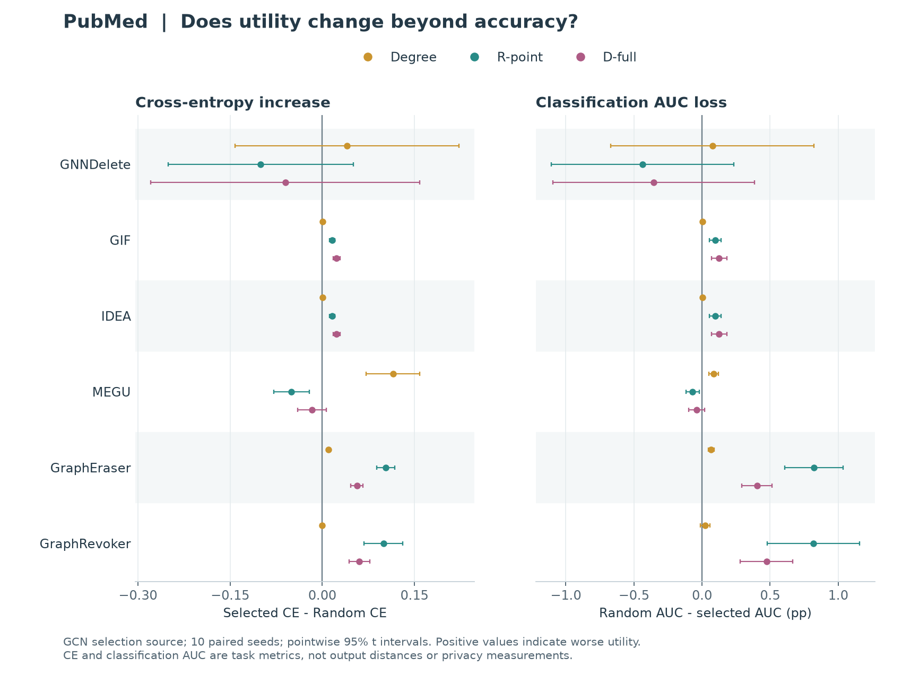

# 问题 2：同时展示效用变化与重训行为偏离

2026-10-18 · 图表方案与已有指标核对 · EXP-079/e79r5 · 不新增 GPU 实验

**建议保留三个主要问题：选点能否影响 Retrain → GU 如何响应同一请求 → 响应能否跨选点模型保留。问题 2 用效用原值、相对 Random 的增量和预测行为三部分展开，附属实验检查预算、选点近似、更多效用指标与空间分布。** 框架让这些发现可以在统一请求和参照下比较；各项 insight 不必服从同一个机制解释。

当前 OB 结果章采用另一套 Q 编号（响应量、GU 区分、跨来源），与汇报的三个问题不同。此处 Q2 专指汇报的“GU 怎样改变删除的影响”；正式成稿时应统一编号，将 GU 间差异放入这个问题下。

**新增：[围绕 Retrain 和同一 selector 跨 GU 的三张叙事图](STORIES.html)。** 该页将完整指标图组织为三条可讨论的发现，并保留反例和配对区间。

**Before 核验：[保存预测与初始 ensemble checkpoint 的逐项对照](BEFORE_AUDIT.html)。** 本批 Cora 的两种分片方法没有误取单 shard，但 GraphRevoker 的低初始性能仍需审查配置和初始模型质量。

## 1. 哪些指标已有，哪些仍需要补算？

| 指标 | 已有数据 / 可直接分析 | 建议位置与作用 |
|---|---|---|
| 删除前与删除后 accuracy、同请求 Retrain accuracy | 六 GU、三数据集、十 seed；当前 f1 字段与 accuracy 数值相同 | Q2 主图原值端点：展示实际性能水平及方法起点 |
| 总损失 U、相对 Random 额外损失 ΔU、效用 gap G | 已有配对量；无需新训练 | 主图重点突出 ΔU；原值端点间距表达 G，分解表解释 U |
| GU–Retrain 预测不一致率、相对 Random 的增量 | 六 GU 全覆盖 | Q2 主图另一面板，检验准确率较稳时行为是否仍改变 |
| 测试交叉熵 CE、分类 macro OvR AUC | GU 和 Retrain 均已记录；原始 metrics 未保存对应删除前 CE/AUC | 配套图检查置信度与类别排序变化；可比较 Random、定向请求和 Retrain，不编造 before |
| 1/2/3/>3 hop 的分歧率及分母 | 六 GU 全覆盖，但个别 hop 层为空 | 附属分析：偏离集中在何处；空层不记为零，选点改变了分层成员，不直接解释为因果传播 |
| update-detection AUC | 保存数值及状态，详见覆盖表 | 附录诊断：根据前后概率变化区分 selected nodes 与测试节点；不是通用 MIA 或遗忘成功率 |
| GU/初始模型、Retrain/初始模型的预测分歧；概率或 logit 距离 | 本轮回传的 metrics.json 中未直接记录 | 需要另查持久化预测及节点/评估图匹配后补算；不能由现有 GU–Retrain 分歧反推 |

| method | cells | CE | classification_AUC | update_detection_AUC | before_accuracy | GU_Retrain_disagreement |
| --- | --- | --- | --- | --- | --- | --- |
| GIF | 360 | 360 | 360 | 360 | 360 | 360 |
| GNNDelete | 360 | 360 | 360 | 360 | 360 | 360 |
| GraphEraser | 360 | 360 | 360 | 360 | 360 | 360 |
| GraphRevoker | 360 | 360 | 360 | 360 | 360 | 360 |
| IDEA | 360 | 360 | 360 | 360 | 360 | 360 |
| MEGU | 360 | 360 | 360 | 360 | 360 | 360 |
| Retrain | 360 | 360 | 360 | 0 | 0 | 0 |

覆盖表中的计数为输出条件数，不能当成独立样本量。Retrain 没有 before 或 update-detection 值时保留缺失。当前 f1 字段实际为单标签测试 accuracy，与 micro-F1 数值相同，不应重复列成两种独立指标。分类 AUC 与 update-detection AUC 回答不同问题，图注必须写全称。

## 2. 主图方案：原值与差值放在同一张组合图

每个数据集一张三面板图，行顺序固定为六种 GU，颜色固定为 Random、Degree、R-point、D-full。Q2 暂固定 GCN 选点，避免同时混入四个 surrogate；跨来源保留给 Q3。EXP-011 的 IM、PageRank 等完整策略仍保留为独立覆盖实验，不能把 EXP-079 称作十 seed 的全部策略比较。

- **左图：实际准确率。** 实心点是 GU，空心菱形是同请求 Retrain，同色线连接配对端点；短虚线是各 GU 自身删除前的均值。Random 本身也有自己的 Retrain 端点，不能用定向请求的 Retrain 替代。线段只表示效用差，不表示时间轨迹。
- **中图：相对 Random 的额外损失。** 以同训练 seed 的 Random 均值作配对差后再计算区间。正值表示额外降低准确率，负值表示改善。保留 Degree，避免只与弱参照比较。
- **右图：预测不一致率原值。** Random 与定向请求在同一坐标系出现，便于直接看绝对偏离及增量。它比较 GU 与同请求 Retrain，不能读成遗忘前后翻转。

原值图回答“最后模型有多好”，差值图回答“策略额外改变多少”。无需在正文同时堆 U、ΔU、G、ΔG 四张大图；这些量有代数关系，分解放在一张小表或典型案例中即可。

### Cora

[矢量 PDF](cora_q2_overview.pdf)。端点区间是各自十 seed 的区间，中图是先配对作差后的区间；不能从左图区间重叠判定配对差异。左图各数据集横轴不同，且不一定从零开始，跨图比较需读数。

### CiteSeer

[矢量 PDF](citeseer_q2_overview.pdf)。端点区间是各自十 seed 的区间，中图是先配对作差后的区间；不能从左图区间重叠判定配对差异。左图各数据集横轴不同，且不一定从零开始，跨图比较需读数。

### PubMed

[矢量 PDF](pubmed_q2_overview.pdf)。端点区间是各自十 seed 的区间，中图是先配对作差后的区间；不能从左图区间重叠判定配对差异。左图各数据集横轴不同，且不一定从零开始，跨图比较需读数。

## 3. 更多指标如何帮助解释，而不是增加指标数量？

CE 对预测置信度敏感，分类 AUC 描述类别分数的排序；二者能检查 accuracy 未变化时是否仍有任务效用变化。它们不是 GU–Retrain 输出距离，也不是新增独立实验。下面保留全部 GU、两个选择器和 Degree 的对照，不只挑改善论点的格子。三数据集分别作图，指标尺度不同，不混成一个分数。

GIF / GCN / R-point 的例子如下。ΔU 和 ΔAUC_loss 为 pp，flip 为 %，Δflip 为 pp，CE 为原单位；均为十训练 seed 的均值，区间见完整 CSV。

| dataset | delta_U | flip | delta_flip | delta_CE | delta_AUC_loss |
| --- | --- | --- | --- | --- | --- |
| Cora | 0.092 | 6.144 | 3.647 | 0.006 | 0.008 |
| CiteSeer | -0.375 | 7.027 | 2.417 | 0.002 | 0.027 |
| PubMed | 0.641 | 3.955 | 1.901 | 0.016 | 0.096 |

这些方向应共同解释：准确率、CE、AUC 和预测分歧可以给出不同结果，不能在看到数值后把最有利的指标换成唯一主指标。正文优先保留“效用与行为是否一致”的问题，CE/AUC 作为检验该观察的补充。

## 4. 实验部分的落位

| 主问题 | 主体证据 | 附属分析 |
|---|---|---|
| Q1 选点依据能否预测删除后的 Retrain 变化？ | 真实 Retrain 的策略比较；保留 Random 和结构基线 | IF 近似、删除预算、选集重合；各自标清实验批次 |
| Q2 同一请求经过 GU 后，效用与行为怎样改变？ | 上述原值 + ΔU + GU–Retrain 分歧；全 GU 与数据集反例 | CE/AUC、hop 分布、局部 GU 差异；update-detection 单独限定解释 |
| Q3 换模型选点后，哪些响应仍保留？ | 十 seed 的强度、行为与 GU 相对关系 | 去除单一 GU 的敏感性、重复选集与方向反转 |

图形形式已可用于讨论，最终排版仍需缩减：正文可选一张紧凑概览配代表案例，其余完整面板放附录。不要将本页六张审阅图全部塞进正文，也不靠增加指标数量凑页数。现有数据具备把 Q2 写得更充分的基础。

## 5. 数据和复核

- [逐条件原值与配对量](metrics_cells.csv)、[逐训练 seed 数据](metrics_seed.csv)、[完整均值及区间](metrics_summary.csv)、[hop 分母与分歧](hop_summary.csv)、[指标覆盖](metric_coverage.csv)。完整 CSV 保留四个选点模型，图中固定 GCN。
- [复现脚本](build_report.py)、[核验记录](validation.json)、[返回汇报](../REPORT.html)。
- 本轮重新核验 run manifest 哈希及 2,520 份 metrics.json 哈希，并与现有 cells.csv 的端点、gap、分歧逐条比对。按 baseline output 身份绑定同请求 Retrain，未重新读取 selection.json 或逐节点预测。
- 每个训练 seed 内先平均三次 Random 请求；十个训练 seed 为重复单位。误差线为探索性点态 95% t 区间，未作全矩阵多重检验；GIF/IDEA 不作为独立复现。原图评估、固定 split、10% 预算，不外推其他部署图和预算。
- 本页为写作与图表候选，不改变既有科学接受状态，也未启动或重跑实验。
