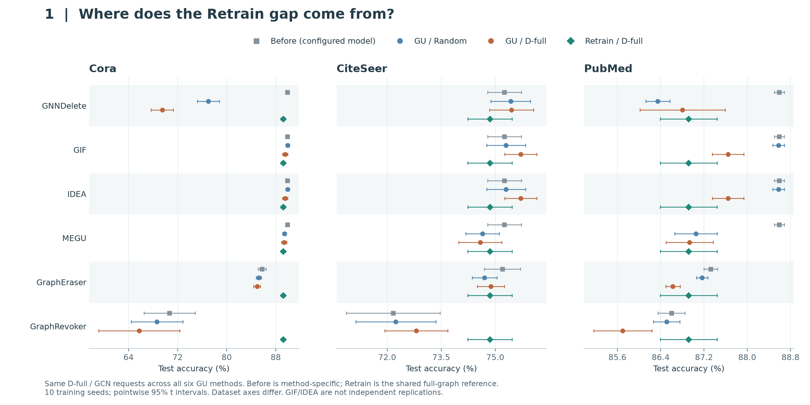
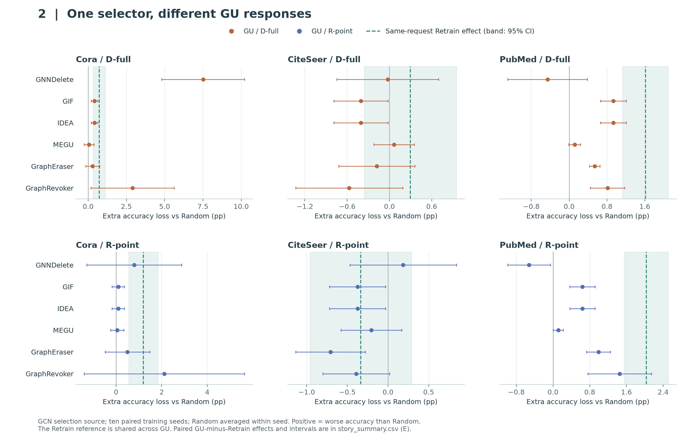
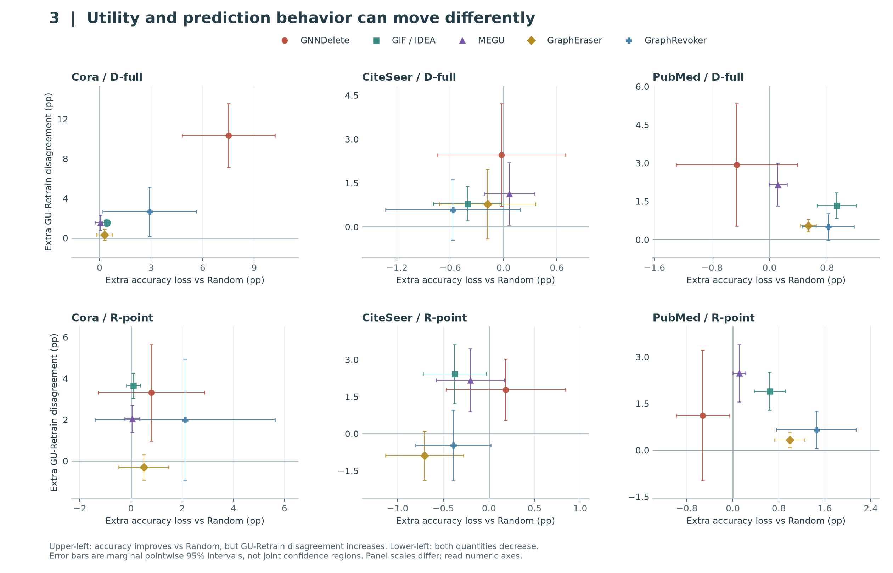

# 问题 2：同一删除请求，为什么得到不同的 GU 响应？

2026-10-18 · 三张叙事图候选 · EXP-079/e79r5 · GCN 选点 · 十训练 seed

**问题 2 同时问两件事：同一 selector 对实际效用造成什么变化；这些变化与同请求 Retrain 的效用和预测行为有什么关系。** 下面按“先看端点 → 再比较 GU 响应 → 最后看效用与行为是否一致”组织。三张图共用同一批请求，不是三个独立实验。

## 图 1：大的 Retrain gap，需要结合初始性能和 Random 来理解

**方法审计更新：[原论文与当前实现对照](METHOD_AUDIT.html)。图中 GraphRevoker 实际是 GPA + optimal 配置版，当前 adapter 未接入论文的 contrastive 聚合模块，不能用于完整 GraphRevoker 的方法优劣结论。** [Before 来源核验](BEFORE_AUDIT.html)确认本批 Cora 没有误取单 shard；但数值能复算不代表完整方法实现正确。图和原数值保留为诊断，不以探索性聚合对照替换正式结果。

**一句话发现：同样看到很大的 GU–Retrain gap，实际背景可能不同；只画 gap 会隐藏各方法起点和随机删除后的表现。**

以 Cora 的 D-full / GCN 请求为例，GNNDelete 从 89.91% 降到 69.48%，Random 后是 76.99%，同请求 Retrain 是 89.19%。因此这里既有方法对随机删除的下降，也有 D-full 的额外影响。GraphRevoker 的情况不同：初始准确率已经是 70.68%，D-full 后为 65.74%。其 23.45 pp gap 不能全部称为该请求新造成的损伤。

**反例与范围。** CiteSeer 中多数端点接近，PubMed 的方法差别也不像 Cora 那样悬殊。分片方法与完整 GCN 起点不同；这里的 Retrain 是共同的 full-graph 参照，不是每个 GU 架构各自精确重训。因此图 1 是参照诊断，不是严格控制架构后的近似误差排名，也没有识别性能差异的因果机制。

**可用于正文的表述。** “The same retraining gap can arise against substantially different starting performance. Reporting the pre-deletion model and random-request outcome alongside the matched retraining endpoint distinguishes overall performance differences from the additional effect of targeted selection.”

## 图 2：同一 selector 的 Retrain 效应，不能直接当作各 GU 的损伤

**一句话发现：固定请求后，各 GU 对定向选择的额外响应不同，而且这种关系随数据集改变。** 每幅面板内，各 GU 使用同一批选集，橙/蓝点是 GU 相对 Random 的额外损失 A_M；绿线是相同请求在 Retrain 上的额外损失 A_R。正值表示比 Random 更差。绿色阴影和横线属于同一个共享参照，不能算作六次复现。

Cora 的 D-full 请求在 Retrain 上额外损失 0.71 pp，到了 GNNDelete 是 7.51 pp，而 MEGU 为 0.05 pp。PubMed 则提供反向例子：同一 D-full 在 Retrain 上额外损失 1.61 pp，GNNDelete 的均值却为 -0.46 pp。这表明“对 Retrain 有影响”不能直接换算成“对所有 GU 都有同样影响”。负均值的证据强弱仍应读区间。

为检验“放大或削弱”，计算逐训练 seed 的 E=A_M−A_R，再给配对区间，不能靠两组误差线是否重叠判断。下表保留该量及反例；完整六 GU、两策略、三数据集结果见 CSV。

| 条件 | ΔU [95% CI] | Retrain ΔU [95% CI] | E [95% CI] | Δ分歧 [95% CI] |
| --- | --- | --- | --- | --- |
| Cora / gt_full / GNNDelete | +7.51 [+4.80, +10.21] | +0.71 [+0.32, +1.11] | +6.80 [+4.06, +9.53] | +10.34 [+7.14, +13.54] |
| Cora / gt_full / GraphRevoker | +2.90 [+0.18, +5.63] | +0.71 [+0.32, +1.11] | +2.19 [-0.53, +4.91] | +2.65 [+0.17, +5.14] |
| PubMed / gt_full / GNNDelete | -0.46 [-1.30, +0.39] | +1.61 [+1.13, +2.09] | -2.07 [-3.04, -1.10] | +2.93 [+0.53, +5.33] |
| CiteSeer / r_point / GIF | -0.38 [-0.72, -0.03] | -0.34 [-0.96, +0.29] | -0.04 [-0.67, +0.59] | +2.42 [+1.22, +3.62] |
| CiteSeer / r_point / GraphEraser | -0.71 [-1.13, -0.28] | -0.34 [-0.96, +0.29] | -0.37 [-1.19, +0.45] | -0.89 [-1.88, +0.10] |

**反例与范围。** CiteSeer 的效用差异小，不能硬排出稳定的 GU 易受影响次序。这一图研究同 selector 在不同 GU 上的响应，不声称 D-full/R-point 优于所有策略；Degree 和完整策略范围仍由[完整指标页](REPORT.html)与 EXP-011 支撑。GIF/IDEA 数值重合，不作为独立验证。不同 GU 的训练和架构也不同，这里比较的是整个已配置系统的响应。

**可用于正文的表述。** “A request's effect on exact retraining does not determine its utility effect across approximate unlearning systems. Under matched deletion requests, the additional loss varies across GU methods and can change direction across datasets.”

## 图 3：同一 selector 的效用和行为响应，也不必同步

**一句话发现：某些条件下准确率提高了，与同请求 Retrain 的预测分歧却增加；另一些 GU 并不表现出这种分离。** 横轴是额外准确率损失，纵轴是额外预测分歧。左上象限表示准确率比 Random 更高、但分歧也更大；右上表示两者同时增加。零轴只是比较基准，不是遗忘正确性的阈值。

CiteSeer 的 GIF / R-point 是清楚的例子：ΔU=-0.38 [-0.72, -0.03] pp，而 Δ分歧=+2.42 [+1.22, +3.62] pp。MEGU 的平均效用也改善、平均分歧增加，不过效用区间应单独阅读。GraphEraser 则是反例：同一 R-point 下 ΔU=-0.71 [-1.13, -0.28] pp，Δ分歧=-0.89 [-1.88, +0.10] pp；它不支持“所有 GU 的分歧都会上升”。

**解释边界。** GraphEraser 的分歧变化区间跨零，因此它提供方向不同的均值，尚不能确认分歧降低。这说明单独按准确率给请求排序会遗漏预测行为变化；它不证明这种分歧就是隐私风险或遗忘失败。也尚未区分 GU 自己改变了哪些节点、Retrain 改变了哪些节点。若后续追问原因，需要核对两侧相对初始模型的逐节点变化，不能用这张散点图补写机制。横纵误差线分别为点态区间，不是二维联合置信域；这里是探索性分析。

**可用于正文的表述。** “Utility preservation does not imply preservation of prediction agreement with retraining. For the same selector, the relationship between these two responses is method-dependent: improved accuracy can coexist with increased disagreement, while other GU methods show mean decreases in both quantities.”

## 怎样放进论文

图 2 最适合作为问题 2 的主图：直接回答“一个 selector 对不同 GU 怎么样”。图 1 用来解释参照和方法起点，可压成前置概览或两个案例；图 3 支撑“效用与行为不总一致”的发现。三张候选先完整保留，成稿时再按版面选择，不要求全用双栏。

这三条经验发现可以由同一 framework 串起来：它固定请求、提供 Random 和 Retrain 参照，让不同 GU 的响应及其差异可比较。无需把三个观察强行解释成同一个机制。

## 证据、图源和复现

- [图 1 PDF](story01_retrain_context.pdf) · [图 2 PDF](story02_selector_across_gu.pdf) · [图 3 PDF](story03_utility_behavior.pdf)。
- [完整逐 seed 数据](story_seed.csv) · [完整均值与区间](story_summary.csv) · [生成脚本](build_stories.py) · [核验记录](story_validation.json)。
- [指标与原值完整页](REPORT.html) · [返回导师汇报](../REPORT.html)。
- 来源为经本轮核验的 2,520 份 metrics.json 派生表；本图使用 GCN 选点的两个 selector、三数据集、六 GU，共 360 个 GU 条件，另用同 seed 的 Random 平均值和同请求 Retrain。已检查每个 dataset/seed/selector 的 selection_id 和 Retrain output 在六 GU 间一致。
- 十个训练 seed，固定 split 2024、10% 训练候选节点删除、原图评估；Random 三请求先在 seed 内平均。点态 95% t 区间未作全矩阵多重比较校正，案例为事后探索性选例。未新增 GPU 运行，未改变科学接受状态。
