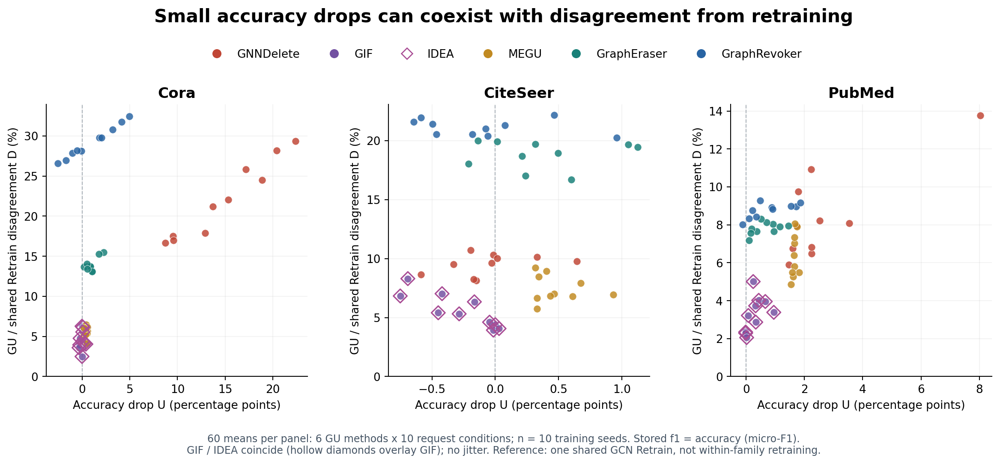
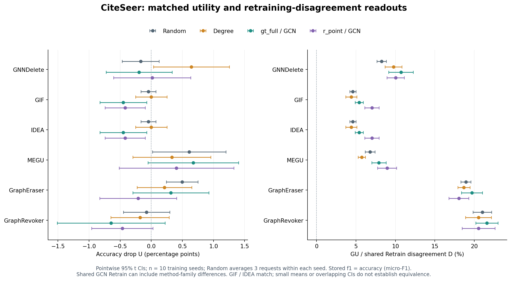

# 固定 10% 的补充证据：EXP-079 十 seed

2026-10-16 · EXP-079 / e79r5 · 固定预算附录

> 本附录保留十 seed 的效用与预测失配分析。它不承担删除比例响应的主证据；多 ratio 主线已调整为 EXP-032 的三 seed、1%/5%/10%/15% 表。请先阅读[主报告](REPORT.html)。

本附录重新核验5,041个原始文件，覆盖三数据集、六GU和十训练seed；所有结果均为10%删除预算。本次没有新增GPU实验。

## 1. 这段论文适合借鉴什么

Jain 等的 §5.5/Fig.2 在 Cora 上提高删除比例，联合观察 accuracy、与 GOLD 的 fidelity 和输出距离；部分方法的 accuracy 保持稳定，对 GOLD 的对齐却恶化。作者据此提出不忠实遗忘的可能性，没有证明参数或输出完全不变。§5.6 已研究 Degree、类别偏置等删除分布，因此“增加几项指标或非随机删除”本身不足以成为我们的新贡献。[官方论文，§5.5–5.6](https://proceedings.iclr.cc/paper_files/paper/2026/file/a89d228d9489814b98050a1f7b43ccdd-Paper-Conference.pdf)

这一论证方式适合我们：先观察效用，再检查同一请求下的重训练参照，最后用直接更新证据解释失配。它帮助排除的是“低 drop 足以说明可靠遗忘”这一判断。要检验“drop 小是因为更新不足”，必须增加前后输出比较。

| 观察到什么 | 可以怎样表述 | 仍需什么证据 |
| --- | --- | --- |
| GU 的测试效用基本保持 | 聚合效用变化小 | 不能由此推出参数或逐节点预测未变 |
| GU 与同请求 Retrain 预测不同 | 在指定查询集上存在重训练预测失配 | 需要起点与重训练波动，才能解释来源和异常程度 |
| GU 接近 no-update，而同模型家族 Retrain 明显远离 no-update | 在指定查询集上出现响应不足的证据 | 需预设容忍界、重训练随机性校准及独立确认；不能混用分片原模型与单 GCN Retrain |
| 同图、同推理流程下，检查的完整状态与输出均未变 | 检查时未发生可观测净变化 | 不能证明中间从未更新，也不能从有限查询推出所有输入等价或隐私可恢复 |

我们拟研究的具体问题是：**在固定预算和请求权限下，策略性删除是否比 Random/Degree 更容易暴露 GU 相对重训练的失配；若存在失配，直接更新证据是否支持响应不足？** “更小预算就能暴露”另需预算实验。

## 2. 本轮数据与指标口径

本轮采用 e79r5 的完整可信回传：Cora、CiteSeer、PubMed；配置中的目标模型为 GCN；训练 seed 为 42、212、2024、0–6；固定 split seed 2024；删除预算为训练候选池的 10%，分别删除 189、232、1,380 个节点。六个 GU 为 GNNDelete、GIF、IDEA、MEGU、GraphEraser、GraphRevoker，另有共享 Retrain。

每个训练 seed 包括 gt_full/r_point × GCN/SGC/GAT/GIN 八种请求条件、Degree，以及三个 Random 请求。统计先在训练 seed 内平均 Random 的三个抽样，形成十种条件；每种条件有十个训练重复。共有 180 个 GU 条件均值。Degree 和部分选择集合跨训练 seed 重用；这些训练重复不等于十份独立请求。GIF/IDEA 在 U、G、预测不一致率上全部重合，展示保留两行，解释不计作两份独立复现。

**字段名需要更正理解：** 当前保存为 `f1` 的数值实际按 argmax 正确率计算，即单标签分类 accuracy，在本设置下等于 micro-F1；它不是 macro-F1。报告沿用用户所说的 F1 drop 作为问题入口，图表使用 accuracy/utility drop 的实际含义。[指标实现](../../experiments/output_metrics.py)

| 本报告符号 | 计算和单位 | 解释边界 |
| --- | --- | --- |
| U | 方法自身 before accuracy − GU after accuracy，百分点 pp | 可为负；低 U 不等于等效，也不等于没有更新 |
| G | 同请求共享 Retrain accuracy − GU accuracy，pp | 有符号效用差；负值也不能证明遗忘更好 |
| D | 同请求 GU/Retrain 的 argmax 不一致率，% | 当前 `flip` 的实际语义；不是 before/after 翻转率。相同协议下 agreement = 100% − D |
| B | 方法自身 before accuracy − 共享 Retrain accuracy，pp | 等于 U−G；对于分片方法，混有方法起点差异，不能一概叫“删除数据导致的损失” |
| 更新检测 AUC | 根据 before/after 概率变化范数，区分删除节点与测试节点 | 既不是残留隐私 MIA，也不是变化幅度；不得改名为 forgetting score |

训练时移除选中节点的监督与关联边，保留其特征行；本轮在 **original graph** 上评估。GU 与 Retrain 的评价协议一致。D 在排除选中节点的测试掩码上计算，选中节点本就来自训练集。[删除契约](../../experiments/node_deletion.py) · [D 实现](../../experiments/flip_hop_metrics.py)

**共享 Retrain 的限制必须保留：** 它是单个 GCN 在保留训练图上从头训练，不是按 GraphEraser/GraphRevoker 的相同分片流程重建。因此分片方法的 G/D 同时反映模型家族起点与更新后差异。若要把 D 解释成删除算法自身的近似误差，需要补同家族参照或明确保留“相对共享 GCN 参照”的范围。[Retrain 实现](../../unlearning/unlearning_methods/Retrain/retrain.py)

下文区间均为十个训练 seed 上的点态 95% t 区间；策略比较先在 seed 内配对。没有全矩阵多重比较校正，也没有做等效检验。跨条件范围仅为描述，不能用作置信区间或独立试验成功率。

## 3. 现有实验已经能够展示的内容

### 3.1 完整覆盖：低效用变化与预测失配可以共存



图 1：每点为一个条件的十 seed 均值，包含 Random、Degree 和两类 selector 的四种来源。GIF/IDEA 重合。横轴是方法自身前后效用差，纵轴是 GU 与共享同请求 Retrain 的预测不一致率，二者比较对象不同。此图没有预算曲线，也不设定“合格遗忘”阈值。导出：[SVG](utility_vs_retrain_disagreement.svg) · [PDF](utility_vs_retrain_disagreement.pdf)。

| 数据集 | GU | U 的条件均值范围 / pp | D 的条件均值范围 / % |
| --- | --- | --- | --- |
| Cora | GNNDelete | 8.727 ～ 22.380 | 16.679 ～ 29.336 |
| Cora | GIF | −0.332 ～ 0.387 | 2.497 ～ 6.273 |
| Cora | IDEA | −0.332 ～ 0.387 | 2.497 ～ 6.273 |
| Cora | MEGU | 0.166 ～ 0.535 | 4.121 ～ 6.494 |
| Cora | GraphEraser | 0.185 ～ 2.232 | 13.100 ～ 15.498 |
| Cora | GraphRevoker | −2.546 ～ 4.945 | 26.568 ～ 32.435 |
| CiteSeer | GNNDelete | −0.586 ～ 0.646 | 8.123 ～ 10.706 |
| CiteSeer | GIF | −0.751 ～ 0.030 | 3.934 ～ 8.303 |
| CiteSeer | IDEA | −0.751 ～ 0.030 | 3.934 ～ 8.303 |
| CiteSeer | MEGU | 0.315 ～ 0.931 | 5.736 ～ 9.234 |
| CiteSeer | GraphEraser | −0.210 ～ 1.126 | 16.697 ～ 20.000 |
| CiteSeer | GraphRevoker | −0.646 ～ 0.961 | 20.255 ～ 22.162 |
| PubMed | GNNDelete | 1.471 ～ 8.030 | 5.898 ～ 13.763 |
| PubMed | GIF | −0.020 ～ 0.946 | 2.055 ～ 5.008 |
| PubMed | IDEA | −0.020 ～ 0.946 | 2.055 ～ 5.008 |
| PubMed | MEGU | 1.541 ～ 1.818 | 4.864 ～ 8.073 |
| PubMed | GraphEraser | 0.094 ～ 1.450 | 7.175 ～ 8.311 |
| PubMed | GraphRevoker | −0.127 ～ 1.856 | 8.025 ～ 9.275 |

每行覆盖相同的十种请求条件。完整精度与极值对应条件见 [覆盖表](coverage_ranges.csv)，均值、标准差及区间见 [180 条件表](all_condition_summary.csv)。不将六 GU 当六个独立统计样本，不合成为全局排名。

### 3.2 最清楚的案例：CiteSeer 的聚合效用掩盖了不同预测



图 2：同时展示 Random、Degree、gt_full/GCN、r_point/GCN，避免只展示某个正例。点为十 seed 均值，误差线为点态 95% 区间。六 GU 全部保留，GIF/IDEA 不作为独立证据。导出：[SVG](citeseer_four_condition_intervals.svg) · [PDF](citeseer_four_condition_intervals.pdf)。

| 方法 / 请求 | U / pp [95% 区间] | G / pp [95% 区间] | D / % [95% 区间] |
| --- | --- | --- | --- |
| GraphEraser / Random | 0.495 [0.242, 0.749] | 0.445 [0.082, 0.808] | 18.939 [18.309, 19.569] |
| GraphEraser / gt_full–GCN | 0.315 [−0.295, 0.926] | −0.030 [−0.749, 0.689] | 19.715 [18.395, 21.034] |
| GraphRevoker / Random | −0.075 [−0.448, 0.298] | 2.908 [1.792, 4.023] | 21.026 [19.848, 22.204] |
| GraphRevoker / gt_full–GCN | −0.646 [−1.512, 0.221] | 2.042 [1.407, 2.677] | 21.607 [20.208, 23.005] |

GraphEraser 的 Random 条件尤其直观：方法自身 before accuracy 约 75.195%，GU after 约 74.700%，共享 Retrain 约 75.145%；正确率相近，却有约 18.939% 的测试节点预测不同。不同节点上的正确与错误可以在聚合准确率中抵消。这证明单一效用读数会遗漏行为差异，但还没有判定差异是否超出模型家族和重训练波动。

**这个现象不是策略性选点独有。** GraphEraser 的 gt_full/GCN 相对 Random 的 D 增量为 +0.776 pp [−0.408, 1.960]；GraphRevoker 为 +0.581 pp [−0.454, 1.615]。这些区间尚未给出清楚的新增检出优势。不能把“换指标看到了差异”直接写成“我们的 adversary 发现了 Random 发现不了的缺陷”。

### 3.3 保留正例与反例，避免把两个故事拼成一个结论

GNNDelete 有清晰的局部策略增量，但它们并非“低 drop 隐藏问题”的案例：

| 条件 | U / pp | G / pp | D / % | D 相对 Random 增量 / pp [95% 区间] |
| --- | --- | --- | --- | --- |
| Cora / GNNDelete / gt_full–GIN | 22.380 | 21.716 | 29.336 | 11.464 [8.320, 14.608] |
| PubMed / GNNDelete / gt_full–SGC | 8.030 | 8.233 | 13.763 | 6.932 [4.830, 9.034] |

这些事后选出的案例支持局部请求敏感性；原有 U 已经揭示损害，不能称为新指标独有的检测盲区。Cora 该案例的 D 相对 Degree 增量仍为 4.815 pp [1.396, 8.235]，但 G 相对 Degree 为 2.694 pp [−0.329, 5.716]，不同端点不应互相替代。完整正负对照见 [配对比较表](paired_contrasts.csv)。

相反，PubMed / GIF / gt_full–SGC 的 U 为 −0.020 pp [−0.081, 0.040]，D 为 2.345% [2.158, 2.533]，明显小于上述分片方法案例。没有独立 Retrain–Retrain 参照，仍不能把它认证为正确遗忘；它说明不能把所有“低 U”都叙述为严重失败。

另外，Cora / GraphRevoker 的 Random before 约 70.683%，GU after 约 68.641%，共享 Retrain 约 89.902%。其较大的 G 已包含明显的方法起点差距，不能全部归因于删除更新。这也是本节必须保留 method-specific before 与 canonical original 两个参照的原因。

## 4. “模型没变化”目前能判断到哪一步

本轮 2,160 个 GU 单元的 `update_detection_auc` 均为 computed，且均不等于 0.5。该指标根据保存的 before/after 数组计算每个节点的 `L2(softmax(before) − softmax(after))`，再进行删除节点与测试节点的排序判别。如果这两组节点的前后概率完全相同，全部分数都为零，AUC 应为 0.5。[实现](../../experiments/output_metrics.py) · [完整原始数值](raw_gu_metrics.csv)

因此，**在保存输出与评分协议可信的前提下，现有结果已经不符合“评价节点上的前后概率完全相同”这一极端情形。** 例如 GIF/IDEA 各自在 Cora、CiteSeer、PubMed 有 33、28、16 个单元的 U 精确为零，更新检测 AUC 仍不为 0.5。零效用变化并不等于零输出变化。

但 AUC 主要反映排序，对统一缩放变化幅度不敏感。极小的数值变化也可能形成不同分数。所以它不能排除“变化太小而未响应请求”，也不能证明参数更新或有效遗忘。MEGU 的 after 还包含 Correct & Smooth 后处理，输出变化尤其不能直接归因于参数变化。[MEGU 适配](../../experiments/modular_megu.py)

这里还存在三个关键缺口：

1. **直接变化幅度尚未观测。** 本地回传只有 run/metrics/selection JSON，没有逐节点 logits、参数或 before/after 概率距离。不能从现有表写出“logit 距离升高”。
2. **方法起点与重训练波动尚未分离。** 分片方法需要同时对比方法自身原模型、canonical original 与当前共享 Retrain；认定超出合理波动，需要独立重训练重复。不能用请求不同的十个 seed 直接代替固定请求的 Retrain–Retrain 校准。
3. **输出距离需要统一语义。** 普通 GCN 输出 raw logits，MEGU 输出经后处理的 log probabilities，分片模型输出加权 log-softmax。直接跨方法使用 raw-logit L2 会混入输出表示尺度。建议先定义统一概率化的 TV 或 JS，明确 softmax、掩码、图与聚合方式；这是一项拟议端点，尚无本轮实测值。[分片输出](../../experiments/modular_shards.py)

MIA 接近 0.5 的问题另行处理。普通 MIA 受攻击能力和样本组成影响，低攻击表现本身不能认证遗忘；相关工作已经讨论了这一问题，因此不能声称首先发现该缺陷。[Tu 等，可靠经验遗忘评价](https://arxiv.org/html/2404.11577v4)。本项目当前更新检测 AUC 不可拿来冒充该隐私 MIA，对“标准 MIA 的检测盲区”作结论仍需真实的匹配 MIA 对照。

## 5. 证据、复算与交付范围

本报告使用的数据执行 SHA 为 `e02b5fa40ebce66fb45e57ea23b8d6c8d7856685`，run 为 `e79r5`，job 为 `exp079-20261013-e79r5`。没有把本报告的分析代码版本当作实验执行版本，也没有合并历史工程 Gate 或其他预算的结果。

- [分析与输入核验](verification.json)：manifest、可信索引与 5,041 文件 SHA-256 一致；CSV 与原始 metrics、同请求 Retrain 身份一致；完整覆盖与配对检查通过。
- [源码身份核验](source_verification.json) · [更新检测 AUC 完整范围](update_detection_coverage.csv)：源码与执行版本对齐；AUC 数值只用于本报告限定的输出变化判断。
- [完整条件统计](all_condition_summary.csv) · [长格式](all_condition_summary_long.csv) · [每 seed 配对值](seed_values.csv) · [原始 GU 指标](raw_gu_metrics.csv)。
- [跨条件范围](coverage_ranges.csv) · [Random/Degree 配对比较](paired_contrasts.csv) · [配对比较长格式](paired_contrasts_long.csv)。
- [独立分析脚本](analyze.py) · [报告数值与源码检查](verify_report.py) · [HTML 生成器](render_report.py) · [浏览器核验脚本](check_report.cjs)。
- 上游 [响应模式报告](../../self/research/analyses/EXP-079/e79r5/RESPONSE_PATTERN_REPORT.md) 与 [诊断报告](../../self/research/analyses/EXP-079/e79r5/DIAGNOSIS_REPORT.md) 提供先前问题与方法背景；本报告数字重新从可信输入复算。

在仓库根目录，现有本地分析环境可运行：

```powershell
& 'E:\conda_package\envs\gnn\python.exe' -B -X utf8 reports/forgetting_response_audit/analyze.py
```

`FIXED_BUDGET_APPENDIX.md` 是本附录的可编辑源，HTML 从同一内容生成；不手改 HTML。生成器需 `markdown-it-py` 与 `beautifulsoup4`，浏览器检查需 Playwright。本附录检查记录为同目录 `appendix_report_verification.json` 与 `appendix_html_qa.json`，科研图均提供 PNG/SVG/PDF。

本附录保存固定10%下的现有结果分析。主章节大纲与补实验优先级见主报告。新指标实测、远端 Output 存活性、固定请求 Retrain–Retrain 校准、预算趋势和 forgetting evaluator 有效性均未声称完成；科学接受仍为 `not_requested`。
