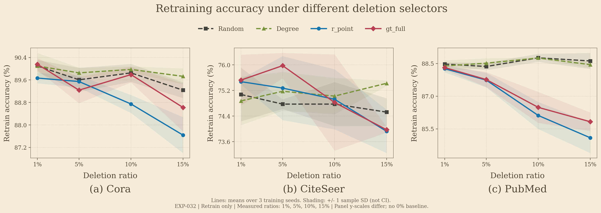

# 删除比例增加时，GU 是否跟上重训练的变化？

以 EXP-032 三 seed、多 ratio 为起点的结果分析与补实验方案 · 2026-10-17 更新

> **本节应以 EXP-032 的 1%、5%、10%、15% 预算轴为主线。** 它已经给出了同一组 selector 下的 Retrain 曲线；目前缺的是同请求下的 GU 曲线及直接输出变化。固定 10% 的十 seed 结果放在[补充附录](FIXED_BUDGET_APPENDIX.html)，用于说明“低效用损失与重训练不一致可以同时出现”，不能代替多 ratio 的响应分析。

**建议先补已有四个 ratio 下的 GU 对照。** 现有 Retrain 结果已经显示可辨别的预算响应，暂不把 30%、50% 或 80% 加入默认补实验清单。三 seed 与十 seed 主要影响不确定性的估计；是否有多个 ratio，决定能否回答“随着删除量增加，响应如何变化”。

## 1. 修正证据主次：为什么应该用这张三 seed 表

| 证据 | 实际覆盖 | 对本节的作用 | 不能支持什么 |
|---|---|---|---|
| EXP-032 | 三数据集；三 seed；1%、5%、10%、15%；10 个 selector 配置；仅 Retrain；360 格 | 主线：先确认这些删除请求在重训练上产生了怎样的预算响应 | 没有 GU，不能判断 GU 随预算变化是否偏离重训练 |
| EXP-011 Table 02 v2 | 三数据集；三 seed；固定 10%；六个 GU + Retrain | 固定预算下的 GU 对照，辅助挑选后续诊断对象 | 三 seed 不等于多 ratio；不能拼成 EXP-032 的 GU 曲线 |
| EXP-079 e79r5 | 三数据集；十 seed；固定 10%；六个 GU + Retrain | 补充低 drop、效用差与预测不一致的并存现象 | 重复次数更多仍不能回答预算响应，也不能直接接到 EXP-032 曲线上 |

用户提供的 Jain 等 §5.5 段落最值得借鉴的是**联合观察效用与重训练对齐程度随删除比例的变化**：若重训练发生变化，而近似方法保持较高准确率，这种“稳定”需要进一步解释。它本身不是未遗忘的充分证据；尤其是图分片方法，共享的单模型 Retrain 还可能引入模型家族差异。

我们的章节可以围绕一个可检验的问题展开：**在具有可观测重训练响应的删除请求下，GU 的变化是否足以匹配该响应？** 此处“足以”需由直接输出差异及重训练自身波动校准，不能只看 GU 的 F1 是否下降。

## 2. 现有结果：EXP-032 已经提供了什么

本次从校正映射后的原始结果重算，执行版本为 `ee4ea59509523a650fe67bacf9bc961dfe9db78b`。覆盖 Cora、CiteSeer、PubMed，训练 seed 为 42、212、2024，预算为训练候选节点的 1%、5%、10%、15%。360 格全部为 GCN Retrain，恢复运行均复用了缓存结果；本次分析没有训练模型。

字段名为 `f1_after`，但本任务中它与记录的 test accuracy 一致，即单标签分类的 micro-F1；下文使用 **accuracy**。图中展示 Random、Degree、r_point、gt_full 四个具有明确对照角色的 selector；[完整汇总](ratio_condition_summary.csv)保留全部 10 个配置，不将 gt_full 的参数变体当作独立方法数。

**图例表示删除节点的 selector，所有曲线均为删除后的完整重训练，包括 Random。** 三幅子图分别对应三个数据集；横轴为删除比例，纵轴为测试准确率。曲线为三 seed 均值，阴影为 ±1 sample SD，不是置信区间。没有加入不存在的 Original／0% 点；也没有用 accuracy 代替尚缺失的 fidelity 或 logit distance。三个面板纵轴范围不同，跨数据集的效应大小请看下面的百分点变化。可下载 [SVG](selector_retrain_accuracy.svg) 或 [PDF](selector_retrain_accuracy.pdf)；[全部 10 个配置的均值曲线](selector_retrain_accuracy_all.png)另存，完整 SD 见 CSV。

直接回答“Random 选点的重训呢”：PubMed 的 Random 均值从 1% 时的 **88.472%** 变为 15% 时的 **88.616%**，端点变化为 **+0.144 ± 0.420 pp**，即变化很小；r_point 则从 **88.261%** 降至 **85.091%**，变化为 **-3.169 ± 0.801 pp**。在相同的 15% 预算下，r_point 比 Random 低 **3.524 ± 0.901 pp**。前者比较同一策略的两个预算，后者比较同一预算下的两种策略，二者应区分。三 seed 的描述性结果不构成等效或显著性检验。

下面先在同一 seed 内计算 `accuracy(15%) − accuracy(1%)`，再报告三 seed 的 mean ± sample SD。负数表示随着预算增加，重训练效用下降；单位为百分点（pp）。

| 数据集 | Random | Degree | r_point | gt_full |
|---|---:|---:|---:|---:|
| Cora | -0.861 ± 0.384 | -0.369 ± 0.665 | -2.030 ± 0.804 | -1.538 ± 0.768 |
| CiteSeer | -0.551 ± 0.459 | +0.551 ± 0.771 | -1.552 ± 0.677 | -1.552 ± 0.771 |
| PubMed | +0.144 ± 0.420 | +0.059 ± 0.183 | -3.169 ± 0.801 | -2.485 ± 0.417 |

这里有三个可以保留的观察：

- **已有 adversarial selector 产生了预算压力。** r_point 和 gt_full 在三个数据集的 1%→15% 端点变化均为三个 seed 全部下降；Random／Degree 的端点变化幅度较小。因此，现有四个比例值得直接补 GU 对照。
- **PubMed 应保留。** 在 15% 时，r_point 相对同 seed 的 Random 低 3.524 ± 0.901 pp，gt_full 低 2.789 ± 0.158 pp；它是当前较清楚的重训练响应场景。不能因图大、MIA 可能接近随机而事先排除它。
- **预算响应不是处处单调。** 例如 Cora 的 gt_full 均值有中间回升，CiteSeer 部分策略在 5% 时先提高。正文可以说端点效用下降，不能写所有曲线随 ratio 单调恶化，更不能称重训练“崩溃”。

以上结果说明“请求改变了重训练结果”的效用层面证据，**尚未说明任何 GU 未充分响应**。此外，360 格的 `f1_before` 均为空，Original prediction 状态均为 `missing_original_predictions`。所以 1%→15% 的变化不是 Original→Retrain 的损失，现有返回文件也不能直接提供 Original、GU、Retrain 三者的概率距离。

## 3. 可写入论文的小节大纲

建议小节题目：**Response to increasing deletion budgets**，或中文“随删除预算增加的响应与重训练对齐”。标题暂不使用“遗忘失败”，因为那是待检验的解释。

| 段落 | 要回答的问题 | 内容与图表 | 当前状态 |
|---|---|---|---|
| 1. 动机与协议 | 为什么低 F1 drop 不足以解释遗忘质量？ | 同请求、同预算、同评估节点；同时观察效用和重训练对齐 | 可写 |
| 2. 重训练参照 | 这些请求是否确实使重训练产生变化？ | EXP-032 四 ratio 曲线、配对端点变化；区分 adversarial 与 Random／Degree | accuracy 可写；直接输出距离缺失 |
| 3. GU 跟随情况 | 当重训练响应增强时，GU 是否随之改变？ | 在相同请求上叠加 GU；画 GU–Retrain 的概率距离与预测不一致率 | 缺同协议、多 ratio GU |
| 4. 排除低响应解释 | GU 的低 drop 是有效保留，还是接近未更新？ | 同时比较 GU–Original、Retrain–Original、GU–Retrain；加入重训练重复的自然波动 | 需要保存输出并做校准 |
| 5. 结论与边界 | 能稳定识别哪些行为，在哪些条件下不可判别？ | 保留对齐、偏离、响应不足和参照信号过弱等结果；不强求所有 selector 排名一致 | 待补实验后填写 |

现在可以使用的结果段落：

> 在 EXP-032 的三 seed 实验中，将删除比例从 1% 增加到 15% 后，r_point 对应的重训练 accuracy 在 Cora、CiteSeer 和 PubMed 上分别平均下降 2.03、1.55 和 3.17 个百分点，而 Random 与 Degree 的端点变化较小。这说明策略性删除在现有预算范围内已能产生可观测的重训练效用响应。由于该实验仅包含 Retrain，这些结果为后续检验近似 GU 是否跟随重训练响应提供了参照，尚不能判断其遗忘质量。

英文草稿：

> Across three training seeds, increasing the deletion ratio from 1% to 15% reduced retrained accuracy under r_point by 2.03, 1.55, and 3.17 percentage points on Cora, CiteSeer, and PubMed, respectively. Random and degree-based requests showed smaller endpoint changes. These results establish an observable utility response to targeted deletion within the existing budget range. Since this experiment contains only retrained models, assessing whether approximate unlearning tracks that response requires matched unlearning runs and direct output comparisons.

## 4. 需要补什么：先补 GU，再决定是否扩预算

### 4.1 先核对能否复用已有参照

复用 EXP-032 的 Retrain 必须匹配数据指纹、split、训练 seed、完整 selector 配置、ratio、实际删除节点、目标模型及训练／删除／推理协议。**不能仅因为名字相同或 10% 结果相近，就认定其他比例可复用。** 协议不兼容的条件，需要重新生成相应 Retrain 参照。

这个实验的旧 `selection_id` 不是跨预算唯一的节点集标识：118 个 ID 中，75 个对应多个预算下不同长度的节点列表。本次按完整条件、cell ID 与 selection 文件 SHA 绑定；270/270 个相邻预算检查确认为严格前缀。后续 GU 应直接消费同一实际节点列表，不用同名 selector 重新抽样，也不按 `selection_id` 单独连接。

先检查可取得的 Original 与 Retrain 输出、评估节点顺序和输出语义。现有本地 EXP-032 返回文件未提供所需预测数组；远端数组是否可取、是否可匹配，**NOT OBSERVED**。如果缺失，需按匹配协议补输出，相关计算不计入下面 432 格的 GU 数量。

### 4.2 最小主实验矩阵

| 维度 | 建议范围 | 理由 |
|---|---|---|
| 数据集 | Cora、CiteSeer、PubMed | 与现有参照一致；保留 PubMed 的预算响应 |
| 训练 seed | 42、212、2024 | 逐 seed 配对；先完成预算轴，暂不增加到十 seed |
| ratio | 1%、5%、10%、15% | 直接补齐现有参照；不预设必须达到大规模删除 |
| selector | Random、Degree、r_point、gt_full | 两个对照与两个主要策略；全部预算使用相同选择协议 |
| GU | GIF、MEGU、GNNDelete | 覆盖已有低 drop 与较大效用扰动的不同表现；不把 GIF／IDEA 的近重复结果计为两份独立证据 |

总计 **3 × 3 × 4 × 4 × 3 = 432 个 GU 条件**，对应 **144 个既有 Retrain 条件**。这里的“条件”是逻辑输出数量，不是耗时估计，也不包括缺失参照、Original 输出与重训练重复校准。IDEA 可留作补充一致性检查；GraphEraser／GraphRevoker 后续若加入，应先准备可比的同家族重训练参照。

可以先执行 Cora＋CiteSeer 的 288 格，再完成 PubMed 的 144 格；这是执行分批，不是根据前一批是否符合 hypothesis 决定保留哪个数据集。当前仅形成方案，未创建或提交新 GPU 任务。

### 4.3 每个条件至少保留三类读数

| 读数 | 内容 | 用途 |
|---|---|---|
| 效用 | GU、Retrain 的测试 accuracy；有匹配 Original 时再报告 before–after drop | 描述保留能力；单独不能证明遗忘 |
| 与参照的对齐 | GU–Retrain 的 argmax disagreement，以及概率向量的平均 TV 或 JS 距离 | 检查 GU 是否实现与该请求对应的重训练行为 |
| 响应程度 | GU–Original 与 Retrain–Original 的相同距离；分别报告删除集、保留测试集及必要的邻域 | 检查“接近未更新”的解释；不能只看一个聚合 F1 |

建议先固定平均 total variation：每个评估节点取 `0.5 × sum_c |p_a(c) − p_b(c)|`，再在同一节点集合上平均。它是现成的输出距离，用于诊断；定义一个距离本身不构成新贡献。各方法输出可能是 logits、log-probabilities 或后处理结果，必须先根据实际输出契约统一为概率，不能直接比较跨方法的 raw-logit L2。

Original 必须是与相应方法及推理协议匹配的基线。若推理图也随删除改变，no-op 对照应是在相同推理图上使用未更新参数；只有推理输入保持相同时，Original 曲线才可画成水平线。单个 GCN 的 Original／Retrain 不能替代分片模型的同家族参照。

### 4.4 用重训练自身波动判断“偏离”是否有意义

仅有三条不同 seed 的曲线，不能自动给出同一删除请求下重训练的自然波动，因为 selector 也可能随 seed 改变。应在预先选定的条件上固定删除节点集，独立重复 Retrain，估计 Retrain–Retrain 距离。这个校准子集应在查看新 GU 结果前确定，至少覆盖三个数据集、低／高两个预算及 Random／adversarial 请求。

“接近”及“超出自然波动”的判定规则应预先固定。响应不足的判断限定于校准覆盖的条件；其他条件先报告描述性距离，除非另行验证校准规则的适用性。不能将少量条件的波动阈值直接用于全部 432 个 GU 条件。

如果 Retrain 相对 Original 的变化与自然波动无法区分，该条件应标为“参照响应过弱，暂不可判别”。如果 GU 与匹配 Original 接近、Retrain 明显变化，且 GU–Retrain 偏离超过自然波动，才有更强证据支持“响应不足”。如果 GU 跟随 Retrain，低 F1 drop 可以与有效响应相容，应如实报告。

**是否增加更高 ratio，由参照可辨别性与研究问题决定。** 当前 accuracy 结果足以支持先补 1%–15% 的 GU；直接输出诊断仍可能需要更强参照。若要另研究大规模删除，应预先写明新预算和动机，而不能在现有结论不理想时不断扩预算寻找失败案例。

## 5. 固定 10% 的结果保留在哪里

[EXP-011 三 seed Table 02 分析](../../self/research/analyses/EXP-011/table02-v2-analysis.md)仍可提供固定预算的 GU 概貌。EXP-079 的十 seed 重分析保存在[附录 HTML](FIXED_BUDGET_APPENDIX.html)与[附录 Markdown](FIXED_BUDGET_APPENDIX.md)，包括全部三数据集、六 GU 的条件汇总、CiteSeer 例子、update-detection AUC 的语义与边界。

附录支持的判断是：**小的测试效用变化可以与较大的共享 Retrain 预测不一致并存。** 它不能判断这种不一致随 ratio 如何发展；对于分片方法，也不能把共享 GCN 参照的差异全部归因于未遗忘。

附录中的 update-detection AUC 基于 before–after 预测变化，不能当作 MIA 或新的 forgetting 指标。非 0.5 的结果可以排除相应保存输出在所评估节点上完全相同，但不能排除变化极小，也不等于证明参数完成了有效遗忘。不同实验的 Random 重复次数、训练协议和选择配置亦需分开处理，不能把两张表直接拼接。

## 6. 这条路线怎样形成实际 contribution

当前可主张的是**一种由删除请求驱动、以重训练响应为参照的诊断路线，以及已有重训练预算响应的实证基础**。目前还不能主张已经验证了新的 forgetting metric，也没有证明“selector 稳定性”就等于指标有效性。

更有力度的贡献需要补实验后落到具体能力或发现，例如：在常规效用读数相近的条件下，框架能够区分“与重训练对齐的低 drop”和“接近未更新、却未跟随重训练的低 drop”；这种区分经过匹配请求、直接输出及自然波动校准，并明确其适用边界。该句是**待验证的贡献目标**，不能提前写成结果。

跨 selector 的稳定性可以作为重复性证据，但不要求所有 selector 排名相同。不同请求可能测到不同响应；尤其是参照本身几乎不变时，应输出“不可判别”，而不是给方法打一个强制有序的 forgetting 分数。排名和 dashboard 可用于呈现这些条件、反例与覆盖缺口，核心仍是被验证的诊断能力。

如果 GU 曲线实际与 Retrain 对齐，就保留该结果，并把失败解释限制在有证据的条件。增加实验维度、构造分数或换一种表述都不能替代核心实证发现。

## 7. 证据、核验与复现

本次分析使用[EXP-032 已登记分析记录](../../self/research/analyses/EXP-032.json)与[校正后的原始 run.json](../../results/runs/gpu4090/aagu032-extended-v2-multi-gcn-retrain/aagu032-recovery-full-20260920/run.json)。登记 run SHA-256 为 `8391e397c1c12075e66249844fe93ca70423a0fede0785faae23185e0541e1ed`。

721 个文件的本地哈希、已完成 job manifest 与当前 trusted index 一致；360 个条件覆盖与节点绑定通过检查。**这不等于最新 delivery 总门禁通过**：当前外层 delivery 仍记录 9 月 22 日重收集的 WinError 206，状态为 `blocked`，project acceptance 为 `not_evaluated`。本报告保留该失败记录，没有修改科学验收状态。

| 产物 | 内容 |
|---|---|
| [ratio_cells.csv](ratio_cells.csv) | 360 条原始条件、指标、选择文件与身份绑定 |
| [ratio_condition_summary.csv](ratio_condition_summary.csv) | 120 组均值与 SD，包含全部 10 个 selector 配置 |
| [ratio_budget_changes.csv](ratio_budget_changes.csv) | 相邻预算和 1%→15% 的 seed 内配对变化 |
| [ratio_display_endpoint_changes.csv](ratio_display_endpoint_changes.csv) | 本文主表的 12 组端点变化 |
| [ratio_baseline_contrasts.csv](ratio_baseline_contrasts.csv) | 相同 seed、相同预算下相对 Random／Degree 的 216 组差值 |
| [ratio_prefix_checks.csv](ratio_prefix_checks.csv) | 270 个相邻预算节点前缀检查 |
| [ratio_verification.json](ratio_verification.json) | 执行版本、冻结配置、721 文件校验、缓存复用与 delivery 限制 |
| [ratio_figure_checks.json](ratio_figure_checks.json) | 图形结构与数据检查 |
| [selector_plot_verification.json](selector_plot_verification.json) | selector 图的来源哈希、全部 120 组均值与 SD 校验、输出哈希 |
| [plot_selector_comparison.py](plot_selector_comparison.py) | 论文风格的四 selector 主图与十配置补充图生成脚本 |
| [analyze_ratios.py](analyze_ratios.py) | 只读重分析与图表生成脚本 |
| [verify_report.py](verify_report.py) | 报告主表、附录表及证据输出哈希核对 |
| [render_report.py](render_report.py) | 从 Markdown 生成两个自包含 HTML 页面 |

本报告与附录的 Markdown 为可编辑源，HTML 由同一内容生成。只运行了本地 CPU 重分析、文件校验与报告渲染检查；新增 GPU 实验为 0。上述 432 格是建议补齐的实验范围，尚未完成正式配置、dry-run 或执行。
