# EXP-011 / e11r1：完整分析图册

2026-10-23 · 3 个训练 seed · 新损失 / shard_epochs=300 · [重点结论](REPORT.html)

所有图绑定本次可信 run；每个训练 seed 内先平均选点重复。误差线为训练 seed 均值的点态 95% t 区间。详细限定、方法实现范围和新旧比较见重点报告。

011 有 1,449 个输出条件，Random 每训练 seed 十次选点，IM 每训练 seed 三次选点；统计样本量始终是三个训练 seed。IM 4k/16k/65k 分别是 4096/16384/65536 RR 采样数，不是删除节点数。

## PubMed：原始效用与请求对照

先看原始准确率，再区分相对 Random 的额外损伤、相对同请求 Retrain 的差距。R-point 对分片方法的效用下降最值得检查；不同方法方向并不一致。

### 准确率原值

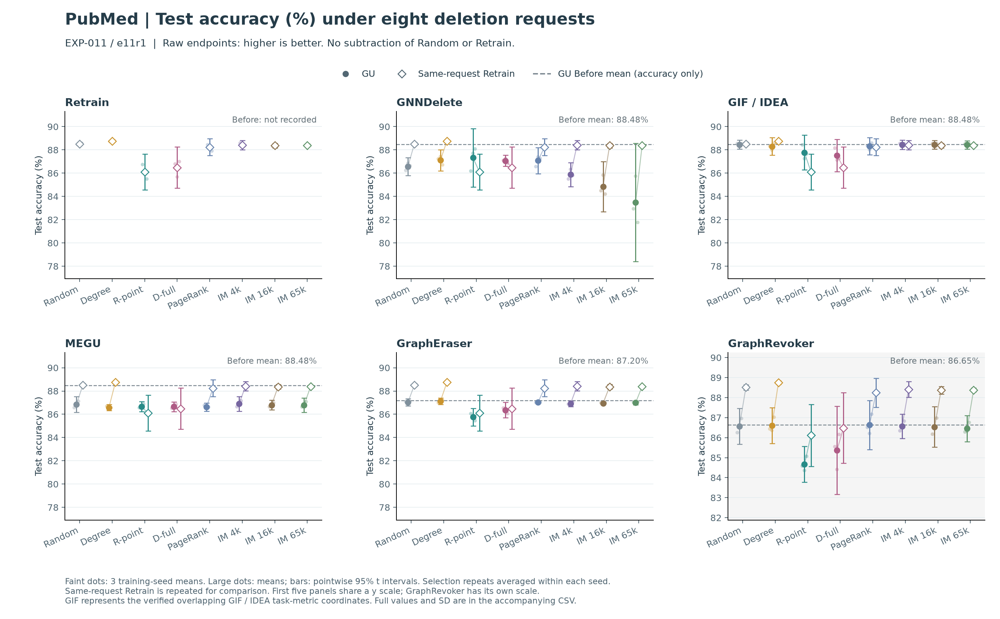

[PNG](e11r1_pubmed_accuracy.png) · [PDF](e11r1_pubmed_accuracy.pdf) · [SVG](e11r1_pubmed_accuracy.svg)

### 测试交叉熵原值

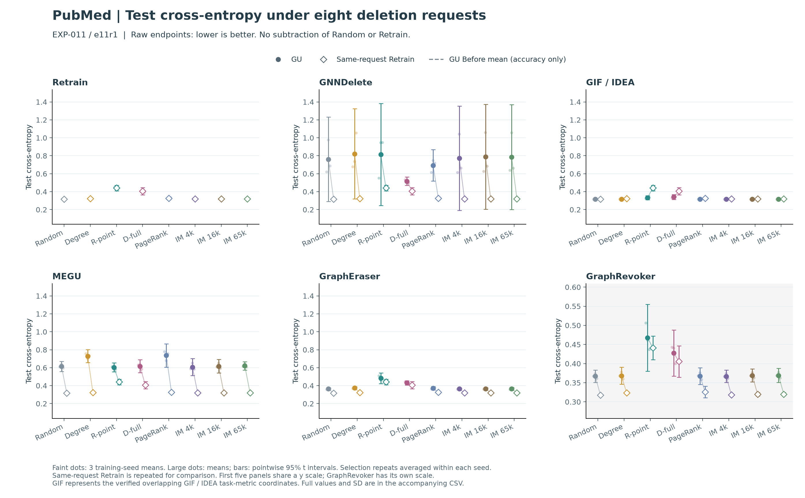

[PNG](e11r1_pubmed_ce.png) · [PDF](e11r1_pubmed_ce.pdf) · [SVG](e11r1_pubmed_ce.svg)

### 分类 macro OvR AUC 原值

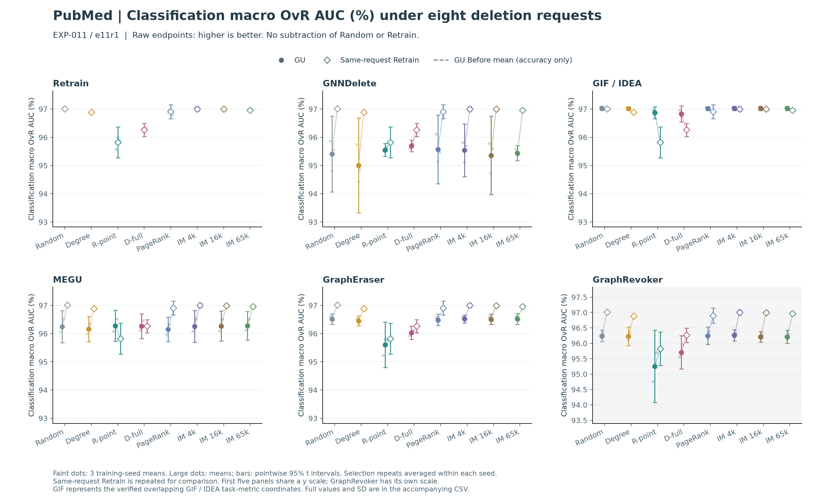

[PNG](e11r1_pubmed_auc.png) · [PDF](e11r1_pubmed_auc.pdf) · [SVG](e11r1_pubmed_auc.svg)

### Random 对照、重训差距与预测分歧

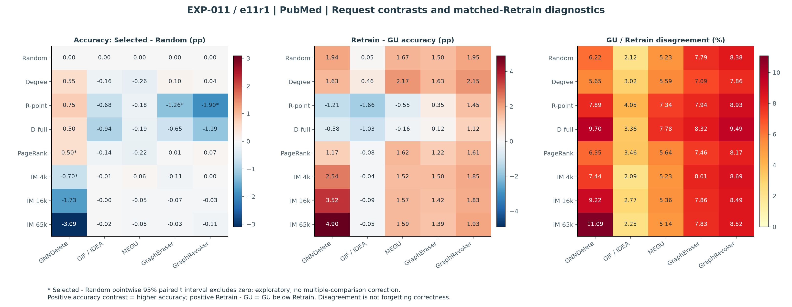

[PNG](e11r1_pubmed_contrasts.png) · [PDF](e11r1_pubmed_contrasts.pdf) · [SVG](e11r1_pubmed_contrasts.svg)

## Cora：原始效用与请求对照

GNNDelete 的大幅变化和 GraphRevoker 自身的较低 Before 需要分开理解。避免把不同 Before 或不同纵轴下的原始准确率直接压成算法优劣排名。

### 准确率原值

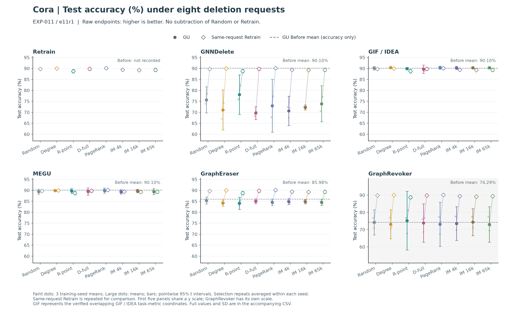

[PNG](e11r1_cora_accuracy.png) · [PDF](e11r1_cora_accuracy.pdf) · [SVG](e11r1_cora_accuracy.svg)

### 测试交叉熵原值

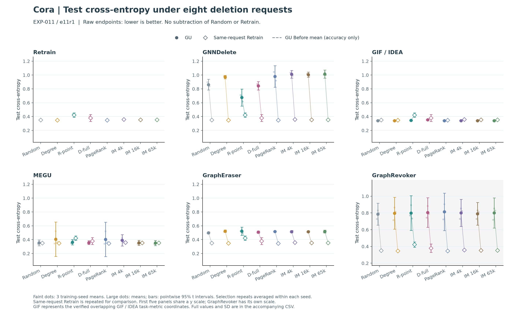

[PNG](e11r1_cora_ce.png) · [PDF](e11r1_cora_ce.pdf) · [SVG](e11r1_cora_ce.svg)

### 分类 macro OvR AUC 原值

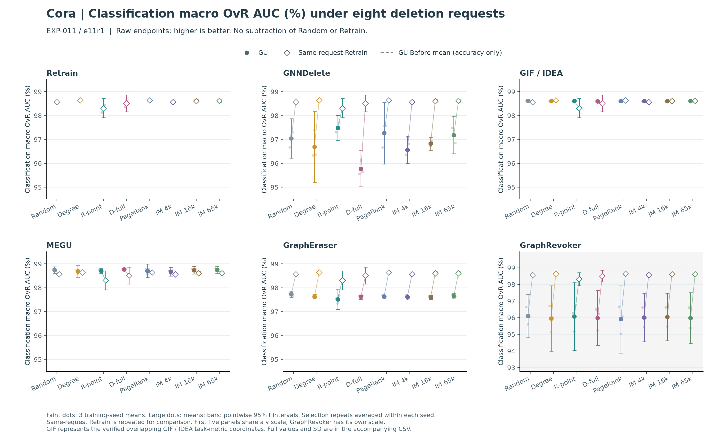

[PNG](e11r1_cora_auc.png) · [PDF](e11r1_cora_auc.pdf) · [SVG](e11r1_cora_auc.svg)

### Random 对照、重训差距与预测分歧

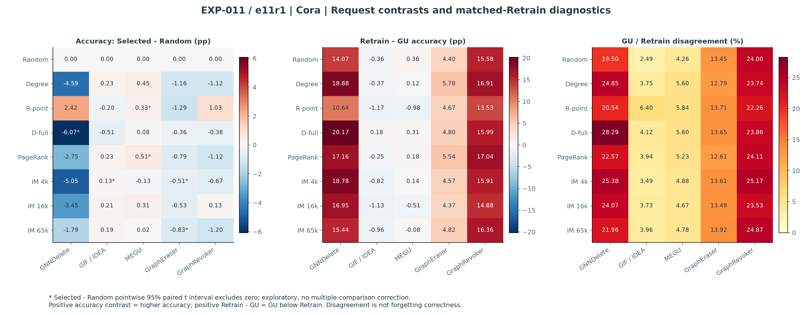

[PNG](e11r1_cora_contrasts.png) · [PDF](e11r1_cora_contrasts.pdf) · [SVG](e11r1_cora_contrasts.svg)

## CiteSeer：原始效用与请求对照

这是不能忽略的反例：GraphEraser 在 R-point / D-full 下的准确率没有呈现 PubMed 的下降方向；完整均值和配对区间见 CSV。

### 准确率原值

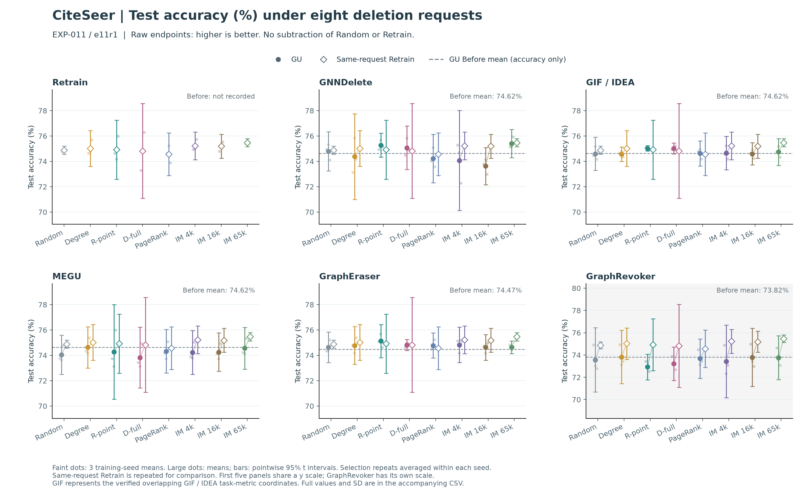

[PNG](e11r1_citeseer_accuracy.png) · [PDF](e11r1_citeseer_accuracy.pdf) · [SVG](e11r1_citeseer_accuracy.svg)

### 测试交叉熵原值

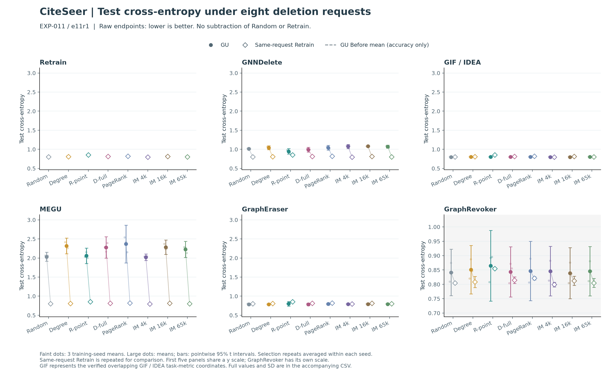

[PNG](e11r1_citeseer_ce.png) · [PDF](e11r1_citeseer_ce.pdf) · [SVG](e11r1_citeseer_ce.svg)

### 分类 macro OvR AUC 原值

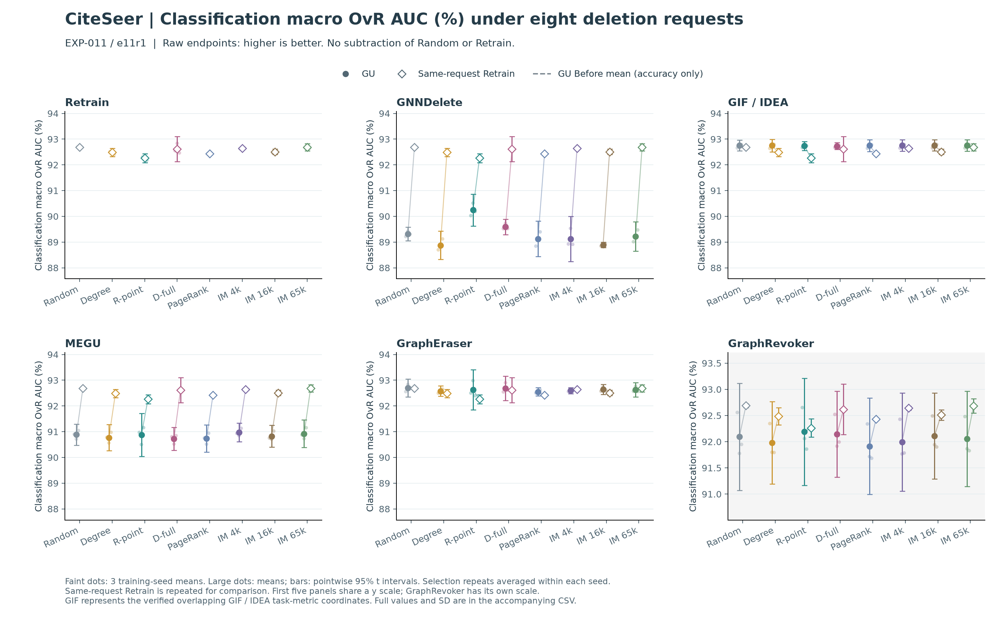

[PNG](e11r1_citeseer_auc.png) · [PDF](e11r1_citeseer_auc.pdf) · [SVG](e11r1_citeseer_auc.svg)

### Random 对照、重训差距与预测分歧

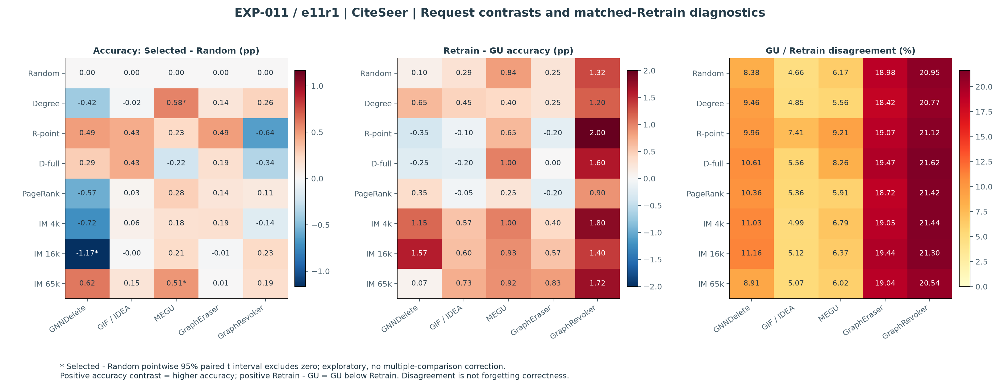

[PNG](e11r1_citeseer_contrasts.png) · [PDF](e11r1_citeseer_contrasts.pdf) · [SVG](e11r1_citeseer_contrasts.svg)

## 新旧分片协议对照

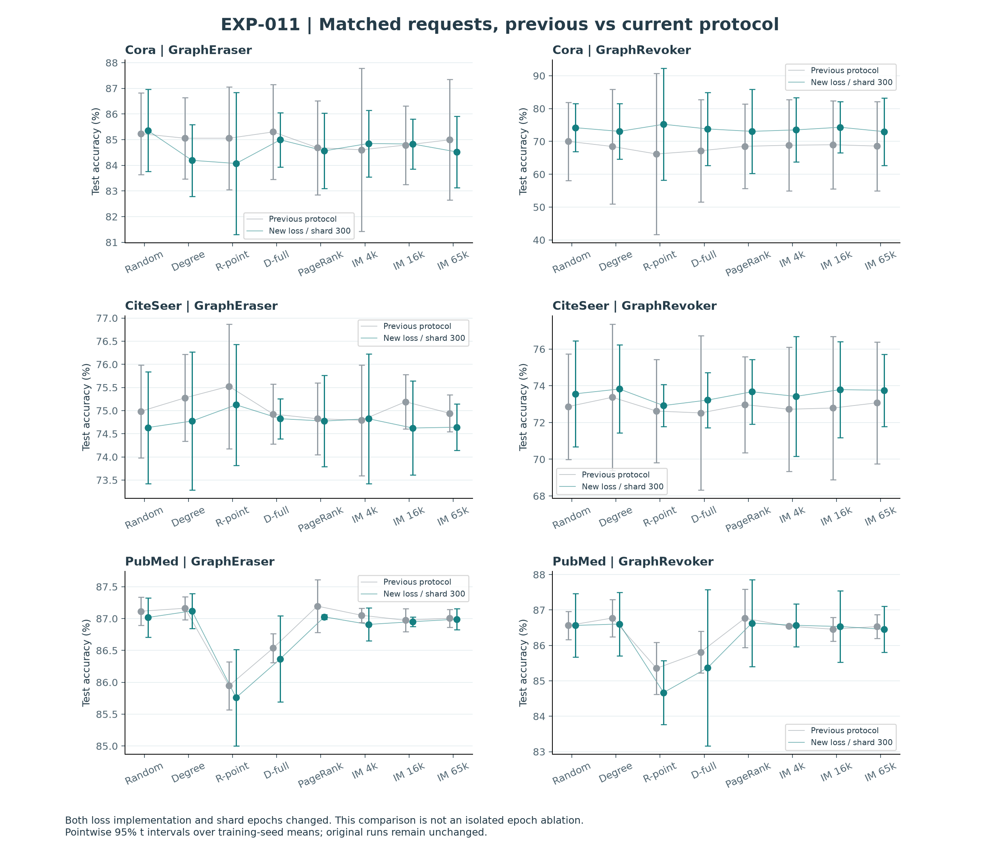

[PNG](e11r1_protocol_comparison.png) · [PDF](e11r1_protocol_comparison.pdf) · [SVG](e11r1_protocol_comparison.svg)

## 数据与验证

[逐 cell 数据](cells.csv) · [逐 seed 数据](seed_values.csv) · [摘要](summary.csv) · [配对区间](paired_vs_random.csv) · [输入核验](input_audit.json) · [图册验证](validation.json)。
