# EXP-079 / e79r6：完整分析图册

2026-10-23 · 10 个训练 seed · 新损失 / shard_epochs=300 · [重点结论](REPORT.html)

所有图绑定本次可信 run；每个训练 seed 内先平均选点重复。误差线为训练 seed 均值的点态 95% t 区间。详细限定、方法实现范围和新旧比较见重点报告。

079 有 2,520 个输出条件。原值与对照图固定 GCN 选点来源，并保留 Random、Degree；后面的响应模式图覆盖 GCN、SGC、GAT、GIN 四种选点模型。Random 每训练 seed 三次选点，推断样本量为十个训练 seed。

## PubMed：原始效用与请求对照

先看原始准确率，再区分相对 Random 的额外损伤、相对同请求 Retrain 的差距。R-point 对分片方法的效用下降最值得检查；不同方法方向并不一致。

### 准确率原值

[PNG](e79r6_pubmed_accuracy.png) · [PDF](e79r6_pubmed_accuracy.pdf) · [SVG](e79r6_pubmed_accuracy.svg)

### 测试交叉熵原值

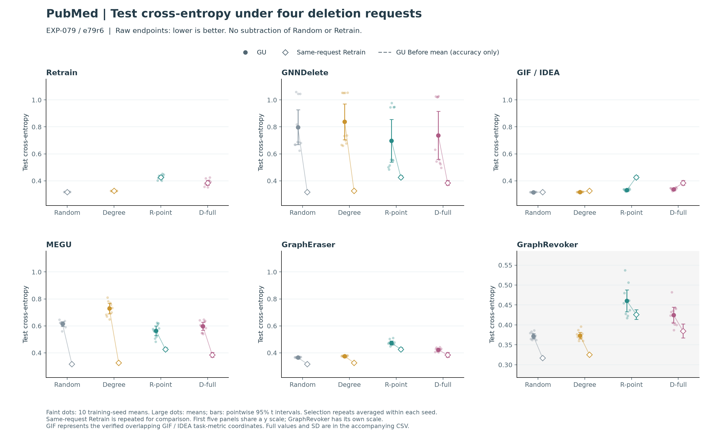

[PNG](e79r6_pubmed_ce.png) · [PDF](e79r6_pubmed_ce.pdf) · [SVG](e79r6_pubmed_ce.svg)

### 分类 macro OvR AUC 原值

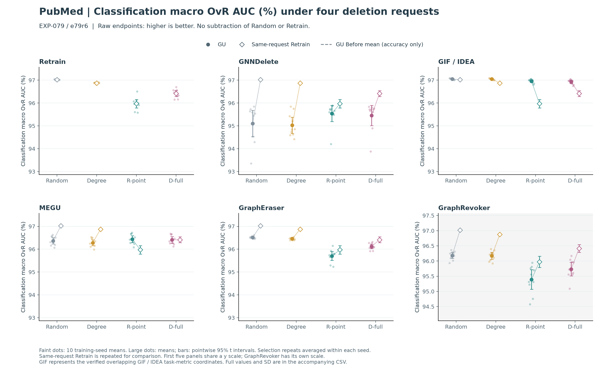

[PNG](e79r6_pubmed_auc.png) · [PDF](e79r6_pubmed_auc.pdf) · [SVG](e79r6_pubmed_auc.svg)

### Random 对照、重训差距与预测分歧

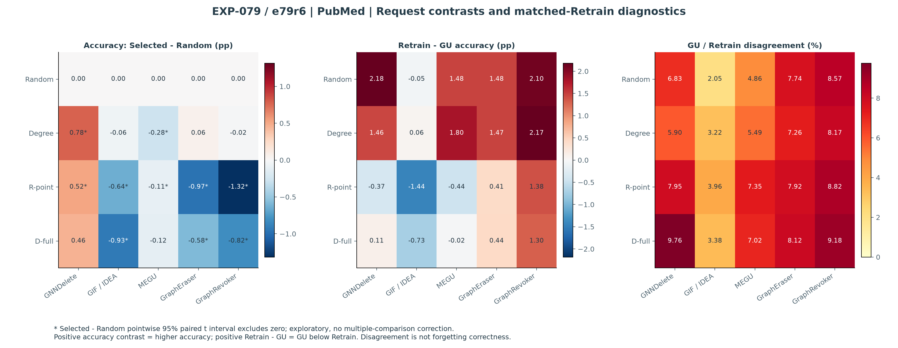

[PNG](e79r6_pubmed_contrasts.png) · [PDF](e79r6_pubmed_contrasts.pdf) · [SVG](e79r6_pubmed_contrasts.svg)

## Cora：原始效用与请求对照

GNNDelete 的大幅变化和 GraphRevoker 自身的较低 Before 需要分开理解。避免把不同 Before 或不同纵轴下的原始准确率直接压成算法优劣排名。

### 准确率原值

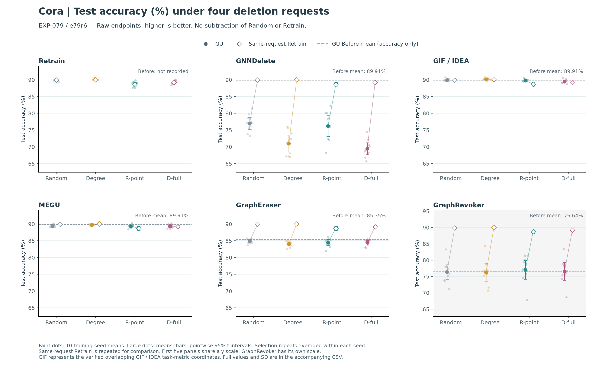

[PNG](e79r6_cora_accuracy.png) · [PDF](e79r6_cora_accuracy.pdf) · [SVG](e79r6_cora_accuracy.svg)

### 测试交叉熵原值

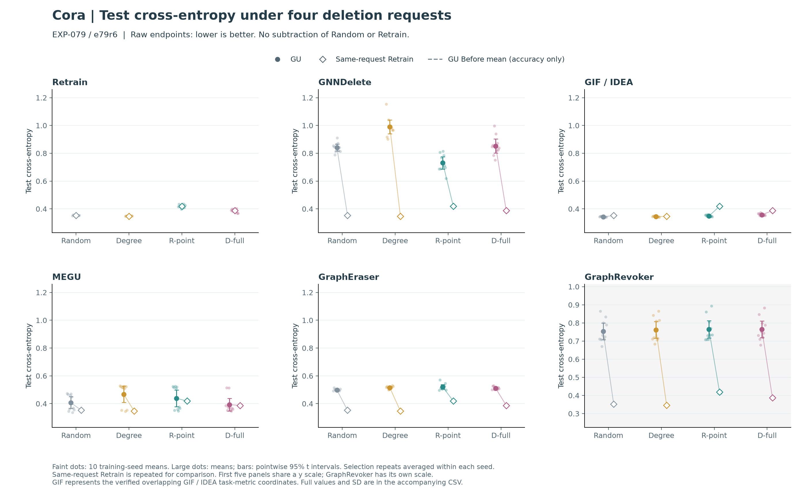

[PNG](e79r6_cora_ce.png) · [PDF](e79r6_cora_ce.pdf) · [SVG](e79r6_cora_ce.svg)

### 分类 macro OvR AUC 原值

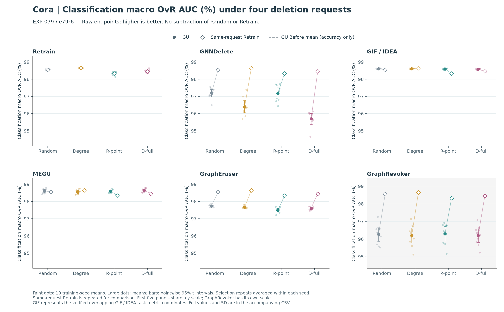

[PNG](e79r6_cora_auc.png) · [PDF](e79r6_cora_auc.pdf) · [SVG](e79r6_cora_auc.svg)

### Random 对照、重训差距与预测分歧

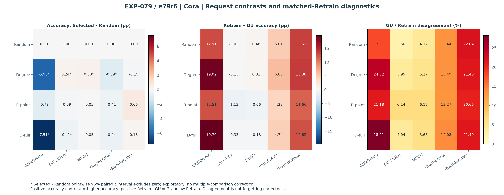

[PNG](e79r6_cora_contrasts.png) · [PDF](e79r6_cora_contrasts.pdf) · [SVG](e79r6_cora_contrasts.svg)

## CiteSeer：原始效用与请求对照

这是不能忽略的反例：GraphEraser 在 R-point / D-full 下的准确率没有呈现 PubMed 的下降方向；完整均值和配对区间见 CSV。

### 准确率原值

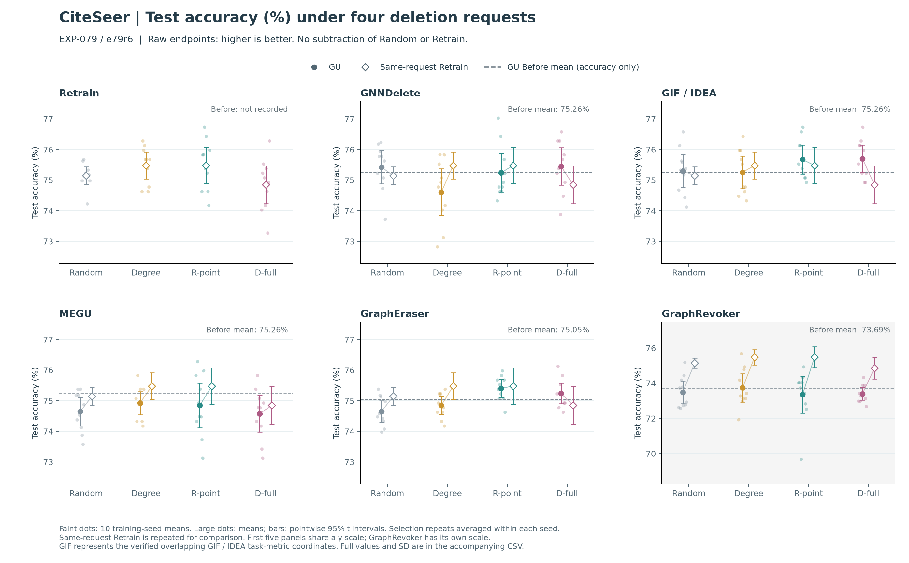

[PNG](e79r6_citeseer_accuracy.png) · [PDF](e79r6_citeseer_accuracy.pdf) · [SVG](e79r6_citeseer_accuracy.svg)

### 测试交叉熵原值

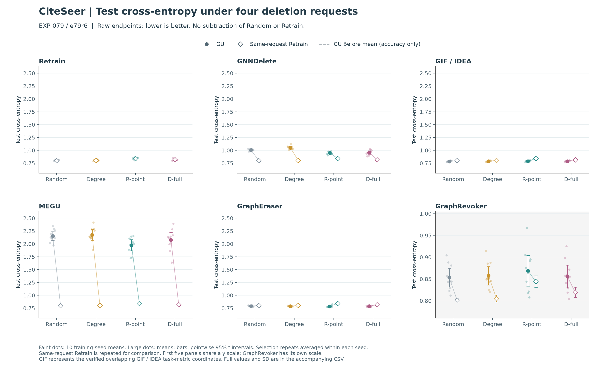

[PNG](e79r6_citeseer_ce.png) · [PDF](e79r6_citeseer_ce.pdf) · [SVG](e79r6_citeseer_ce.svg)

### 分类 macro OvR AUC 原值

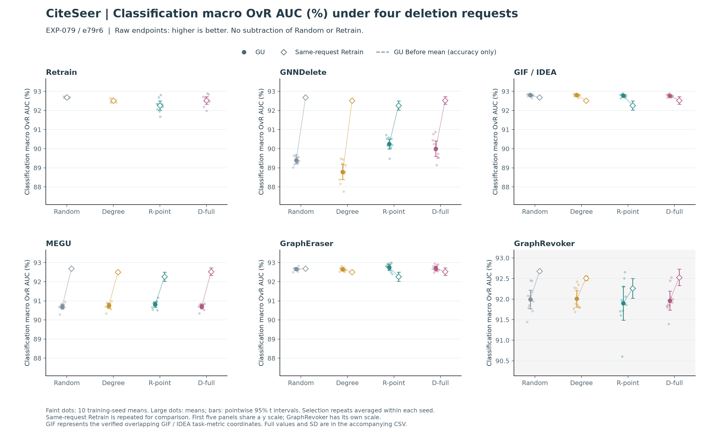

[PNG](e79r6_citeseer_auc.png) · [PDF](e79r6_citeseer_auc.pdf) · [SVG](e79r6_citeseer_auc.svg)

### Random 对照、重训差距与预测分歧

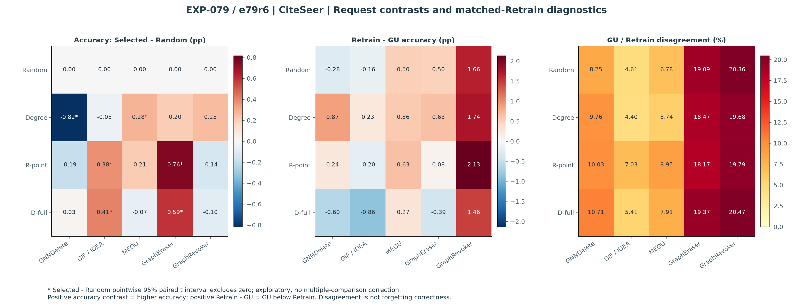

[PNG](e79r6_citeseer_contrasts.png) · [PDF](e79r6_citeseer_contrasts.pdf) · [SVG](e79r6_citeseer_contrasts.svg)

## 新旧分片协议对照

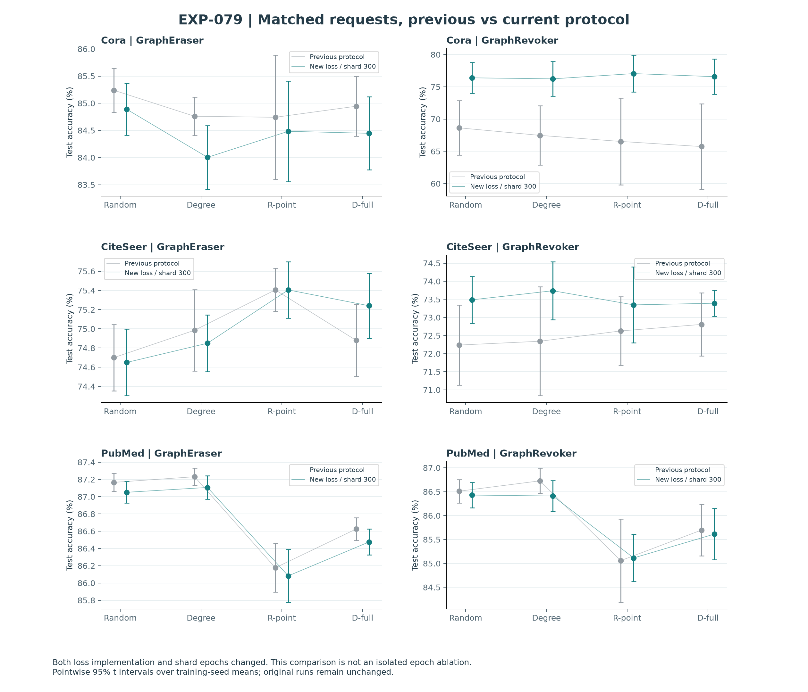

[PNG](e79r6_protocol_comparison.png) · [PDF](e79r6_protocol_comparison.pdf) · [SVG](e79r6_protocol_comparison.svg)

## 跨选点模型响应与敏感性

所有图重新从 e79r6 的十 seed 结果计算。此处 U=Before−After，G=Retrain−GU；均值区间、模式距离、Holm 检验和去掉某个 GU 的敏感性属于不同统计问题。主报告已解释目前能支持的有条件结论。

### U / G 全条件图谱

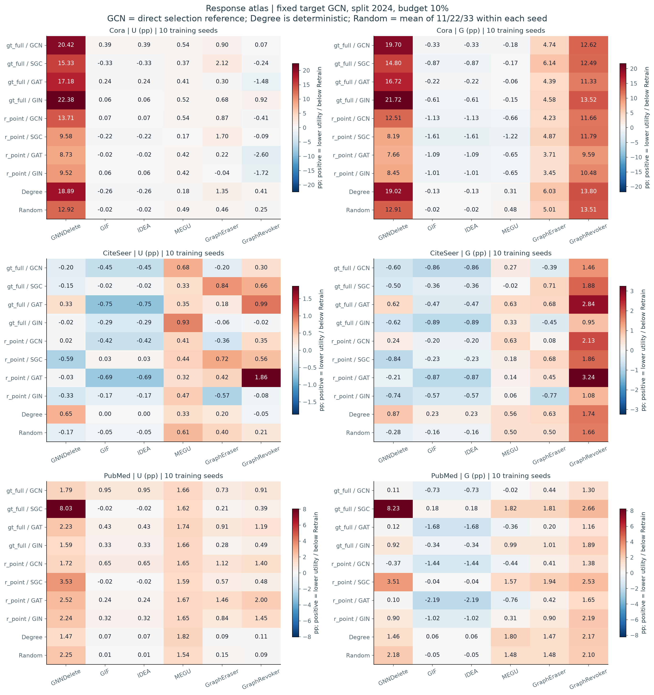

[PNG](response_atlas_U_G_10seeds.png) · [PDF](response_atlas_U_G_10seeds.pdf) · [SVG](response_atlas_U_G_10seeds.svg)

### 跨选点模型的绝对效用响应

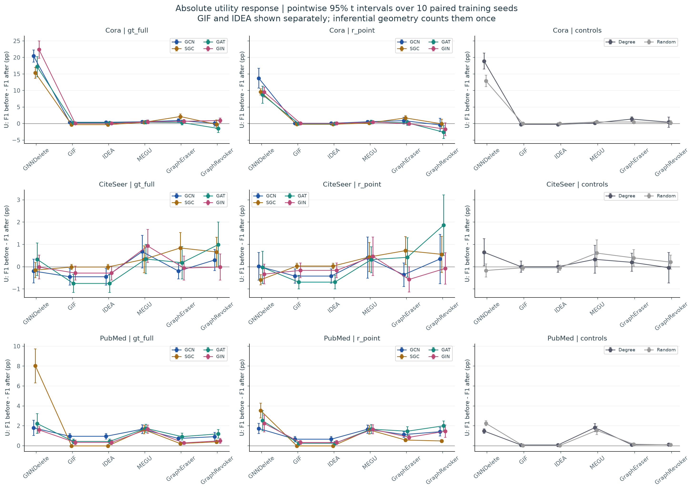

[PNG](response_profiles_U_10seeds.png) · [PDF](response_profiles_U_10seeds.pdf) · [SVG](response_profiles_U_10seeds.svg)

### 相对其他 GU 的请求选择性

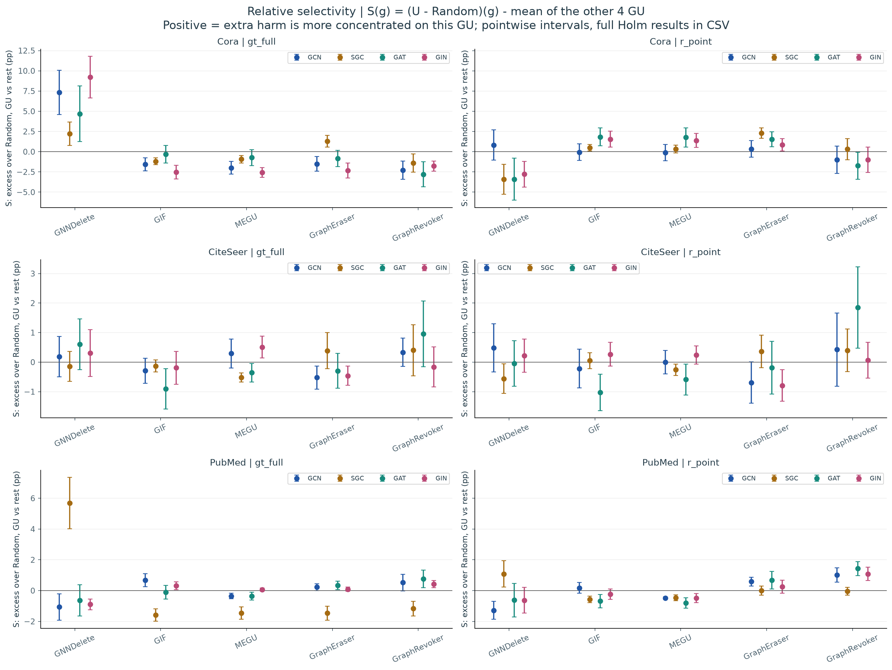

[PNG](response_selectivity_U_10seeds.png) · [PDF](response_selectivity_U_10seeds.pdf) · [SVG](response_selectivity_U_10seeds.svg)

### 中心化响应距离

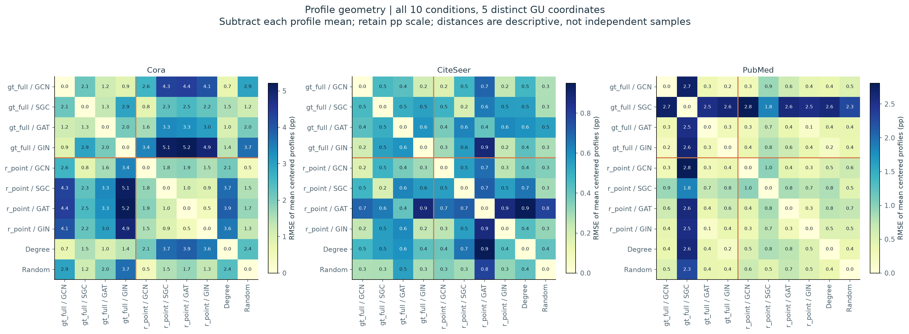

[PNG](response_distance_matrix_U_10seeds.png) · [PDF](response_distance_matrix_U_10seeds.pdf) · [SVG](response_distance_matrix_U_10seeds.svg)

### 跨来源模式的 GU 敏感性

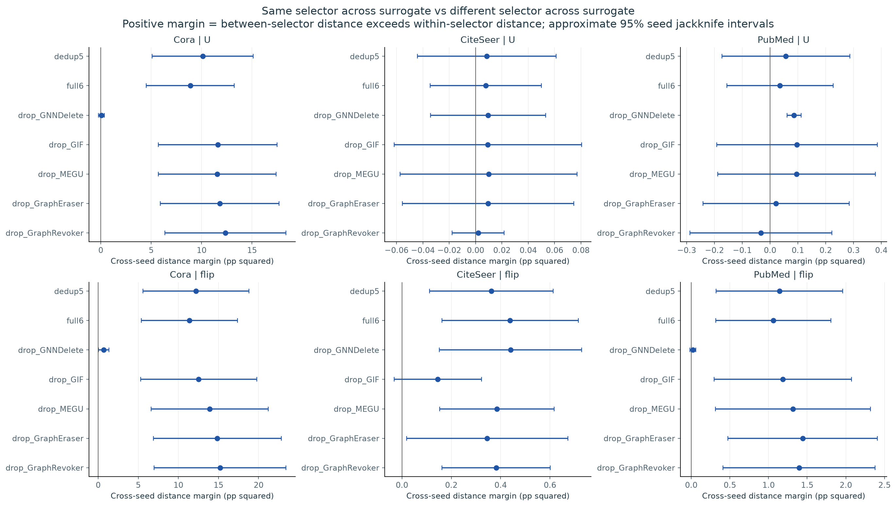

[PNG](response_margin_sensitivity_10seeds.png) · [PDF](response_margin_sensitivity_10seeds.pdf) · [SVG](response_margin_sensitivity_10seeds.svg)

### 与同请求 Retrain 的预测分歧

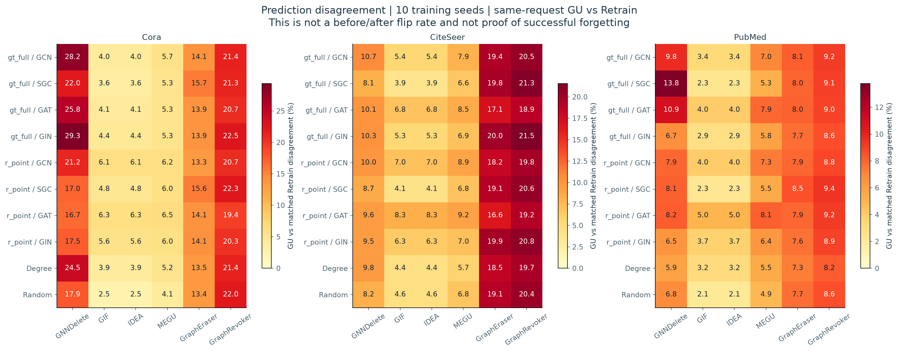

[PNG](response_disagreement_10seeds.png) · [PDF](response_disagreement_10seeds.pdf) · [SVG](response_disagreement_10seeds.svg)

[响应摘要](response_profile_summary.csv) · [选择性与 Holm 校正](response_selectivity.csv) · [方法间交互](response_GU_pair_interactions.csv) · [跨来源保持](response_interaction_preservation.csv) · [模式 margin](response_consistency_margin.csv) · [复用统计函数的身份绑定](response_generator_binding.json)。

## 数据与验证

[逐 cell 数据](cells.csv) · [逐 seed 数据](seed_values.csv) · [摘要](summary.csv) · [配对区间](paired_vs_random.csv) · [输入核验](input_audit.json) · [图册验证](validation.json)。
