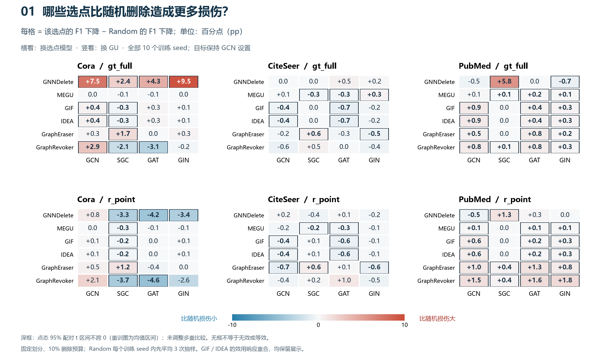
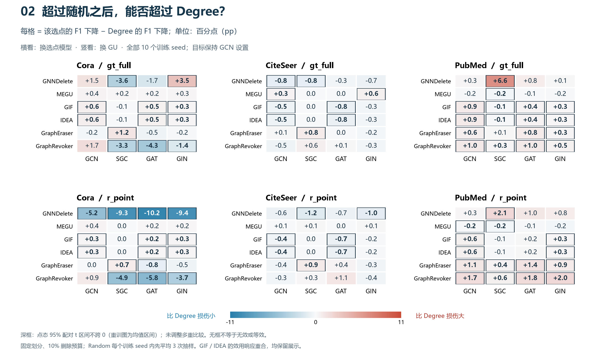
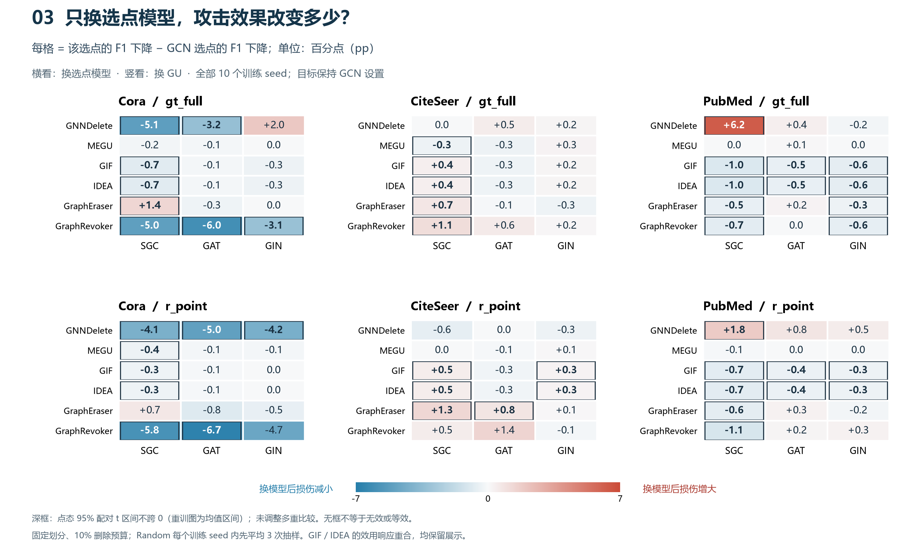
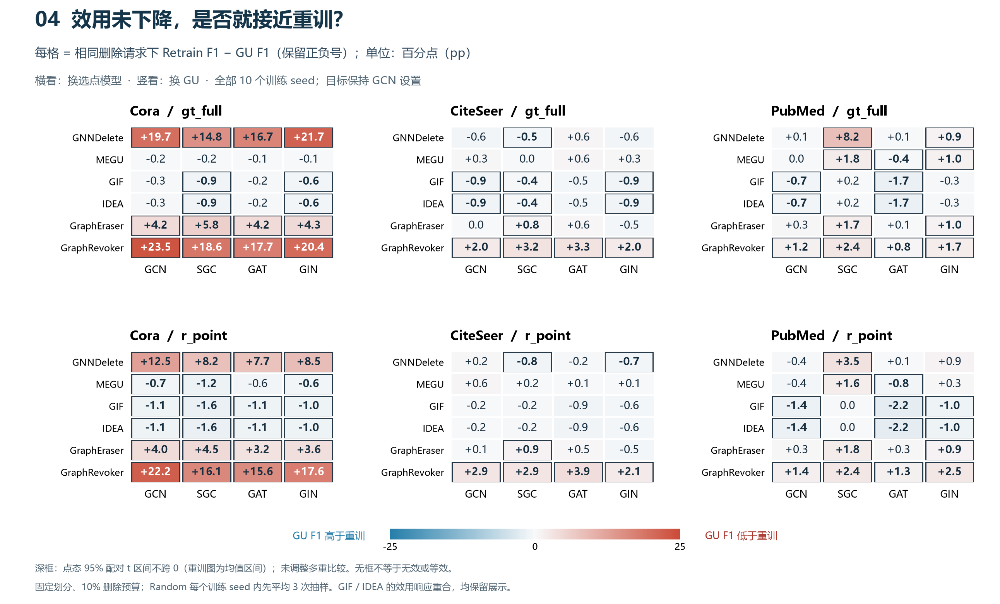

# EXP-079：以 GCN 为参照，观察条件性迁移

完整 10 个训练 seed · 3 数据集 × 2 selector × 4 选点架构 × 6 GU · 固定 split 与 10% 删除预算

**主图只回答一个问题：GCN 选点产生的攻击增益，换成其他选点模型后能否保留？** 以 GNNDelete 为具体案例，同时展示全部三个数据集、两种 selector 与四种选点模型。其他 GU 的完整矩阵在后面，用于核对适用范围。图中的每个估计都使用完整十个训练 seed，不按运行批次分组。

## 主图：GCN 参照与三个 surrogate

**先看左侧 Cora 面板的蓝柱。** 灰底的 GCN 是参照，右侧 SGC / GAT / GIN 是替换后的选点模型。纵轴是超过 Random 的额外 F1 损失，零线代表 Random，虚线是 Degree 的均值。蓝色为 gt_full，橙色为 r_point。

- **迁移正例：Cora / gt_full。** GCN 的额外损伤为 +7.51 pp；SGC、GAT、GIN 分别为 +2.42、+4.26、+9.46 pp，四个点态区间均在零上方。这个例子表明 gt_full 不依赖必须使用 GCN 选点才能产生正向攻击增益，但迁移后的强度不同，不能称等效。SGC、GAT 的损伤弱于 GCN；GIN−GCN 的配对差区间跨零，不能据均值更高宣布更强。
- **策略对照：Cora / r_point。** GCN 的正向增益本身尚未确立，三个 surrogate 均弱于 Random。因此这里展示策略差异，不把它包装为“一个已有效攻击的迁移失败”。超过 Random 的结论也不等于超过 Degree；后者看补充图及配对区间。
- **边界：PubMed 与 CiteSeer。** PubMed 的 SGC 产生正向增益，但 GCN 参照没有确立正向增益，所以应称代理架构改变了攻击结果，不计算“保留了 GCN 的多少比例”。CiteSeer 中两种 selector、四种架构的区间均跨零，未观察到清晰增益。

可用于图注的结论：**在 Cora / GNNDelete 上，gt_full 的正向攻击增益可跨选点架构保留；这种现象依赖 selector 和数据集，不能推广为所有条件下的迁移。** 这张图展示有依据的局部规律，不承担所有 GU 的总体排序结论。GNNDelete 是分析后选取的说明性案例，完整范围见下方矩阵。

**两种 selector 的准确含义。** 两者都使用 GNN 与逆 Hessian 向量积。r_point 用候选节点自身的损失梯度构造点级 IF；gt_full 进一步用删除前受影响节点的损失梯度与移除候选节点关联边后的邻域损失梯度之差构造影响源。r_point 仍然通过 GNN 使用图结构，因此应区分“是否显式计入删除的邻域影响”，不能称“无图方法与有图方法”。实现见[点级 IF](../../../../../experiments/target_direct_v1/methods.py)与[图删除影响源](../../../../../experiments/c_target_v1/core.py)。当前结果不单独证明邻域项是迁移成功的因果机制。

[主图 PDF](transfer_focus_10seeds.pdf) · [主图 SVG](transfer_focus_10seeds.svg) · [主图全部数值与配对区间](transfer_focus_10seeds.csv) · [主图生成器](transfer_focus.py)

## 补充：全部 GU 的检测矩阵

以下六个面板覆盖全部数据集与 selector，每格为十 seed 均值。横着看选点架构，竖着看 GU；目标保持 GCN 设置。

## 1. 哪些选点造成了超过随机删除的损伤？

**最简单的读法：先选一个面板，再横着看一行。** 例如 Cora / gt_full 的 GNNDelete 行，四个数分别回答四种选点模型比随机删除多造成多少 F1 损失。红色为更多损伤，蓝色为更少损伤，接近白色为均值差较小。深框表示点态 95% 配对区间不跨零；无框表示方向尚不明确，不能据此宣布无效。

横向比较反映 selector 对选点架构的敏感性；纵向比较反映不同 GU 在这些请求下的响应。这里测的是**相对随机的额外损伤**，蓝色不意味着模型没有损伤，也不意味着 GU 已经实现正确遗忘。

- **同一个 GU，两种 selector 的表现可以相反。** 看 Cora 的 GNNDelete 行：gt_full 的四种选点架构均比 Random 造成更多损伤；r_point 的 SGC、GAT、GIN 均比 Random 造成更少损伤。GIN 分别为 **+9.46** 与 **-3.39 pp**，两者区间均不跨零。
- **同一个 selector，不同代理架构可能给出不同攻击结果。** 看 PubMed / gt_full 的 GNNDelete 行：SGC 比 Random 多 **+5.78 pp**，GIN 为 **-0.66 pp**，两者区间均不跨零。
- **也保留未观察到清晰增益的条件。** CiteSeer 的 GNNDelete 在两种 selector、四种选点架构下，相对 Random 的区间全部跨零。这是当前设置中的不确定结果，不证明这些攻击在其他设置中无效。

## 2. 相对 Degree，结论是否仍然成立？

读法和图 1 相同，只更换参照。Cora / gt_full / GNNDelete 的 GIN 比 Degree 多 **+3.49 pp**；SGC 和 GAT 的均值低于 Degree。因此“超过 Random”不能直接升级成“超过简单结构选点”。

## 3. 改变选点模型，是否改变攻击评估？

每格都与**相同数据集、selector、GU 和训练 seed 下的 GCN 选点**配对。红色表示换模型后损伤增加，蓝色表示减少；只显示三个 surrogate，因为 GCN 与自身的差恒为零。这里的正负只表示相对 GCN 选点的变化，不代表已经超过 Random 或 Degree。

例如 Cora / r_point / GNNDelete，GIN 相对 GCN 的损伤变化为 **-4.19 pp**；PubMed / gt_full / GNNDelete，SGC 相对 GCN 为 **+6.24 pp**。这张图直接呈现差异大小与配对不确定性，不要求读者先理解跨 GU 排序相关。

## 4. GU 的效用响应与重训偏离要同时看

红色表示 GU 的 F1 低于同一请求的 Retrain，蓝色表示高于 Retrain。该差距保留正负号；**负值不是更正确的遗忘，接近零也只表示 F1 接近，并不保证逐节点预测一致。** 这张图不是相对 Random 的增益图。

Cora / gt_full / GIN 的 GraphRevoker，相对 Random 的效用损伤增量为 **-0.23 pp**，但与同请求 Retrain 的 F1 差距为 **+20.37 pp**。因此，主图颜色浅或偏蓝不能单独作为 GU 防御成功的证据。

## 如何用于论文

主图采用开头的 GCN 参照柱状图，以 GNNDelete 为案例说明可迁移的正例、selector 对照与数据集边界。四张完整矩阵作为补充：相对 Random 的攻击增益、Degree 对照、相对 GCN 的配对变化、GU 与重训的差距。单独的 Cora / r_point 散点图仅作进一步诊断。

这一检测框架同时评价攻击选点与 GU 响应，不要求每种攻击都有效。候选发现是：攻击增益及其对代理架构的依赖随数据集、selector 和 GU 而变化。各图中的正例、负例和不确定结果都属于研究结果。当前区间为探索性点态区间；不把某个格子的区间当成全矩阵确认性结论，不据此宣布普遍防御能力或机制。

目标说明：GraphEraser / GraphRevoker 是 GCN shard ensemble；GCN 选点是 full-graph 参考，并不等同于这两个 ensemble 的严格白盒攻击。所有效果仅覆盖本次预算、划分、参数和请求集合。

## 数据与复现

- [全部 576 项图中数值、区间与 seed 正值计数](diagnostic_atlas_10seeds.csv) · [完整分析](REPORT.html) · [完整分析源](REPORT.md)
- [配对 seed 数据](paired_seed_values.csv) · [生成器](overview.py) · [核验记录](overview_verification.json)
- 图 1：[PDF](diagnostic_random_10seeds.pdf) · [SVG](diagnostic_random_10seeds.svg)
- 图 2：[PDF](diagnostic_degree_10seeds.pdf) · [SVG](diagnostic_degree_10seeds.svg)
- 图 3：[PDF](diagnostic_source_10seeds.pdf) · [SVG](diagnostic_source_10seeds.svg)
- 图 4：[PDF](diagnostic_retrain_10seeds.pdf) · [SVG](diagnostic_retrain_10seeds.svg)

从仓库根运行：`python -B -X utf8 self/research/analyses/EXP-079/e79r5/overview.py`。逐项从 paired_seed_values.csv 重算，并与 summary.csv 的 all10 结果交叉核对。没有新增 GPU 运行或改变科学接受状态。
