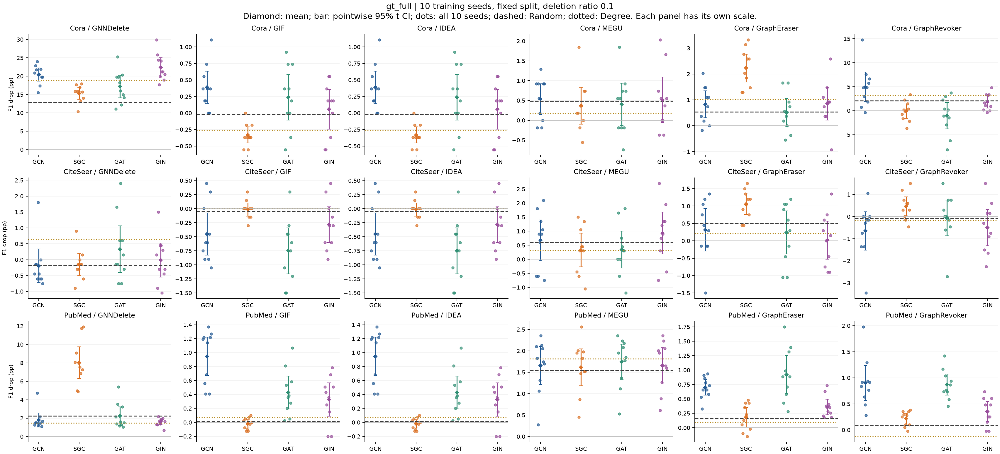
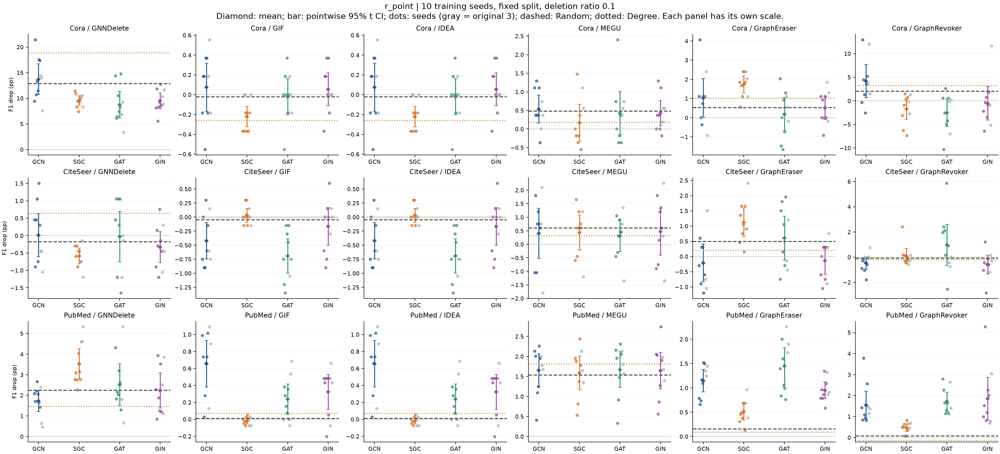
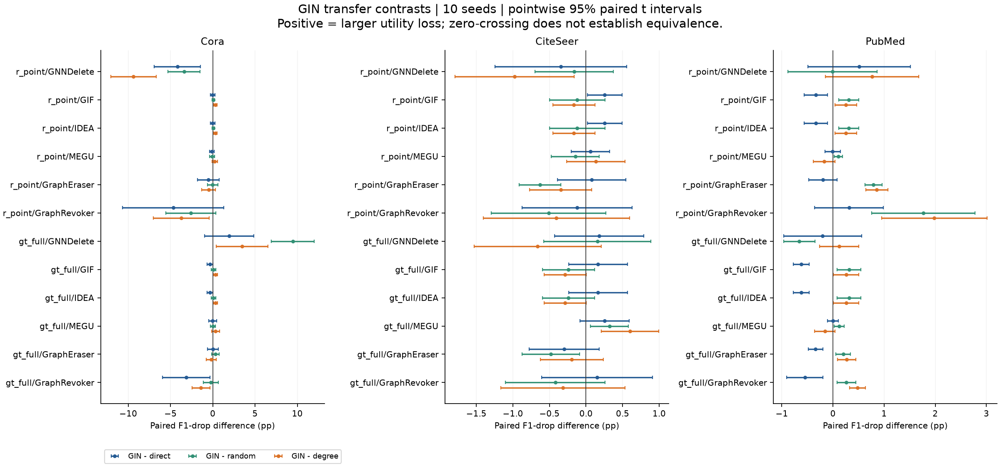
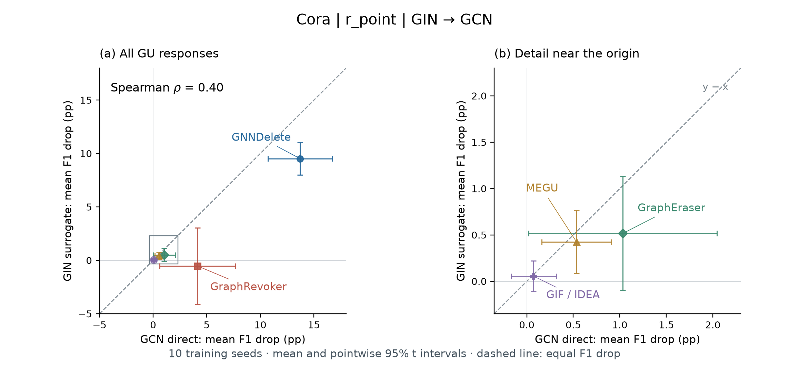

# EXP-079：十 seed 的 selector 与 GU 响应检测

2026-10-14 · e79r5 · 完整 2520 格 · 分析完成，科学结论待用户审阅

**[迁移规律偏窄的后续诊断与改进优先级](DIAGNOSIS_REPORT.html)** · [诊断 Markdown](DIAGNOSIS_REPORT.md)。已补查原始交叉熵、AUC、GCN 参照有效性和执行版本中的数值/删除契约；局部迁移结果不升级为普遍结论。

## 先看迁移案例：GCN 选点的攻击增益能否保留？

**主展示统一使用全部 10 个训练 seed。** 以下选择 GNNDelete 为说明性案例，同时保留三个数据集、两种 selector、四种选点架构。GCN 是明确的参照组；替换 SGC / GAT / GIN 时，目标仍保持 GNNDelete / GCN。全部六种 GU 的矩阵保留在图解的补充部分。

柱高为相对 Random 的额外 F1 损失，误差棒为十 seed 配对差的点态 95% t 区间，未作多重比较调整。蓝色为 gt_full，橙色为 r_point；灰底 GCN 是参照，零线为 Random，虚线仅表示 Degree 均值。Cora / gt_full 从 GCN 到三个 surrogate 都保持正向增益，构成条件性迁移正例；Cora / r_point 的 GCN 增益尚未确立，不能称已有效攻击的迁移失败。

- **同一个 GU，两种 selector 的表现可以相反。** 看 Cora 的 GNNDelete 行：gt_full 的四种选点架构均比 Random 造成更多损伤；r_point 的 SGC、GAT、GIN 均比 Random 造成更少损伤。GIN 分别为 **+9.46** 与 **-3.39 pp**，两者区间均不跨零。
- **同一个 selector，不同代理架构可能给出不同攻击结果。** 看 PubMed / gt_full 的 GNNDelete 行：SGC 比 Random 多 **+5.78 pp**，GIN 为 **-0.66 pp**，两者区间均不跨零。
- **也保留未观察到清晰增益的条件。** CiteSeer 的 GNNDelete 在两种 selector、四种选点架构下，相对 Random 的区间全部跨零。这是当前设置中的不确定结果，不证明这些攻击在其他设置中无效。

**[打开迁移主图与完整补充矩阵](OVERVIEW_REPORT.html)** · [图解 Markdown](OVERVIEW_REPORT.md)：包含两种 IF selector 的具体区别、GCN 参照、Degree 对照、更换选点架构后的配对变化与同请求 Retrain 差距。效用损伤小并不自动证明 GU 防御成功；结合重训对照解释。

## 详细结论与复现核验

**十 seed 矩阵同时包含攻击增益、相对基线更弱以及方向不确定的结果；这些结果共同用于检测 selector 的架构依赖和 GU 的条件性响应。** 历史三 seed 与新增七 seed 的拆分仅用于复现核验，不作为论文图表的比较轴或叙事顺序；没有按结果删 seed 或只挑有利方法。

- 核心正例：十 seed 的 GIN 平均 F1 drop 为 **22.38 pp**，GCN direct 为 **20.42 pp**，Random 为 **12.92 pp**，Degree 为 **18.89 pp**。GIN−Random 的配对差为 **9.46 pp，95% CI [6.91, 12.02]**。新增七 seed 全部高于 Random，十 seed 为 10/10。
- Degree 优势比原探索更清晰，但有限：十 seed GIN−Degree 为 **3.49 pp [0.43, 6.54]**，7/10 seed 为正；新增七 seed 为 5/7。这里是未经多重比较调整的点态区间，不称全矩阵确认性显著优势。
- 迁移幅度仍有不确定性：GIN−direct 为 **1.96 pp [-0.95, 4.86]**，逐 seed 配对 MAE **3.51 pp**。均值接近、区间跨零都不证明统计等效。
- 明确反例：Cora / GNNDelete / r_point 的 GIN drop 仅 9.52 pp，比 direct 少 4.19 pp、比 Random 少 3.39 pp；新增七 seed 无一胜 Random。PubMed / GNNDelete / gt_full 的 GIN−Random 为 −0.66 pp，十 seed 全部为负。
- 不能一概优选 GIN：PubMed / GNNDelete / gt_full 的 SGC drop 为 **8.03 pp**，高于 GCN 的 1.79、GIN 的 1.59、Random 的 2.25。新增七 seed 中 SGC−Random 为 **4.74 pp [3.38, 6.11]**，也保持正向优势。更强的损伤与更忠实地匹配 direct 响应是不同目标。
- 相关性的旧结论需要收窄：Cora / r_point 的 GIN 跨 GU 排序相关从原三 seed 的 1.00 降到新增七 seed 的 0.30、合计十 seed 的 0.40；Cora / gt_full 仍为 1.00，但 Random、Degree 也都是 1.00。相关不能独立证明代理选点有价值。

## 1. 证据范围与可信链

主输入：job `exp079-20261013-e79r5`；run `e79r5`；执行 SHA `e02b5fa40ebce66fb45e57ea23b8d6c8d7856685`；配置 `experiments/configs/exp079/surrogate_multiseed.yaml`。

3 个数据集 × 10 个训练 seed × 12 个选点条件 × 7 个方法 = **2520 格**。12 个条件为两种算法×四种选点架构、Degree 和 Random 三次抽样。六种 GU 共 2160 格，Retrain 共 360 格。目标为 GCN；GraphEraser/GraphRevoker 是 GCN shard ensemble，图中 GCN 是 full-graph 参考，不等同于 ensemble 的严格白盒选点。

已消费 SyncMate accepted 回执，重新核对 **5041/5041** 本地文件 SHA-256 与可信索引，逐格检查 Selection、Output、相同 seed/选集的 Retrain 配对、数值有限性和矩阵覆盖。原 EXP-013 的 756 格也重新检查本地哈希，按科学条件对齐后，Selection / Output ID 及 F1 drop、retrain gap 一致；可复用旧证据。旧执行 SHA 为 `62926d95b843af137076eb9dd0a15e1c54c75663`。不同版本生成/消费来源保留在原 run 中，不把缓存结果称为本次全部重新训练。

运行于北京时间 2026-10-13 20:37:32 至 2026-10-14 02:27:31，完整 Runner 作业 **20999 秒（5:49:59）**。这是 r5 本轮耗时，历史失败和 Gate 不计入这一个数；不能把它当成从零完成整个研究的成本。有效范围仅固定 split、预算 0.1 与本次参数配置。

## 2. 统计口径

F1 drop U = 100×(F1_before−F1_after)，正值表示下降；所有差值单位为百分点 pp。G = 100×(F1_retrain−F1_GU)，保留正负号；flip 为相同请求 GU 与 Retrain 在 retained test 节点上的预测不一致比例，**不是相对原模型的翻转率**。

同一训练 seed 内先平均 Random 的三个抽样，再计算 surrogate−direct / Random / Degree；有效训练重复数是 3、7 或 10。均值区间用双侧 t 区间，配对差用逐 seed 差值构造；依赖 seed 重复的模型假设，全部是探索性点态区间。没有事先冻结确认性主对比、等效阈值或多重比较方案，因此本报告不事后制造确认性接受门槛。原始值、SD、配对差、胜出 seed 数和 MAE 均保存。

固定 dataset、算法，先跨 seed 求每个 GU 的均值，再沿 GU 计算 Spearman；GIF/IDEA 的 360 对 U 完全相同，因此相关主表保留 GIF、去掉 IDEA，只比较五种固定 GU。六方法原始表全保留，不能把重复响应计作两个独立证据。相关区间按 seed 整块重采样 2000 次，保持全部 GU 的配对关系；它刻画训练重复不确定性，不将五个 GU 当作随机方法总体。全部 54 项相关的未定义重采样次数为 0。三 seed bootstrap 尤其离散，仅作诊断。

## 3. 原三 seed 的核心正例是否复现

Cora / GNNDelete / gt_full，表内 drop 为均值；差值同时给点态 95% 配对区间。

| seed组 | GIN drop | GCN drop | Random drop | Degree drop | GIN−Random 95% CI | GIN−Degree 95% CI |
| --- | --- | --- | --- | --- | --- | --- |
| old3 | 20.234 | 20.480 | 11.501 | 19.004 | 8.73 [1.21, 16.26] | 1.23 [-7.02, 9.48] |
| new7 | 23.300 | 20.401 | 13.521 | 18.846 | 9.78 [6.12, 13.43] | 4.45 [0.31, 8.60] |
| all10 | 22.380 | 20.424 | 12.915 | 18.893 | 9.46 [6.91, 12.02] | 3.49 [0.43, 6.54] |

新增七 seed 的正例方向与旧三 seed 一致；其中 Degree 优势的区间也移至零上方。仍需保留 seed 波动：GIN−direct 的均值差有正负抵消，MAE 更大，不能据区间跨零宣布等效。

沿用此前尺度提案，仅作附加诊断：X=direct−Random，Y=GIN−Random，R=mean(Y)/mean(X)。本例 X 的均值为 7.51 pp，95% CI [4.80, 10.21]；R=1.260，Fieller 区间 [0.895, 1.892]。它表示均值上的额外损伤保留比例，允许大于 1，不能代替等效检验。其他条件若 X 区间下界不大于零，则标记“参照增益未确立”，不解释比值、不加 epsilon；完整诊断见 summary.csv。这一口径此前仅为草案，未冒充预注册主指标。

## 4. 全范围效果与失败条件

先以 GNNDelete / gt_full 展示四个选点架构的十 seed 平均 drop，避免把 GIN 正例误读成全局最优代理：

| dataset | GCN | SGC | GAT | GIN | U_random | U_degree |
| --- | --- | --- | --- | --- | --- | --- |
| CiteSeer | -0.195 | -0.150 | 0.330 | -0.015 | -0.170 | 0.646 |
| Cora | 20.424 | 15.332 | 17.177 | 22.380 | 12.915 | 18.893 |
| PubMed | 1.790 | 8.030 | 2.226 | 1.590 | 2.246 | 1.471 |

以下两张图覆盖四种选点架构、六 GU、三数据集；每个分面使用自己的纵轴，避免大幅 drop 掩盖小幅变化。散点为全部十个训练 seed，不按运行先后区分颜色；菱形为十 seed 均值，误差线为点态 95% 均值区间，虚线为 Random，点线为 Degree。

GIN 的完整配对图把三种参照分开；右侧意味着损伤大于该参照。

PubMed / GraphEraser / r_point 的 GIN−Random 为 0.79 pp [0.63, 0.96]、GIN−Degree 为 0.86 pp [0.64, 1.07]，新增七 seed 仍同向且区间在零上方。PubMed / GraphRevoker / r_point 也保留正向的基线优势。它们补充条件性正例，但量级与 Cora / GNNDelete 的 22.38 pp 差异很大。CiteSeer 大多数 GIN 条件 drop 很小或为负；不能将有符号负 drop 称作攻击损伤。

下表只用于全范围扫描：每个 source 有 3×6×2=36 个条件，包含 GIF/IDEA 重复响应，不是独立成功次数；区间计数未经多重比较修正，不作为显著性发现数量。

| 组 | source | 条件数 | 均值胜Random | Random区间下界>0 | 均值胜Degree | Degree区间下界>0 |
| --- | --- | --- | --- | --- | --- | --- |
| new7 | GAT | 36 | 23 | 8 | 18 | 11 |
| new7 | GIN | 36 | 19 | 10 | 19 | 11 |
| new7 | SGC | 36 | 19 | 9 | 18 | 9 |
| all10 | GAT | 36 | 21 | 11 | 21 | 10 |
| all10 | GIN | 36 | 19 | 12 | 19 | 14 |
| all10 | SGC | 36 | 20 | 11 | 18 | 9 |

## 5. 跨 GU 响应关系是否稳定

GIN 表如下，完整 SGC/GAT/GIN 的 54 行见 correlations.csv。old3/new7/all10 是不同 seed 组的原始 drop 相关，右侧为十 seed 的简单基线相关和 seed bootstrap 百分位区间。

| dataset | selector | old3 | new7 | all10 | rho_random | rho_degree | bootstrap_lo | bootstrap_hi |
| --- | --- | --- | --- | --- | --- | --- | --- | --- |
| CiteSeer | gt_full | 0.900 | 0.900 | 1.000 | 0.700 | 0.700 | 0.300 | 1.000 |
| CiteSeer | r_point | 0.400 | 0.667 | 0.700 | 0.400 | 0.900 | -0.159 | 0.975 |
| Cora | gt_full | 1.000 | 1.000 | 1.000 | 1.000 | 1.000 | 0.700 | 1.000 |
| Cora | r_point | 1.000 | 0.300 | 0.400 | 1.000 | 1.000 | 0.100 | 1.000 |
| PubMed | gt_full | 0.900 | 0.667 | 0.500 | 0.600 | 0.600 | 0.500 | 1.000 |
| PubMed | r_point | 0.300 | 1.000 | 0.900 | 0.900 | 0.600 | 0.500 | 1.000 |

### 补充诊断：Cora / r_point，全部十 seed

此图仅用于单个条件的补充诊断；主展示采用报告开头的十 seed GCN 参照柱状图，完整矩阵用于核对范围。横轴为 GCN direct 的平均 F1 drop，纵轴为 GIN surrogate 的平均 F1 drop；一个点对应一种 GU 的平均响应。GIF/IDEA 的响应完全重合，合并标注并仅计一次排序相关。误差棒分别表示两侧均值的点态 95% t 区间；右图放大左图框出的近原点区域，没有删去负值或小效应。

虚线 y=x 表示两侧的平均效用损伤相同，点在虚线下方意味着 GIN 的平均损伤较小。Cora / r_point 的 GNNDelete 为 13.71 vs 9.52 pp，GraphRevoker 为 4.15 vs −0.54 pp；其余 GU 的效应较小，见右侧放大图。图中直接呈现损伤幅度与不确定性，Spearman rho=0.40 作为辅助描述，不绘制拟合直线、不将 seed 编号当比较轴。

rho 的 seed 整块 bootstrap 区间为 [0.10, 1.00]，说明跨 GU 排序关系仍不确定。单侧均值误差棒不等于配对差的区间；是否接近 direct、是否超过 Random/Degree，仍须结合前面的逐 seed 配对差。不能只凭 rho 判断代理选点的攻击价值。

图注建议：**GCN direct 与 GIN surrogate 在 Cora/r_point 下的跨 GU 效用响应。** 点和误差棒为十个训练 seed 的均值及点态 95% t 区间；虚线表示相同 F1 drop。右图为近原点区域的放大。GIF 和 IDEA 的响应重合；相关系数在五个不同 GU 响应上计算。

[图中数值](cora_r_point_transfer_10seeds.csv) · [SVG](cora_r_point_transfer_10seeds.svg) · [PDF](cora_r_point_transfer_10seeds.pdf)。三/七 seed 的独立核验保留在分析记录中，不作为论文主图的分组或叙事顺序。

稳定的例子是 Cora / gt_full：旧三 seed 与新增七 seed 的 GIN 排序相关均为 1.00。反例是 Cora / r_point：原本 1.00 的关系没有稳定复现。CiteSeer / r_point 的 GAT 从旧三 seed 0.80 变为新增七 seed −0.30，也说明代理架构不能一概替换。PubMed / r_point 的 GIN 从旧三 seed 0.30 升至新增七 seed 1.00，展示旧小样本结果的不稳定。十 seed 的 PubMed / r_point 为 0.90，Random 同为 0.90。

共同减去 Random 的相关另存 CSV，仅用于诊断，因为两侧共享参照项；不能将其解释成攻击特有的因果关系。也不能将“跨 GU 相关”写成“某个固定 GU 内跨攻击条件相关”。

## 6. 选点层：有重叠，但没有相同选集

同 seed surrogate 与 GCN 选集的平均 Jaccard（交集/并集），与 GCN 自身跨 seed 的平均 Jaccard 并列；后者 45 对共享 seed，仅作描述，不能当 45 个独立重复。

| dataset | selector | GAT | GIN | SGC | GCN自身跨seed |
| --- | --- | --- | --- | --- | --- |
| CiteSeer | gt_full | 0.232 | 0.186 | 0.030 | 0.439 |
| CiteSeer | r_point | 0.273 | 0.307 | 0.039 | 0.471 |
| Cora | gt_full | 0.274 | 0.240 | 0.039 | 0.524 |
| Cora | r_point | 0.370 | 0.304 | 0.076 | 0.520 |
| PubMed | gt_full | 0.299 | 0.228 | 0.045 | 0.272 |
| PubMed | r_point | 0.304 | 0.339 | 0.017 | 0.277 |

Cora / gt_full 的 GIN−GCN Jaccard 约 0.240，低于 GCN 自身跨 seed 的 0.524，但攻击正例仍然复现。因此本例的效果迁移不要求选出相同节点；本实验还不足以识别产生同类损伤的机制。SGC 自身选集在 Cora/PubMed 十 seed 下完全相同、CiteSeer 也近乎相同，却与 GCN 重叠很低；这是选集稳定性观察，不等于 SGC 有效性或十份独立选集证据。模型分数未回传，评分排序相关 **NOT OBSERVED**。

## 7. Retrain gap、预测差异与解释边界

Cora / GNNDelete / gt_full / GIN 的平均 U 为 22.38 pp，G 为 21.72 pp，说明相同选集的 Retrain 仍明显高于 GU 输出；平均预测不一致比例为 29.34%。这些是效用与近似误差证据，不能改写成隐私泄露成功率。

GraphRevoker 在 Cora 的 GIN / gt_full 平均 drop 为 1.81 pp，signed retrain gap 却有 20.37 pp；小 drop 不等于接近精确 Retrain。两类指标的参照不同，不能混合排名。负 G 表示本次 GU F1 高于对应 Retrain，也不等于遗忘更正确或具有一般保护机制。这里只解释观测量，不把它归因于凸性、某种优化机制或分片保护。完整 G、flip 逐 seed 值及汇总保存在 CSV；update-detection AUC 原值与状态保存在 cells.csv，本轮不据此做 MIA/隐私结论。

## 8. 工程事实与科学证据分开

| 层 | hit | miss | not_applicable |
| --- | --- | --- | --- |
| score | 2317 | 203 | 0 |
| selection | 2317 | 203 | 0 |
| method | 2184 | 336 | 0 |
| selector_checkpoint | 1582 | 98 | 840 |
| method_checkpoint | 2160 | 0 | 360 |
| evaluation | 756 | 1764 | 0 |
| post_unlearning_utility_and_retrain_gap | 648 | 1512 | 0 |
| post_unlearning_flip_hop | 648 | 1512 | 0 |

方法 Output 为 2184 HIT、336 MISS；基础 Evaluation 为 756 HIT、1764 MISS。Selection/Score 按逐格访问记录，共享选集会跨 GU 重复，不能把 MISS 行数当独立生产 Artifact 数。方法 producer_called 共 336 格；原始 cache_provenance 保留在 run.json。Gate e79g4/e79g7/e79g8 及超时 r1–r3 等不加入科学样本，不以它们扩大 seed 数。本轮未重新启动 GPU 作业、修改缓存或同步 SSH。

## 9. 建议采用的结论与下一步

建议的论文表述：在固定划分、10% 删除预算和本次 GCN 目标设置下，完整十 seed 矩阵显示攻击增益依赖数据集、选点算法和选点架构，并在不同 GU 上产生不同响应。Cora / GNNDelete 的 gt_full / GIN 相对 Random 存在正向增益，r_point / GIN 则弱于 Random；PubMed / GNNDelete / gt_full 的 SGC 产生正向增益而 GIN 弱于 Random。这些结果支持将 surrogate 作为攻击评估的一项受控变量，同时用基线与 Retrain 对照检测 GU 的条件性响应；不据未观察到增益宣布一般防御能力。

本轮可以结束“十 seed 矩阵尚未完成”的运行结论，并将当前科学分析送审。科学接受仍由用户决定；没有将 analysis complete 写成 accepted。后续若要提出普遍替代、等效性或跨 split 泛化，需要另行定义目标范围与确认性门槛；本次不据结果自动扩实验或选择最优代理后声称无偏确认。

## 附表：GIN 十 seed 全部条件

| dataset | method | selector | drop±SD | 对direct差与CI | 对random差与CI | 对degree差与CI |
| --- | --- | --- | --- | --- | --- | --- |
| CiteSeer | GIF | gt_full | -0.29 ± 0.44 | 0.17 [-0.24, 0.57] | -0.24 [-0.59, 0.11] | -0.29 [-0.57, 0.00] |
| CiteSeer | GIF | r_point | -0.17 ± 0.47 | 0.26 [0.02, 0.49] | -0.12 [-0.50, 0.26] | -0.17 [-0.45, 0.12] |
| CiteSeer | GNNDelete | gt_full | -0.02 ± 0.75 | 0.18 [-0.43, 0.79] | 0.16 [-0.58, 0.89] | -0.66 [-1.53, 0.21] |
| CiteSeer | GNNDelete | r_point | -0.33 ± 0.62 | -0.35 [-1.24, 0.55] | -0.16 [-0.70, 0.38] | -0.98 [-1.79, -0.16] |
| CiteSeer | GraphEraser | gt_full | 0.02 ± 0.76 | -0.30 [-0.78, 0.18] | -0.48 [-0.87, -0.09] | -0.20 [-0.62, 0.23] |
| CiteSeer | GraphEraser | r_point | -0.14 ± 0.63 | 0.08 [-0.39, 0.54] | -0.63 [-0.91, -0.35] | -0.35 [-0.77, 0.08] |
| CiteSeer | GraphRevoker | gt_full | -0.50 ± 1.14 | 0.15 [-0.61, 0.91] | -0.42 [-1.10, 0.26] | -0.32 [-1.17, 0.54] |
| CiteSeer | GraphRevoker | r_point | -0.59 ± 1.04 | -0.12 [-0.87, 0.63] | -0.51 [-1.29, 0.27] | -0.41 [-1.41, 0.60] |
| CiteSeer | IDEA | gt_full | -0.29 ± 0.44 | 0.17 [-0.24, 0.57] | -0.24 [-0.59, 0.11] | -0.29 [-0.57, 0.00] |
| CiteSeer | IDEA | r_point | -0.17 ± 0.47 | 0.26 [0.02, 0.49] | -0.12 [-0.50, 0.26] | -0.17 [-0.45, 0.12] |
| CiteSeer | MEGU | gt_full | 0.93 ± 1.04 | 0.26 [-0.08, 0.59] | 0.32 [0.06, 0.58] | 0.60 [0.21, 0.99] |
| CiteSeer | MEGU | r_point | 0.47 ± 1.21 | 0.06 [-0.20, 0.32] | -0.15 [-0.47, 0.18] | 0.14 [-0.27, 0.54] |
| Cora | GIF | gt_full | 0.06 ± 0.42 | -0.33 [-0.69, 0.02] | 0.07 [-0.20, 0.34] | 0.31 [0.06, 0.57] |
| Cora | GIF | r_point | 0.06 ± 0.23 | -0.02 [-0.30, 0.26] | 0.07 [-0.07, 0.21] | 0.31 [0.11, 0.52] |
| Cora | GNNDelete | gt_full | 22.38 ± 3.67 | 1.96 [-0.95, 4.86] | 9.46 [6.91, 12.02] | 3.49 [0.43, 6.54] |
| Cora | GNNDelete | r_point | 9.52 ± 2.14 | -4.19 [-6.93, -1.44] | -3.39 [-5.29, -1.50] | -9.37 [-12.05, -6.69] |
| Cora | GraphEraser | gt_full | 0.85 ± 0.89 | 0.02 [-0.64, 0.68] | 0.31 [-0.12, 0.75] | -0.17 [-0.76, 0.43] |
| Cora | GraphEraser | r_point | 0.52 ± 0.86 | -0.52 [-1.80, 0.76] | -0.02 [-0.64, 0.60] | -0.50 [-1.30, 0.31] |
| Cora | GraphRevoker | gt_full | 1.81 ± 1.74 | -3.14 [-5.95, -0.33] | -0.23 [-1.12, 0.65] | -1.40 [-2.47, -0.34] |
| Cora | GraphRevoker | r_point | -0.54 ± 4.98 | -4.69 [-10.68, 1.31] | -2.58 [-5.53, 0.37] | -3.75 [-7.05, -0.44] |
| Cora | IDEA | gt_full | 0.06 ± 0.42 | -0.33 [-0.69, 0.02] | 0.07 [-0.20, 0.34] | 0.31 [0.06, 0.57] |
| Cora | IDEA | r_point | 0.06 ± 0.23 | -0.02 [-0.30, 0.26] | 0.07 [-0.07, 0.21] | 0.31 [0.11, 0.52] |
| Cora | MEGU | gt_full | 0.52 ± 0.80 | -0.02 [-0.49, 0.45] | 0.03 [-0.27, 0.34] | 0.33 [-0.12, 0.78] |
| Cora | MEGU | r_point | 0.42 ± 0.48 | -0.11 [-0.39, 0.17] | -0.06 [-0.36, 0.23] | 0.24 [-0.07, 0.55] |
| PubMed | GIF | gt_full | 0.33 ± 0.34 | -0.62 [-0.77, -0.47] | 0.31 [0.08, 0.55] | 0.26 [0.01, 0.50] |
| PubMed | GIF | r_point | 0.32 ± 0.29 | -0.33 [-0.56, -0.11] | 0.31 [0.11, 0.51] | 0.25 [0.04, 0.46] |
| PubMed | GNNDelete | gt_full | 1.59 ± 0.43 | -0.20 [-0.96, 0.56] | -0.66 [-0.97, -0.35] | 0.12 [-0.26, 0.50] |
| PubMed | GNNDelete | r_point | 2.24 ± 1.19 | 0.51 [-0.49, 1.52] | -0.01 [-0.88, 0.86] | 0.77 [-0.15, 1.68] |
| PubMed | GraphEraser | gt_full | 0.36 ± 0.19 | -0.34 [-0.48, -0.20] | 0.20 [0.06, 0.34] | 0.27 [0.09, 0.45] |
| PubMed | GraphEraser | r_point | 0.95 ± 0.24 | -0.20 [-0.47, 0.08] | 0.79 [0.63, 0.96] | 0.86 [0.64, 1.07] |
| PubMed | GraphRevoker | gt_full | 0.35 ± 0.27 | -0.55 [-0.91, -0.20] | 0.26 [0.08, 0.44] | 0.48 [0.32, 0.64] |
| PubMed | GraphRevoker | r_point | 1.86 ± 1.42 | 0.31 [-0.36, 0.99] | 1.77 [0.75, 2.78] | 1.98 [0.95, 3.01] |
| PubMed | IDEA | gt_full | 0.33 ± 0.34 | -0.62 [-0.77, -0.47] | 0.31 [0.08, 0.55] | 0.26 [0.01, 0.50] |
| PubMed | IDEA | r_point | 0.32 ± 0.29 | -0.33 [-0.56, -0.11] | 0.31 [0.11, 0.51] | 0.25 [0.04, 0.46] |
| PubMed | MEGU | gt_full | 1.66 ± 0.58 | 0.00 [-0.10, 0.11] | 0.12 [0.02, 0.22] | -0.16 [-0.36, 0.04] |
| PubMed | MEGU | r_point | 1.65 ± 0.64 | -0.01 [-0.16, 0.14] | 0.10 [0.02, 0.19] | -0.17 [-0.39, 0.04] |

## 复现与证据文件

- [可编辑报告](REPORT.md) · [自包含 HTML](REPORT.html) · [原始 2520 格表](cells.csv) · [配对 seed 值](paired_seed_values.csv)
- [全部组别统计与尺度诊断](summary.csv) · [相关与 bootstrap](correlations.csv) · [跨架构重叠](selection_overlap.csv) · [自身跨 seed 重叠](within_source_overlap.csv)
- [审核摘要](audit.json) · [分析生成器](analyze.py) · [报告生成器](report.py)
- 原始 run：`results/runs/gpu4090/exp079-surrogate-multiseed/e79r5/run.json`；SHA-256 `115ebaa86a7fa95dd65ca64fc34d5fcc0d6033a2a9ee912ad54d947dbda38f56`。
- 回传与验收：`.syncmate/deliveries/exp079-20261013-e79r5.json`；可信索引：`.syncmate/artifact_index.json`。审计检查只消费本次与明确引用的 EXP-013 文件，未改写运行事实。
- 从仓库根复现：`python -B -X utf8 self/research/analyses/EXP-079/e79r5/analyze.py`。运行需要 numpy、pandas、scipy、matplotlib、markdown-it-py；只重建本分析目录。
