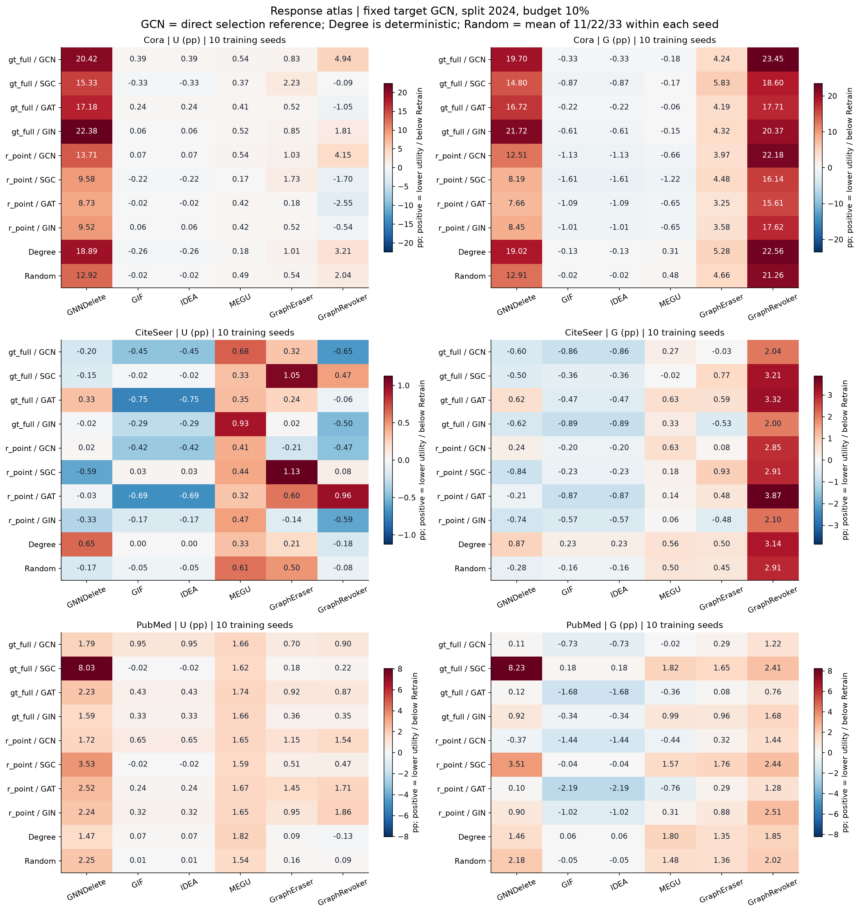
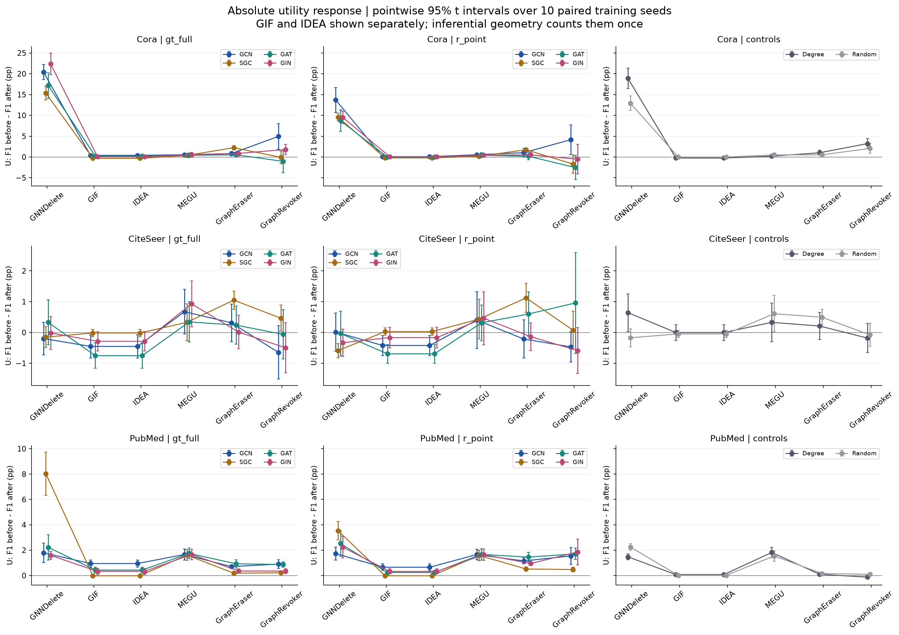
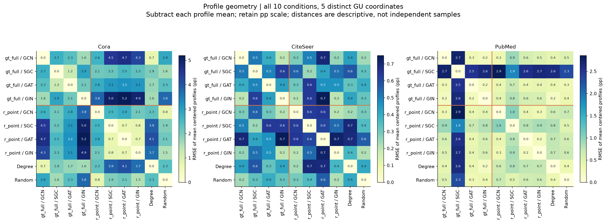
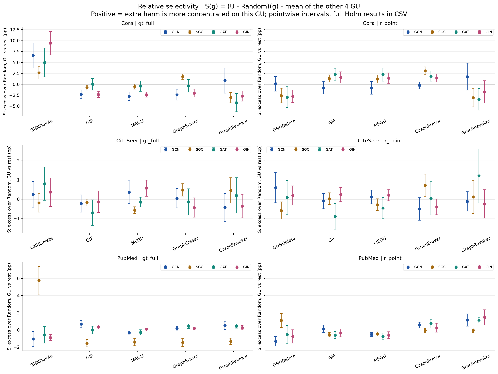

# EXP-079：选点策略响应模式的跨 surrogate 一致性与相对可区分性

日期：2026-10-15。分析完成；科学接受状态：**not_requested**。范围：固定目标架构 GCN、固定 split seed2024、训练候选节点 10% 删除预算；Cora/CiteSeer/PubMed；完整十训练 seed；六 GU 与同请求 Retrain。本报告由 `response_pattern_report.py` 生成，统计与科研图由 `response_pattern.py` 生成。

## 1. 本轮回答与支持范围

**选点策略确实可以产生局部可辨认的 GU 响应差异，但数据不支持把每一种策略都视为跨 surrogate 不变的指纹。** Cora 上 gt_full 相比 r_point 的差异主要集中在 GNNDelete，且四种选点来源均保留这一方向。去除总体平均强度后，同策略跨 surrogate 的距离仍较小；去掉 GNNDelete 后，这个总体优势的区间跨零。这里保留的是含强度的相对响应差异，不能据此说多个 GU 共同构成了稳健的策略特征。

PubMed 展示了相对影响关系会随 surrogate 改变的直接证据：gt_full/SGC 对 GNNDelete 的响应显著不同于 GCN/GAT/GIN；同一策略的 GCN 与 GIN 有局部相近关系，而 SGC 出现方向反转。CiteSeer 的 **U** 效应小且训练波动占比较高，没有建立两种模型型策略稳定可区分的效用模式。这不等于四种请求完全相同，也不证明等效。

**预测不一致率的结论不同于 F1。** GU 对同请求 Retrain 的预测不一致率在三个数据集上都显示正的探索性跨 seed 距离裕量；Cora/PubMed 的该结果仍主要依赖 GNNDelete，CiteSeer 的优势很小且对去掉 GIF 等坐标敏感。效用保持与预测行为接近 Retrain 应作为不同问题报告。

直观指标采用“GU 相对其余 GU 的额外影响”S 和“两个 GU 之间的策略差异对比”K。两者以 pp 表示，零点明确，不需要把接近零的分母归一化。跨 surrogate 的总体关系再用同策略/异策略距离裕量表达，保留原始强度和不确定性。

## 2. 研究问题与论文定位

研究对象是**删除请求如何让一组 GU 方法呈现不同响应，以及这种相对关系换选点 surrogate 后是否保持**。将每个“策略×选点来源”的六 GU 响应放在同一行，可以区分：共同 GU 敏感性、策略特有的差异、训练重复波动，以及 surrogate 对请求与响应的改变。更有害、同形状、同强度、可区分是四个不同命题。

领域直接先例是 Jain、Kalvani、Galhotra、Ranu 的 ICLR 2026 论文 *Is Graph Unlearning Ready for Practice?*。§5.6/Table10 在 Cora、0.1 删除比例下比较随机、标签频率和 Degree 请求对多个 GU 的 fidelity；GNNDelete 对 high-degree 的 fidelity 为 0.69，对 Random 为 0.79，而 MEGU 对两者为 0.96/0.95，展示不同 GU 对 workload 的响应差异。其 Table13 改变被遗忘目标 backbone；本实验固定目标架构，仅改变选点 surrogate。因此它支持研究问题的合理性，不能代替本实验的 surrogate 一致性证据，也不能将其 fidelity 数字直接当作我们的 F1。见[原论文 §5.6/Table10 与 Table13](https://proceedings.iclr.cc/paper_files/paper/2026/file/a89d228d9489814b98050a1f7b43ccdd-Paper-Conference.pdf)。

### 2.1 方法文献：采用什么，为什么

| 文献 | 原文研究内容 | 本轮采用与适配 | 适用边界 |
| --- | --- | --- | --- |
| Campbell & Fiske, 1959，MTMM | 同 trait 跨测量方法的关联应强于异 trait 关联，联合审查收敛与区分效度 | 比较同策略跨 surrogate 与异策略跨 surrogate，保留重复性检查 | surrogate 改变干预请求，GU 是固定算法坐标；这只是概念借鉴，不是标准 MTMM 验证 |
| Kriegeskorte, Mur & Bandettini, 2008，RSA | 用多维响应间的相异矩阵研究表征几何 | 构造 GU 响应向量和全条件距离矩阵 | GU 坐标仅五个独特 F1 维度；相关性不单独作证，数据集分别分析 |
| Nili et al., 2020，EDI | 比较异对象响应距离与同对象重复距离；讨论分布方差与均值差的混淆 | 同/异策略比较，并明确 surrogate 一致性与训练重复性分开 | 本轮裕量不是原文 EDI；它比较不同 surrogate 条件，而不是同刺激的纯重复 |
| Diedrichsen et al., 2021 | 跨验证消除平方距离的噪声偏差，并处理距离间相关性 | 不同训练 seed 的配对差向量做交叉乘积；全部 GU/策略/来源作为同一 seed 簇保留 | 使用未白化平方欧氏距离，不宣称用了 WUC/crossnobis；不拟合小样本协方差逆矩阵 |
| Gelman & Stern, 2006 | 一个效应显著、另一个不显著并不等于两效应有差异 | 直接估计策略×GU 差异对比及其跨 surrogate 配对变化 | S/K 是本设计的线性对比适配，不是原文提出的 GU 指标 |
| Dolan & Moré, 2002 | 优化求解器的性能比率与累计分布 profile | 提醒保留算法间完整响应，而不是只看单一平均排名；本轮不采用其比率 | U/G 可为零或负，少量固定 GU 也不是代表性问题集合；套用最佳算法比率会失真 |
| Demšar, 2006 | 多数据集分类器比较及 Wilcoxon/Friedman/post-hoc 检验 | 借鉴配对比较与多重性意识 | 三个数据集不能把 GU 或同一 split 的 seed 当作更多独立数据集；不画“普遍排名”的 CD 图 |

以上分别是领域先例、方法学借鉴和本设计的适配。未完成穷尽性新颖性检索，不能宣称响应模式研究或 S/K 指标首次提出。文献完整链接与定位见第 10 节。

## 3. 本次输入核验、配对与样本量

运行身份：`exp079-20261013-e79r5`；RID：`e79r5`；执行 SHA：`e02b5fa40ebce66fb45e57ea23b8d6c8d7856685`；`run.json` SHA-256：`115ebaa86a7fa95dd65ca64fc34d5fcc0d6033a2a9ee912ad54d947dbda38f56`。本次重新消费原 job 的 delivery、manifest 和可信 artifact index，并逐文件读取核验 **5,041/5,041** 文件哈希。核对每格 `cell_id`、请求节点、Output 与同请求 Retrain 身份；没有以旧报告的 PASS 替代本次输入核查。详见 [response_input_audit.json](response_input_audit.json)。

| 层级 | 本次核实的样本量及含义 |
| --- | --- |
| 原始矩阵 | 3 数据集 × 10 训练 seed × 12 请求实例 × 7 方法 = 2,520 格；其中 2,160 GU 格、360 Retrain 格 |
| 请求条件 | gt_full/r_point × GCN/SGC/GAT/GIN = 8；Degree = 1；Random 11/22/33 = 3 |
| 分析 profile | Random 先在每个 dataset×训练seed×GU 内平均三次，再形成 10 条条件 profile；共 1,800 GU 标量 |
| 配对推断单位 | 每个数据集十个训练 seed：42、212、2024、0、1、2、3、4、5、6；每个 seed 保留所有策略、来源、GU 和 Random 配对 |
| GU 坐标 | 全图展示六 GU；主几何用 GNNDelete、GIF、MEGU、GraphEraser、GraphRevoker 五坐标；不把 IDEA 作为另一份 F1 证据 |
| 删除预算 | Cora 189、CiteSeer 232、PubMed 1,380 个训练候选节点；固定 split seed2024；不引入历史工程 Gate |

`cells.csv` 的 U/G/flip/before/after 与此次原始重建一致，`paired_seed_values.csv` 的 1,440 模型型选点 GU 行及共享 Random 参照一致；`summary.csv` 仅核验并使用 `cohort=all10` 的 144 行，不拆三/七 seed 图。

### 3.1 请求重复不等于独立选点重复

| dataset | selector | source | requests | unique_node_sets | jaccard_mean |
| --- | --- | --- | --- | --- | --- |
| Cora | gt_full | SGC | 10 | 1 | 1.000 |
| Cora | r_point | SGC | 10 | 1 | 1.000 |
| Cora | degree | baseline | 10 | 1 | 1.000 |
| Cora | random | baseline | 30 | 3 | 0.344 |
| CiteSeer | gt_full | SGC | 10 | 6 | 0.988 |
| CiteSeer | r_point | SGC | 10 | 3 | 0.990 |
| CiteSeer | degree | baseline | 10 | 1 | 1.000 |
| CiteSeer | random | baseline | 30 | 3 | 0.341 |
| PubMed | gt_full | SGC | 10 | 1 | 1.000 |
| PubMed | r_point | SGC | 10 | 1 | 1.000 |
| PubMed | degree | baseline | 10 | 1 | 1.000 |
| PubMed | random | baseline | 30 | 3 | 0.346 |

Degree 在每个数据集都是同一节点集合；SGC 在 Cora/PubMed 的每种 selector 中只有一份集合，CiteSeer 的 gt_full/r_point 有 6/3 份近似集合。**Random 的三份集合也跨训练 seed 重用**：每数据集 30 个调用对应 3 个独特节点集合。十 seed 估计训练与相应选点过程的响应波动，不能解释成十份独立 Degree 请求或三十份独立 Random 请求。表中 requests 计数是调用条件数，已跨 GU 去重；集合 Jaccard 成对数不作为统计样本量。全部模型来源见 [response_selection_repetition.csv](response_selection_repetition.csv)。

GIF/IDEA 在全部请求的 U 完全相同，CE 最大绝对差为 1.01e-08；因此主分析去掉 IDEA，完整六坐标与逐 GU 删除作为敏感性检查，而不是把两者的重复作为增强证据。

### 3.2 指标语义和评估图

`U = F1_before − F1_after`，单位 pp，正值表示相对各 GU 自身原模型下降。`G = F1_same-request-Retrain − F1_GU`，单位 pp，正值表示 GU 低于同请求 Retrain。负 G 仅说明测试 F1 更高，不证明成功遗忘。`flip = 100 × P(argmax_GU ≠ argmax_Retrain)`，是同请求 GU/Retrain 的预测不一致百分比；不是原模型前后翻转。

固定的是目标**架构** GCN，并非强行让各 GU 的方法特有训练流程具有同一个初始模型。原始 before 在同 dataset×seed×GU 内跨请求保持不变，但不同 GU 可不同。例如 Cora 的平均 before：GNNDelete/GIF/IDEA/MEGU 为 89.91%，GraphEraser 为 85.78%，GraphRevoker 为 70.68%。因此 GraphRevoker 的较小 U 可以与较大 G 共存，不能用 U 小就宣称它接近 Retrain。

原始评估是 `evaluation_graph=original`：训练移除监督与关联边，评估回到绑定原图、排除选中节点的 test mask。flip 协议本次在原始 metrics 的 versioned identity 中逐格核实，源码与执行 SHA 一致。retained graph 敏感性、IF 残差、surrogate 校准仍为 **NOT OBSERVED**；本次未启动 GPU、未修改冻结结果。

## 4. 分析量：强度、形状、选择性和区分

记 `x[s,a,i,g]` 为数据集内策略 s、来源 a、训练 seed i、GU g 的响应。以下公式主分析在五个 GU 上计算，不跨数据集拼向量，不按观察结果改变尺度。

### 4.1 原始 profile 与形状

原始向量保留 pp 大小。去中心化 `C(x) = x − mean_g(x)` 仅移除整体平均响应，**仍保留 GU 间差异的幅度**；C(x) 的距离小表示相对 profile 接近，不等于归一化后角度相同。纯形状补充用 centered cosine，范围 [−1,1]；它移除强度，对近零向量敏感，只作描述，不能拿五坐标的高相关系数当强统计证据。

### 4.2 直接回答“主要影响哪个 GU”的 S/K

令 `Δ[s,a,i,g] = U[s,a,i,g] − U[Random,i,g]`，其中 Random 是同训练 seed 三次选点的平均。

```text
S[s,a,i,g] = Δ[s,a,i,g] − mean_(h≠g) Δ[s,a,i,h]
K[s,a,i,g,h] = Δ[s,a,i,g] − Δ[s,a,i,h]
```

S 为该 GU 相对其余四个 GU 的额外损失集中程度；K 为两个 GU 间的策略×GU 交互对比。例如 K>0 表示策略相对 Random 的变化对 GU-A 更偏向损失。零表示相对影响无差异；负值表示方向相反。S 等于 `5/4 × C(Δ)`，不引入人为权重。两者清除共同 GU 敏感性，不局限于“比 Random 多掉几 pp”；S 对任何模型型策略或 Degree 都有相同含义。

**S/K>0 不自动证明 GU-A 的绝对损失大，也不证明其他 GU 影响小。** 必须同步展示 U、Δ 和区间。若所有 Δ 都负，S>0 可能只是该 GU 的改善较小；其他 GU 的区间跨零也不是“小于预设容忍界”的等效检验。本报告未事后设置等效界。

跨 surrogate 保留用相同 K 的方向以及 `K_source − K_GCN` 的配对变化判断。均值同方向是描述性保留；两边点态区间都在同一侧只是更强的局部线索，仍不证明幅度相同。

### 4.3 同策略是否比异策略更接近

对每对不同来源 a,b（四来源共六对）计算同策略距离 W 与异策略距离 B：

```text
W = average_(a<b) [ d²(gt_a,gt_b) + d²(r_a,r_b) ] / 2
B = average_(a<b) [ d²(gt_a,r_b) + d²(r_a,gt_b) ] / 2
M = B − W
```

M>0 表示异策略距离大于同策略跨 surrogate 距离；M=0 无平均优势，M<0 方向相反。Degree/Random 没有可改变的选点 surrogate，不能复制成四种架构样本去帮助 M；它们进入全条件相异矩阵与 S/K 对比。这里的 M 专门检验 gt_full/r_point 的相对可区分性，并非四种策略的总体分类准确率。

先列出均值 profile 的 RMSE（pp），提供直观大小；再以不同 seed 的配对差向量交叉乘积估计平方距离：

```text
z_i = C(x_P,i − x_Q,i)                  # level版本不使用C
d²_cv(P,Q) = sum_(i≠j) dot(z_i,z_j) / [n(n−1)m]
n=10, m=5
```

在不同 seed 误差独立、均值稳定的条件下，该量消除同 seed 噪声自乘造成的正偏，可为负，**负值是估计噪声，不开平方、不截断成零**。M 的单位 pp²；它也等于不同 seed、不同来源的 `gt_full−r_point` 差向量平均内积。本轮已用显式循环独立核对这一恒等式。因此它回答的是策略差异方向跨来源能否重复，而不是声明每个策略的完整 profile 均不变。

每次删除一个完整 seed 簇，重算整个 M，用 delete-one jackknife 方差和 t(9) 给近似 95% 区间。所有条件共用同一 Random 参照，所有距离共享 profile；都保留在簇内。**六个架构对、十个 GU 对、90个有向 seed 乘积不是独立样本。** 这些探索性区间仅对当前固定 split 与算法集合下的训练随机性有条件意义。只有十簇，近零平方信号可能退化，小样本 jackknife/t 的覆盖率没有保证；不将其包装成确认性显著性结论。

S/K 及单 GU 的 gt_full−r_point 采用十 seed 配对 t 区间。报告图区间为点态，表保留 Holm 调整：每个指标的 S 为 3×9×5=135 个非 Random 对比；K 为 3×9×10=270；gt_full−r_point 为 3×4×5=60。Holm 使用全部预定义端点，不把挑出的例子当作独立确认。跨 surrogate K 的变化和 M 敏感性是描述性/探索性，不另行报确认性 p。

### 4.4 U 与 G 不能重复计票

本轮同 dataset×seed×GU 的 before 不随请求变化，每个请求的 Retrain 参照对各 GU 相同。于是 `U−G = F1_before_g−F1_Retrain_request`；对于两个请求 P,Q，`C(U_P−U_Q)=C(G_P−G_Q)`。同理 centered(ΔU)=centered(ΔG)。原始 U/G 图表达不同绝对含义，但**本轮去中心化几何、S/K 和 centered M 的 U/G 数字代数一致**，不是“多指标相互验证”。flip 反映预测不一致，是另一响应端点。

## 5. 完整响应图：三个数据集、全部 GU



图1：原始 U 与同请求 Retrain gap 的完整响应图谱；每格十 seed 均值，色标按面板显示，比较跨面板大小应读数值。导出：[SVG](response_atlas_U_G_10seeds.svg) · [PDF](response_atlas_U_G_10seeds.pdf) · [PNG](response_atlas_U_G_10seeds.png)


图1 直接显示“哪个 GU 被影响、换来源后哪里变了”。Cora 的 GNNDelete 在所有请求下 U 都较大，包括 Random；这部分属于共同敏感性。GraphRevoker 在 U 和 G 的排序不同。CiteSeer 的 U 多接近零，而 flip 可以达到约 20%，效用与预测一致性不能互相代替。PubMed 的 gt_full/SGC 在 GNNDelete 上突出；不能把它推广为该策略所有 surrogate 的特征。



图2：所有 GU 的效用响应及十 seed 点态 95% t 区间；GCN 为同架构选点参照，Degree 和 Random 单独作为控制条件。导出：[SVG](response_profiles_U_10seeds.svg) · [PDF](response_profiles_U_10seeds.pdf) · [PNG](response_profiles_U_10seeds.png)


### 5.1 Retrain 参照保留完整

下表为同请求 Retrain 的十 seed 平均 F1（%），Random 仍先在 seed 内平均。它不是第七个 GU 响应维度，也不应在 G/flip 上人为填入零来扩大相似度证据。逐 seed 数据见 [response_retrain_f1.csv](response_retrain_f1.csv)。

| 选点 | CiteSeer | Cora | PubMed |
| --- | --- | --- | --- |
| gt_full/GCN | 74.850 | 89.188 | 86.917 |
| gt_full/SGC | 74.910 | 89.373 | 88.796 |
| gt_full/GAT | 75.541 | 89.446 | 86.486 |
| gt_full/GIN | 74.655 | 89.244 | 87.923 |
| r_point/GCN | 75.480 | 88.708 | 86.496 |
| r_point/SGC | 75.000 | 88.524 | 88.573 |
| r_point/GAT | 75.075 | 88.838 | 86.169 |
| r_point/GIN | 74.850 | 88.838 | 87.254 |
| Degree | 75.480 | 90.037 | 88.578 |
| Random | 75.145 | 89.902 | 88.528 |

## 6. 策略差异与跨 surrogate 一致性

### 6.1 总体距离裕量

| 指标 | 数据集 | 同策略跨surrogate RMSE / pp | 异策略跨surrogate RMSE / pp | 交叉seed裕量 / pp² |
| --- | --- | --- | --- | --- |
| U | Cora | 1.868 | 3.608 | 9.976 [5.122, 14.830] |
| U | CiteSeer | 0.502 | 0.496 | -0.003 [-0.041, 0.035] |
| U | PubMed | 1.026 | 1.118 | 0.117 [-0.137, 0.372] |
| flip | Cora | 1.832 | 3.862 | 12.086 [5.500, 18.672] |
| flip | CiteSeer | 1.423 | 1.464 | 0.302 [0.072, 0.532] |
| flip | PubMed | 1.239 | 1.547 | 1.202 [0.366, 2.038] |

RMSE 是均值相对 profile 的 pp 距离；M 使用交叉 seed 的平方距离，故二者不能直接相减互相替代。U 主分析：Cora W≈1.87、B≈3.61 pp，M≈9.98 pp²，近似区间在零以上；CiteSeer 与 PubMed 区间跨零。不能把后三者解释为精确无差异。



图3：十种选点条件的完整相异矩阵；均值去中心化后 RMSE，含 Random 与 Degree；面板独立色标，距离不是独立样本。导出：[SVG](response_distance_matrix_U_10seeds.svg) · [PDF](response_distance_matrix_U_10seeds.pdf) · [PNG](response_distance_matrix_U_10seeds.png)


### 6.2 Cora：可重复的是局部策略差异，完整指纹不稳健

Cora 上 gt_full−r_point 的 GNNDelete 损失差在四来源均为正：

| source | gt_full−r_point / pp [点态95%区间] | p_holm |
| --- | --- | --- |
| GCN | 6.716 [3.495, 9.937] | 0.057 |
| SGC | 5.756 [4.046, 7.467] | 0.002 |
| GAT | 8.450 [3.446, 13.455] | 0.196 |
| GIN | 12.860 [9.823, 15.897] | 0.000 |

这说明同样的策略差异方向可以跨来源保留；部分端点在全 60 个对比 Holm 后未通过，不能把点态区间全部正称为四次独立显著验证。其余 GU 在绝对损失上普遍较小，且总体 M 去掉 GNNDelete 后从 9.98 降至 0.33 pp²，区间 [−0.20,0.87]。支持的是该坐标主导的局部策略区分，尚不能确认多个独立 GU 的整体特征。

### 6.3 纯形状与相对参照形状

Cora 原始 centered profile 的 gt_full 跨 GCN/source cosine 为 0.955–0.987，r_point 为 0.847–0.933；但 r_point/GCN 对**异策略** gt_full/source 的 cosine 反而更高（0.935–0.976）。二者都由 GNNDelete 的共同敏感性主导，高形状相似不足以辨认策略。

去掉 Random 共同响应后的 cosine 更有区分意义，却显示并非每个策略都保持：Cora 的 gt_full/GCN 对 SGC/GAT/GIN 为 0.389/0.607/0.917；r_point/GCN 对三者为 −0.751/−0.849/−0.698，GCN 参照范数只有 0.752 pp。Cora 总体 M 为正并不意味着 r_point 的相对选择性方向也跨 surrogate 一致。完整表在附录，包含去掉 GNNDelete 的版本。cosine 不报独立 p 值，不将近零形状放大为强证据。

### 6.4 PubMed：GCN/GAT/GIN 局部保留，SGC 改变相对关系

对 GNNDelete 与 GraphRevoker 的 K，gt_full 的 GCN 为 −1.269 pp，SGC 为 +5.658 pp，配对改变 +6.927 pp，点态区间 [4.865,8.989]。r_point 也出现反转。该对比消除了 GU 共同易损性，反转比“多损失几 pp”更直接回答了相对影响是否保持。

| selector | source | GCN_mean | source_mean | 配对变化 / pp [点态95%区间] |
| --- | --- | --- | --- | --- |
| gt_full | SGC | -1.269 | 5.658 | 6.927 [4.865, 8.989] |
| gt_full | GAT | -1.269 | -0.800 | 0.469 [-0.262, 1.200] |
| gt_full | GIN | -1.269 | -0.920 | 0.350 [-0.492, 1.191] |
| r_point | SGC | -1.974 | 0.903 | 2.878 [1.774, 3.982] |
| r_point | GAT | -1.974 | -1.346 | 0.629 [-0.319, 1.576] |
| r_point | GIN | -1.974 | -1.777 | 0.198 [-0.503, 0.899] |

这是全结果中挑出的解释性案例，选例本身是探索性的。SGC 的 gt_full 对比在完整 K 家族中 Holm p≈0.006；GCN 与 GIN 的同方向点态区间及变化区间跨零只支持局部方向线索，**不证明等效**。PubMed 的 U M 整体区间跨零，去掉 GNNDelete 后得到小的正裕量（0.131 [0.064,0.198] pp²）；这是敏感性结果，不能事后将它替换为主结论。它说明 SGC/GNNDelete 的异质性可以遮盖其余 GU 的较小策略差异。

### 6.5 CiteSeer：小效用响应中的不确定性

CiteSeer 的 U M 为 −0.003 [−0.041,0.035] pp²。GCN→GIN 的部分相对 GU 顺序在均值上保留，但 SGC/GAT 的方向不同；单个较小区间或孤立 p 值不能建立跨 surrogate 整体模式。附录的 centered excess signal 与 seed noise 表显示，多数模型型条件的相对信号量级不高于单 seed 噪声；十 seed 平均能更精确估计均值，却不自动创造一个强指纹。

## 7. 哪个 GU 被相对集中影响：选择性与保留



图4：每种模型型策略对各 GU 的相对选择性 S；正值是相对其余 GU 更集中，完整 Holm 结果在 CSV，负值不等于绝对性能改善。导出：[SVG](response_selectivity_U_10seeds.svg) · [PDF](response_selectivity_U_10seeds.pdf) · [PNG](response_selectivity_U_10seeds.png)


以 gt_full 的 GNNDelete 为例：

| dataset | source | S / pp [点态95%区间] | p_holm |
| --- | --- | --- | --- |
| Cora | GCN | 6.596 [3.757, 9.435] | 0.059 |
| Cora | SGC | 2.634 [1.222, 4.045] | 0.226 |
| Cora | GAT | 4.995 [1.721, 8.270] | 0.632 |
| Cora | GIN | 9.419 [6.747, 12.091] | 0.003 |
| CiteSeer | GCN | 0.248 [-0.424, 0.920] | 1.000 |
| CiteSeer | SGC | -0.191 [-0.673, 0.290] | 1.000 |
| CiteSeer | GAT | 0.803 [-0.061, 1.667] | 1.000 |
| CiteSeer | GIN | 0.360 [-0.384, 1.105] | 1.000 |
| PubMed | GCN | -1.057 [-1.924, -0.191] | 1.000 |
| PubMed | SGC | 5.736 [4.085, 7.387] | 0.003 |
| PubMed | GAT | -0.561 [-1.536, 0.414] | 1.000 |
| PubMed | GIN | -0.881 [-1.235, -0.527] | 0.037 |

Cora 四来源的 S 均值都正，但只 GIN 在完整 S 家族 Holm 后通过 0.05；PubMed 的 GCN/GIN 为负、SGC 为正，不能宣称选择性跨所有来源不变。CiteSeer 各来源都没有建立 GNNDelete 集中的稳定额外损失。

### 7.1 不限于 GNNDelete 的局部响应

| 数据集 | 选点 | GU | 原始 U / pp | Random U / pp | S / pp [点态95%区间] | Holm p |
| --- | --- | --- | --- | --- | --- | --- |
| Cora | r_point/SGC | GraphEraser | 1.734 | 0.535 | 3.100 [2.221, 3.979] | 0.003 |
| PubMed | r_point/GAT | GraphRevoker | 1.709 | 0.090 | 1.140 [0.807, 1.473] | 0.004 |
| PubMed | degree/baseline | MEGU | 1.818 | 1.541 | 0.527 [0.363, 0.691] | 0.006 |

Cora 的 r_point/SGC 对 GraphEraser 的 S 为 +3.10 pp，但原始 U=1.73 pp，不能称它造成了比 GNNDelete 更大的绝对损失。PubMed 的 r_point/GAT 对 GraphRevoker 有 +1.14 pp 的相对选择性，U=1.71 pp；Degree 对 MEGU 的 S≈0.53 pp、U=1.82 pp。它们说明相对选择性能够区分局部 GU 响应，也显示“局部集中”与“最大损失”不是同一概念。其他来源/控制的完整结果保留，未把三例当成跨来源确认。

### 7.2 全部 GU 成对相对关系的保留

| dataset | selector | source | 均值同方向 / 10 | 两边点态区间同方向 / 10 |
| --- | --- | --- | --- | --- |
| CiteSeer | gt_full | GAT | 5 | 0 |
| CiteSeer | gt_full | GIN | 8 | 1 |
| CiteSeer | gt_full | SGC | 2 | 0 |
| CiteSeer | r_point | GAT | 5 | 0 |
| CiteSeer | r_point | GIN | 7 | 0 |
| CiteSeer | r_point | SGC | 0 | 0 |
| Cora | gt_full | GAT | 7 | 4 |
| Cora | gt_full | GIN | 6 | 4 |
| Cora | gt_full | SGC | 5 | 3 |
| Cora | r_point | GAT | 1 | 0 |
| Cora | r_point | GIN | 3 | 0 |
| Cora | r_point | SGC | 3 | 0 |
| PubMed | gt_full | GAT | 8 | 2 |
| PubMed | gt_full | GIN | 10 | 3 |
| PubMed | gt_full | SGC | 2 | 0 |
| PubMed | r_point | GAT | 8 | 4 |
| PubMed | r_point | GIN | 10 | 4 |
| PubMed | r_point | SGC | 5 | 3 |

分母为五独特 GU 的十个无序对；计数之间相关，不能作为 10 次 Bernoulli 独立试验，不报二项检验。PubMed/GIN 对两 selector 的十个 K 均值方向均与 GCN 相同，但仅 gt_full 的 3 对、r_point 的 4 对在两来源的点态区间都同向；SGC 的保留比例明显低。Cora 的 gt_full 保留多于 r_point。该表说明“一部分相对关系保留”和“整个 profile 不变”之间的差距。完整 K 与配对变化见 [response_GU_pair_interactions.csv](response_GU_pair_interactions.csv)、[response_interaction_preservation.csv](response_interaction_preservation.csv)。

## 8. 敏感性与预测行为

| dataset | metric | coordinates | 裕量 / pp² [近似95%区间] |
| --- | --- | --- | --- |
| Cora | U | dedup5 | 9.976 [5.122, 14.830] |
| Cora | U | full6 | 8.830 [4.565, 13.096] |
| Cora | U | drop_GNNDelete | 0.333 [-0.200, 0.865] |
| Cora | flip | dedup5 | 12.086 [5.500, 18.672] |
| Cora | flip | full6 | 11.365 [5.361, 17.368] |
| Cora | flip | drop_GNNDelete | 0.988 [-0.233, 2.210] |
| CiteSeer | U | dedup5 | -0.003 [-0.041, 0.035] |
| CiteSeer | U | full6 | -0.002 [-0.032, 0.028] |
| CiteSeer | U | drop_GNNDelete | -0.005 [-0.043, 0.033] |
| CiteSeer | flip | dedup5 | 0.302 [0.072, 0.532] |
| CiteSeer | flip | full6 | 0.376 [0.136, 0.616] |
| CiteSeer | flip | drop_GNNDelete | 0.357 [0.120, 0.593] |
| PubMed | U | dedup5 | 0.117 [-0.137, 0.372] |
| PubMed | U | full6 | 0.087 [-0.123, 0.298] |
| PubMed | U | drop_GNNDelete | 0.131 [0.064, 0.198] |
| PubMed | flip | dedup5 | 1.202 [0.366, 2.038] |
| PubMed | flip | full6 | 1.097 [0.342, 1.851] |
| PubMed | flip | drop_GNNDelete | 0.014 [-0.016, 0.043] |


图5：去重、完整六 GU 与逐个删除 GU 的相对可区分裕量；U 与 flip，十 seed 簇 jackknife 近似区间。导出：[SVG](response_margin_sensitivity_10seeds.svg) · [PDF](response_margin_sensitivity_10seeds.pdf) · [PNG](response_margin_sensitivity_10seeds.png)


完整六 GU 的 U 结论与五坐标一致，说明去掉 IDEA 没有制造主结果。Cora/PubMed 的 flip 优势去掉 GNNDelete 后区间跨零；CiteSeer 的 flip 去掉 GNNDelete 仍正，但去掉 GIF 或 GraphEraser 后跨零。这个补充端点值得保留，同时应描述为有限、坐标敏感的预测行为区分。全部逐坐标与 level 版本见 [response_consistency_margin.csv](response_consistency_margin.csv)。


图6：GU 与同请求 Retrain 的预测不一致率；三个数据集、完整六 GU、十 seed 均值；不同于遗忘前后翻转。导出：[SVG](response_disagreement_10seeds.svg) · [PDF](response_disagreement_10seeds.pdf) · [PNG](response_disagreement_10seeds.png)


CiteSeer 的 U 接近零不意味着预测模型接近 Retrain：GraphEraser/GraphRevoker 的 flip 在约 16.7–22.2%，而 GIF/MEGU 较低。§5.6 的 fidelity 关心预测与 GOLD 的一致性；本轮 flip 若在相同掩码和预测协议下可视为其不一致方向的量，但不同实验设置不可直接合并数值。flip 无法判断被删信息是否消失，也没有提供隐私安全证明。

## 9. 可用于论文的措辞与未支持命题

> 在固定 GCN 目标架构、单一数据划分与 10% 删除预算下，删除策略引起的响应差异具有数据集和 surrogate 条件性。Cora 中，gt_full 相比 r_point 对 GNNDelete 的效用影响在四种选点来源下均保持同方向，整体相对 profile 的同策略跨来源距离小于异策略距离；然而该优势在移除 GNNDelete 后不再得到清晰区间支持。PubMed 中，一部分 GCN/GAT/GIN 相对关系保留，而 SGC 可反转针对不同 GU 的相对影响。CiteSeer 的效用响应未建立稳定的整体策略区分。与效用相比，同请求 GU/Retrain 预测不一致率可呈现额外的、但对响应坐标敏感的策略差异。因此结果支持局部可辨认响应与条件性跨 surrogate 保留，尚不足以支持普遍不变的策略指纹。

方法段可写：以完整十个训练 seed 的配对响应形成多 GU profile，用原始效应、策略×GU 线性对比、全条件相异矩阵及不同 seed 交叉乘积的平方距离裕量联合分析；按训练 seed 保留共享控制及成对依赖，并报告独特 GU 去重与逐坐标敏感性。

本轮不能声称：所有策略都跨来源更像自身；存在六份独立 GU 证据；高相关证明策略指纹；U/G 相同几何是独立复现；近零效应证明等效；Degree 十次等于十份独立请求；单 split/单 budget 规律适用于新图、新 split 或其他 target backbone；F1/flip 变化证明遗忘成功；已确认 IF 机制或实现错误解释全体现象。本轮没有必要引入全局最优 surrogate 排名。

若后续研究要支持一般化，需在预先固定 profile 端点、GU 去重规则和实用容忍界后，在独立 split/预算及明确原图/保留图口径上确认；这属于后续实验，**本轮未执行**。当前交付完成了既有数据的分析，不以新增 GPU 数据追求正结果。

## 10. 文献与来源核查

以下于 2026-10-15 核查原论文或官方出版页；引用不将综述代替主研究，不将 arXiv 初稿年份当正式发表年。

1. **Jain, S., Kalvani, R., Galhotra, S., & Ranu, S. (2026).** *Is Graph Unlearning Ready for Practice? A Benchmark on Efficiency, Utility, and Forgetting.* ICLR 2026. [官方 PDF](https://proceedings.iclr.cc/paper_files/paper/2026/file/a89d228d9489814b98050a1f7b43ccdd-Paper-Conference.pdf)。定位：§5.6/Table10（删除 workload）；Table13（目标 backbone）。这是领域主参照。
2. **Campbell, D. T., & Fiske, D. W. (1959).** *Convergent and discriminant validation by the multitrait-multimethod matrix.* Psychological Bulletin, 56(2), 81–105. [原文 PDF](https://languagetesting.info/articles/store/C%26F1959.pdf)。定位：pp.82–83，收敛/区分比较准则。这里只借鉴“同特征跨方法应比异特征更接近”的问题结构。
3. **Kriegeskorte, N., Mur, M., & Bandettini, P. (2008).** *Representational similarity analysis—connecting the branches of systems neuroscience.* Frontiers in Systems Neuroscience, 2, 4. [原文 PDF](https://murlab.org/wp-content/uploads/2020/01/Kriegeskorte-al_representational-similarity-analysis_FrSN2008.pdf)。定位：RDM 框架与 Fig.10 的相关/欧氏/总体强度差异。
4. **Nili, H., Walther, A., Alink, A., & Kriegeskorte, N. (2020).** *Inferring exemplar discriminability in brain representations.* PLoS ONE, 15(6), e0232551. [正式论文](https://journals.plos.org/plosone/article?id=10.1371/journal.pone.0232551)。定位：§2.2.1–2.2.3，EDI、cross-validated distances、移除总体激活；摘要中的分布方差混淆。正式发表时间为 2020-06-10。
5. **Diedrichsen, J., Berlot, E., Mur, M., Schütt, H. H., Shahbazi, M., & Kriegeskorte, N. (2021).** *Comparing representational geometries using whitened unbiased-distance-matrix similarity.* Neurons, Behavior, Data Analysis, and Theory, 5(3), 1–31. [正式出版页](https://nbdt.scholasticahq.com/article/27664-comparing-representational-geometries-using-whitened-unbiased-distance-matrix-similarity)；[可读全文](https://arxiv.org/html/2007.02789v5)。定位：noise bias、不同分区交叉乘积及共享距离协方差；本轮仅采用无白化交叉乘积，不宣称复现 WUC。
6. **Gelman, A., & Stern, H. (2006).** *The difference between “significant” and “not significant” is not itself statistically significant.* The American Statistician, 60(4), 328–331. [作者原文 PDF](https://sites.stat.columbia.edu/gelman/research/published/signif4.pdf)。定位：§1 与均值差/标准误示例。支持直接检验效应间的差，不支持用两个孤立 p 判断 GU 选择性。
7. **Dolan, E. D., & Moré, J. J. (2002).** *Benchmarking optimization software with performance profiles.* Mathematical Programming, 91, 201–213. [作者论文 PDF](https://arxiv.org/pdf/cs/0102001)。定位：§2，性能比率及 CDF；本轮拒绝直接套用其比率到有正负/近零 U/G。
8. **Demšar, J. (2006).** *Statistical comparisons of classifiers over multiple data sets.* JMLR, 7, 1–30. [官方论文页](https://jmlr.org/papers/v7/demsar06a.html)。定位：多数据集配对与 post-hoc 比较；其独立数据集推断不能扩大为本轮 GU/seed 的独立样本。

## 11. 可复现交付与核验

```powershell
python -B -X utf8 self/research/analyses/EXP-079/e79r5/response_pattern.py
python -B -X utf8 self/research/analyses/EXP-079/e79r5/response_pattern_report.py
```

脚本只读取冻结回传与现有 CSV，写本报告独立 `response_*` 派生物；不覆盖原始数据、已有 REPORT/OVERVIEW/DIAGNOSIS。依赖为现有 numpy/pandas/scipy/matplotlib/markdown_it，版本记入输入 audit。无需 config.py、模型、CUDA 或 SSH。

| 交付 | 作用 |
| --- | --- |
| [response_pattern.py](response_pattern.py) | 原始身份/哈希/配对核验、统计、PNG/SVG/PDF 科研图 |
| [response_pattern_report.py](response_pattern_report.py) | 中文报告、同内容静态 HTML、代数独立核对、链接核验 |
| [response_pattern_html_qa.cjs](response_pattern_html_qa.cjs) | 使用现有 Playwright 对本地 HTML 的桌面/手机布局、图片和导航做渲染核验 |
| [response_input_audit.json](response_input_audit.json) | 本次输入身份、5,041 文件核验、样本量、源码/CSV/版本 |
| [response_seed_profiles.csv](response_seed_profiles.csv) | 全十 seed 配对 profile，含全部六 GU、U/G/flip |
| [response_profile_summary.csv](response_profile_summary.csv) | 所有条件×GU×指标均值、点态区间 |
| [response_selectivity.csv](response_selectivity.csv) | S、配对区间、全家族 Holm p |
| [response_gt_vs_r_point.csv](response_gt_vs_r_point.csv) | 直接策略差异，不借助 Random；配对区间、Holm p |
| [response_GU_pair_interactions.csv](response_GU_pair_interactions.csv) | 全部 K 对比与 Holm p |
| [response_interaction_preservation.csv](response_interaction_preservation.csv) | GCN→来源的 K 方向及配对变化 |
| [response_consistency_margin.csv](response_consistency_margin.csv) | U/G/flip、level/centered、去重/完整/逐坐标删除的 M |
| [response_distances.csv](response_distances.csv) | 十条件全部成对 RMSE 与交叉 seed 平方距离 |
| [response_shape_cosine.csv](response_shape_cosine.csv) | 纯形状补充、范数、去掉 GNNDelete 检查 |
| [response_repeatability.csv](response_repeatability.csv) | 去噪 profile 能量、训练 seed 噪声及均值不确定性 |
| [response_selection_repetition.csv](response_selection_repetition.csv) | 调用数、独特请求与 Jaccard |
| [response_retrain_f1.csv](response_retrain_f1.csv) | 同请求 Retrain 逐 seed F1 |
| [response_report_verification.json](response_report_verification.json) | 同内容与本地链接、公式恒等式、图导出核验 |

六组科研图均提供 PNG、SVG 和 PDF；SVG 保留文字，可在矢量编辑器中编辑，PDF 可供论文排版。HTML 的正文由本 Markdown 内容一次渲染，并内嵌 PNG，无外部脚本/字体/图片依赖；下载链接仍指向相邻原文件。

## 附录 A：全部模型型条件的相对信号与噪声

下表单位 pp²。`excess_random_signal_cv2` 是 C(Δ) 均值的去偏能量；`excess_random_seed_noise_energy` 是单 seed 的坐标平均方差，均值噪声为其 1/10。能量负估计不截断，不等于负平方；两列用于理解 signal 与训练波动，不是独立实验或确定性可靠度分数。

| dataset | selector | source | excess_random_signal_cv2 | excess_random_seed_noise_energy |
| --- | --- | --- | --- | --- |
| Cora | gt_full | GCN | 7.541 | 4.884 |
| Cora | gt_full | SGC | 2.471 | 1.109 |
| Cora | gt_full | GAT | 4.982 | 5.089 |
| Cora | gt_full | GIN | 13.970 | 2.548 |
| Cora | r_point | GCN | 0.140 | 4.261 |
| Cora | r_point | SGC | 3.468 | 2.352 |
| Cora | r_point | GAT | 3.935 | 4.319 |
| Cora | r_point | GIN | 1.893 | 3.122 |
| CiteSeer | gt_full | GCN | 0.011 | 0.448 |
| CiteSeer | gt_full | SGC | 0.085 | 0.209 |
| CiteSeer | gt_full | GAT | 0.092 | 0.644 |
| CiteSeer | gt_full | GIN | 0.059 | 0.420 |
| CiteSeer | r_point | GCN | 0.047 | 0.379 |
| CiteSeer | r_point | SGC | 0.087 | 0.365 |
| CiteSeer | r_point | GAT | 0.211 | 1.056 |
| CiteSeer | r_point | GIN | 0.016 | 0.298 |
| PubMed | gt_full | GCN | 0.227 | 0.306 |
| PubMed | gt_full | SGC | 5.181 | 0.861 |
| PubMed | gt_full | GAT | 0.063 | 0.342 |
| PubMed | gt_full | GIN | 0.122 | 0.068 |
| PubMed | r_point | GCN | 0.442 | 0.291 |
| PubMed | r_point | SGC | 0.197 | 0.224 |
| PubMed | r_point | GAT | 0.341 | 0.450 |
| PubMed | r_point | GIN | 0.369 | 0.508 |

## 附录 B：纯形状补充（五 GU、以 Random 为相对参照）

cosine 的 GCN 与 source 范数均为坐标 RMS（pp）。`same_selector_cosine` 是 GCN 与该来源同策略比较，`other_selector_cosine` 是同一个 GCN profile 与该来源另一策略比较。多个值共享输入，不作为独立样本；去掉 GNNDelete 及原始 profile 的完整版本见 CSV。

| dataset | selector | source | same_selector_cosine | other_selector_cosine | GCN_norm_pp | source_norm_pp |
| --- | --- | --- | --- | --- | --- | --- |
| Cora | gt_full | SGC | 0.389 | -0.784 | 2.834 | 1.607 |
| Cora | gt_full | GAT | 0.607 | -0.823 | 2.834 | 2.343 |
| Cora | gt_full | GIN | 0.917 | -0.932 | 2.834 | 3.772 |
| Cora | r_point | SGC | -0.751 | -0.475 | 0.752 | 1.924 |
| Cora | r_point | GAT | -0.849 | -0.462 | 0.752 | 2.090 |
| Cora | r_point | GIN | -0.698 | 0.024 | 0.752 | 1.485 |
| CiteSeer | gt_full | SGC | -0.641 | -0.415 | 0.236 | 0.326 |
| CiteSeer | gt_full | GAT | 0.289 | -0.444 | 0.236 | 0.396 |
| CiteSeer | gt_full | GIN | 0.781 | 0.391 | 0.236 | 0.317 |
| CiteSeer | r_point | SGC | -0.968 | -0.622 | 0.291 | 0.351 |
| CiteSeer | r_point | GAT | -0.059 | 0.650 | 0.291 | 0.563 |
| CiteSeer | r_point | GIN | 0.715 | 0.776 | 0.291 | 0.214 |
| PubMed | gt_full | SGC | -0.837 | -0.759 | 0.507 | 2.295 |
| PubMed | gt_full | GAT | 0.799 | 0.468 | 0.507 | 0.313 |
| PubMed | gt_full | GIN | 0.919 | 0.618 | 0.507 | 0.358 |
| PubMed | r_point | SGC | -0.540 | -0.764 | 0.686 | 0.469 |
| PubMed | r_point | GAT | 0.823 | 0.973 | 0.686 | 0.621 |
| PubMed | r_point | GIN | 0.891 | 0.821 | 0.686 | 0.648 |
