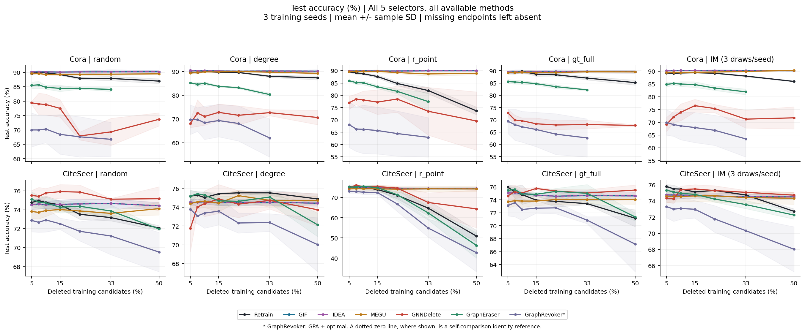
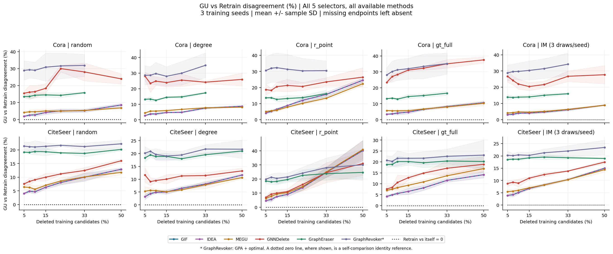
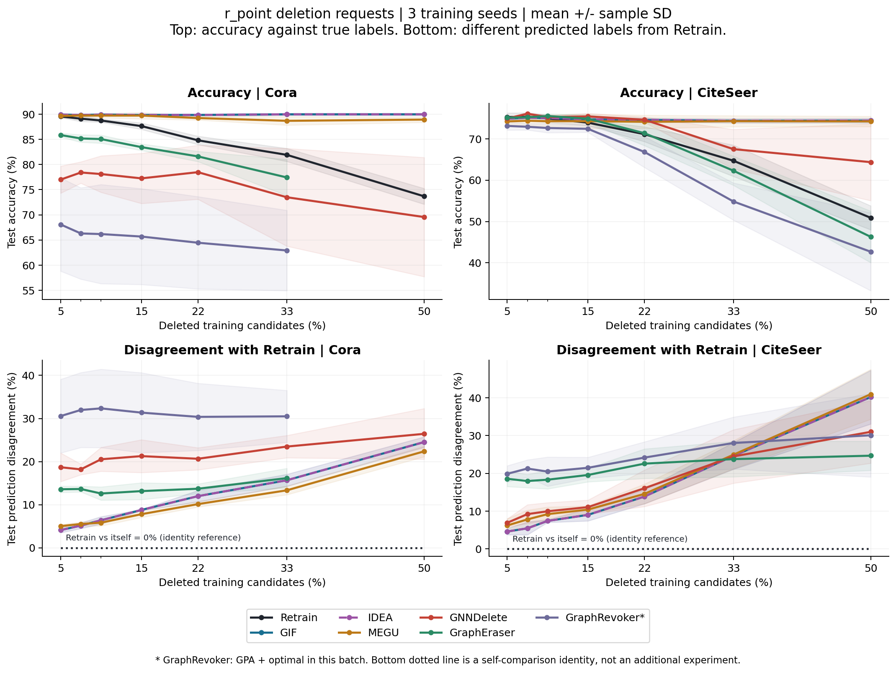
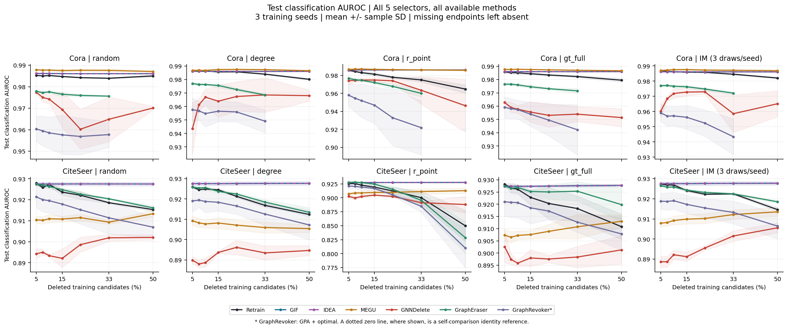
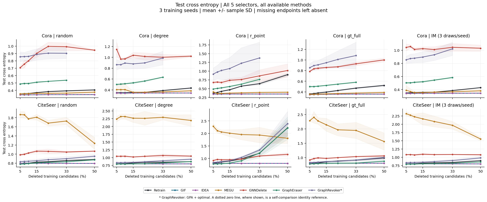
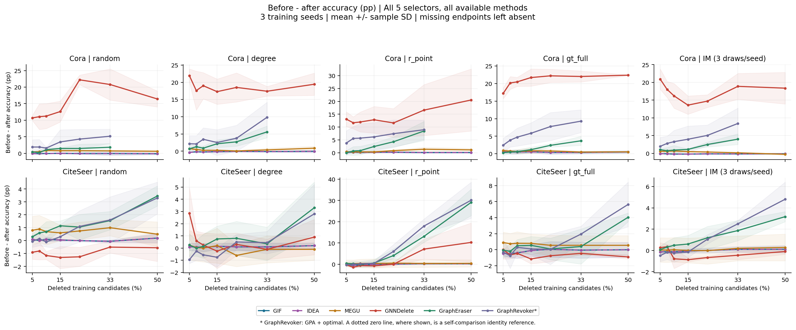

# EXP-080 完整矩阵分析：CiteSeer 50% 已补齐

2026-10-21 · 可信主表 2,016 / 2,016 条件 · 三个训练 seed · 既有结果重分析

**CiteSeer 已完成：50% 档的147条条件已纳入，七种方法的曲线均延伸到50%。** 本次重新核验4,035个回传文件。r_point下，CiteSeer Retrain准确率由5%时的75.28%降到50%时的50.90%；GIF/IDEA仍为74.42%，但与Retrain的预测不一致率达到40.19%。MEGU的对应不一致率为40.94%。这一端点支持“效用稳定与重训练预测对齐分离”，不能单凭它判定未遗忘。

**本报告覆盖完整的五类选点策略与所有已完成GU条件，没有只运行r_point。** 五类selector为Random、Degree、r_point、gt_full、IM-RR；GU方法为GIF、IDEA、MEGU、GNNDelete、GraphEraser、GraphRevoker，另有Retrain参照。`r_point`属于“删哪些节点”的策略轴，不是“怎样遗忘”的方法轴。先看下面全矩阵总览，再看后文r_point案例及其他策略的反例。

| 选择策略 | 本快照可信主表条件 |
| --- | --- |
| random | 288 |
| degree | 288 |
| r_point | 288 |
| gt_full | 288 |
| im_rr_greedy | 864 |

IM-RR有三次选点抽样，所以原始行数是其他策略的三倍；统计前已在每个训练seed内平均。总计2,016行，方法/预算/数据集范围见第1节。

图表可点击放大查看图例和坐标。

**上图：测试准确率**，比较预测与真实标签，包含Retrain实际结果。**下图：与同请求Retrain的预测不一致率D**，比较两个模型的预测类别。每张图两行分别是Cora/CiteSeer，五列依次是五种selector；线条颜色表示GU方法或Retrain。各面板纵轴独立缩放，效应大小以表中pp为准。例如D=25%表示每100个评估节点约25个节点的GU预测与Retrain不同，不是准确率下降25%，也不是25%的删除节点没有遗忘。D越接近0，类别预测越接近参照，但不证明概率输出相同或遗忘充分。

不一致率图的黑色点线标为 **Retrain与自身比较=0%**，是定义上的恒等基准，不是新实验，也不是两个独立Retrain之间的自然波动。原始Retrain行的D仍保持缺失，不向CSV补造测量值。

图例的紫灰色 **GraphRevoker*** 对应本批 **GPA+optimal** 实现，星号说明放在图下注释；不代表完整论文方法。曲线为三训练 seed 均值，阴影为 ±1 sample SD，**不是置信区间**。Cora 的分片方法止于33%；CiteSeer所有方法均有实测50%端点。横轴10、20等数字表示删除候选训练节点的百分比；下图纵轴10、20表示测试预测不一致率10%、20%。

## 1. 本次采用了什么数据

| 范围 | 比例 | 方法 | 主表条件 | 状态 |
| --- | --- | --- | ---: | --- |
| Cora、CiteSeer base / e80r305 | 5%、7.5%、10%、15%、22%、33% | Retrain + 六 GU | 1,764 | 本次全量哈希、可信索引及配对复核通过 |
| Cora high / e80r302 | 50% | Retrain、GIF、IDEA、MEGU、GNNDelete | 105 | 同上 |
| CiteSeer high / e80r306 | 50% | Retrain + 六 GU | 147 | 本次全量哈希、可信索引及配对复核通过 |

这是本轮限定计划 2,016 个主表条件的 **100%**，不是所有未来数据集与方法扩展完成。294 个请求有显式 Retrain，1,722 个 GU 输出逐一匹配其真实删除节点和 baseline Output 身份。gate、失败尝试、早期孤立方法运行不重复计入；PubMed不在本轮范围。Cora50%的两个分片方法42行按既有可行性边界排除，不能视为算法失败得分。EXP-081的Random5是独立的五节点诊断，未并入本矩阵。

CiteSeer high原作业于2026-10-19 20:04:05–21:10:56执行，耗时4,011秒（66分51秒），不含排队与回传；方法缓存87 HIT、60 MISS。Cora high的420秒是105条件含86次方法HIT的缓存续跑墙钟时间，并非105次从头计算。两批方法覆盖和缓存状态不同，不能仅按耗时比较数据集成本。

三训练 seed 为42、212、2024；同一个固定数据划分 seed=2024，测试集没有独立重采样，因此不代表跨split泛化。五类selector为 Random、Degree、r_point、gt_full、IM-RR。IM每个训练seed含11/22/33三次抽样，先在seed内平均，再以三个训练seed计算均值和SD；Random每个训练seed仅一份请求。不能把IM的9行当9个独立训练重复，也不能称当前Random为K5。

**该批只是GCN目标及当前selector配置，不含跨surrogate迁移实验。** 早期EXP-032或EXP-079结果没有拼进本矩阵。三个实际执行SHA间的Git差异涉及报告、新提交Recipe、独立Random5配置与配置目录登记，没有修改本矩阵使用的算法程序和EXP-080科学配置；输入仍分别以原handoff核验，实际执行SHA不替换为报告生成时的HEAD。

## 2. 删除请求先在 Retrain 上产生了什么变化

下面在同一训练seed内计算 accuracy(33%) − accuracy(5%)，再汇总mean ± sample SD；单位pp。

| Selector | Cora Δaccuracy (pp) | CiteSeer Δaccuracy (pp) |
| --- | --- | --- |
| random | -1.72 ± 0.77 | -1.60 ± 0.48 |
| degree | -1.78 ± 0.21 | +0.35 ± 0.85 |
| r_point | -7.63 ± 1.11 | -10.56 ± 2.79 |
| gt_full | -2.21 ± 0.98 | -2.55 ± 0.52 |
| im_rr_greedy | -1.23 ± 0.16 | -1.05 ± 0.15 |

**r_point 是当前最强的可观测重训练响应条件。** 两数据集三个seed均下降；其5%→33%下降为7.63/10.56 pp，明显大于Random的1.72/1.60 pp。不能把这个结果推广成“所有策略都同样有效”：Degree在CiteSeer端点反而平均提高0.35 pp，IM和gt_full的端点变化也较小。中间比例可有反弹，不主张全程单调。

为区分“增加删除量”与“同预算下更强选点”，下面另列33%时同seed的accuracy(selector) − accuracy(Random)。负值表示该策略的Retrain准确率低于Random。

| 数据集 | Selector | 33% 相对Random (pp) |
| --- | --- | --- |
| Cora | degree | +0.12 ± 0.38 |
| Cora | r_point | -5.97 ± 2.04 |
| Cora | gt_full | -0.86 ± 1.26 |
| Cora | im_rr_greedy | +0.23 ± 1.04 |
| CiteSeer | degree | +2.35 ± 0.61 |
| CiteSeer | r_point | -8.46 ± 3.55 |
| CiteSeer | gt_full | +0.25 ± 0.23 |
| CiteSeer | im_rr_greedy | +1.57 ± 0.45 |

**反例：CiteSeer的gt_full虽然随预算下降2.55 pp，但33%时仍比Random高0.25 pp；不能据端点下降就称其攻击优于Random。** Cora的IM在33%也略高于Random。完整配对结果在[paired_vs_random_summary.csv](paired_vs_random_summary.csv)。这里只有描述性三seed结果，没有显著性或等效性检验。

## 3. GU 的效用响应与预测对齐并不相同

以下是**从全矩阵中选出的描述性案例**，不是整批Recipe范围，也不是预注册的唯一主策略。r_point在现有矩阵中具有较强Retrain响应，便于观察效用与对齐的分离；其他策略的弱响应和反例仍完整保留在总览与配对表中。

比较同seed的5%→33%变化。D定义为固定保留测试节点上GU与同请求Retrain的argmax不一致比例；ΔD用百分点表示。

| 数据集 | 方法 | Δaccuracy (pp) | ΔD (pp) |
| --- | --- | --- | --- |
| Cora | Retrain | -7.63 ± 1.11 | — |
| Cora | GIF | +0.06 ± 0.21 | +11.56 ± 1.07 |
| Cora | IDEA | +0.06 ± 0.21 | +11.56 ± 1.07 |
| Cora | MEGU | -0.98 ± 0.38 | +8.30 ± 1.21 |
| Cora | GNNDelete | -3.51 ± 8.76 | +4.80 ± 4.15 |
| Cora | GraphEraser | -8.43 ± 3.53 | +2.58 ± 2.50 |
| Cora | GraphRevoker（GPA+optimal） | -5.17 ± 2.24 | -0.06 ± 3.31 |
| CiteSeer | Retrain | -10.56 ± 2.79 | — |
| CiteSeer | GIF | -0.50 ± 0.23 | +20.02 ± 2.79 |
| CiteSeer | IDEA | -0.50 ± 0.23 | +20.02 ± 2.79 |
| CiteSeer | MEGU | +0.05 ± 0.23 | +18.72 ± 2.50 |
| CiteSeer | GNNDelete | -7.41 ± 4.79 | +17.57 ± 6.21 |
| CiteSeer | GraphEraser | -12.81 ± 3.38 | +5.21 ± 2.65 |
| CiteSeer | GraphRevoker（GPA+optimal） | -18.27 ± 3.56 | +8.16 ± 5.95 |

GIF/IDEA在Cora的accuracy端点变化仅+0.06 pp，CiteSeer仅−0.50 pp；但D分别从 **4.12%升至15.68%**、从 **4.60%升至24.62%**。MEGU也呈现类似分离：CiteSeer accuracy为74.22%→74.27%，D却从6.21%升至24.92%。这一现象跨两个数据集出现，且这些D端点增量在三个seed上方向一致。

准确率相近只说明正确预测节点数相近；它不约束模型与Retrain在每个节点上给出相同类别。这里的D提供了额外的行为证据，但仍无法单独区分过度更新、更新不足或其他优化差异。

**GIF和IDEA不是两份独立支持证据。** 全部294对输出的accuracy、drop、gap及D逐格完全一致，classification AUROC最大绝对差约7.1×10⁻⁶，交叉熵最大差约1.3×10⁻⁸。报告保留两条方法记录，但将其视作近重复响应。

### Cora50%端点进一步拉开差异

| 方法 | Accuracy (%)，mean ± SD | 自身before−after (pp)，均值 | D (%)，均值 |
| --- | --- | --- | --- |
| Retrain | 73.68 ± 1.57 | — | — |
| GIF | 89.98 ± 0.21 | 0.12 | 24.54 |
| IDEA | 89.98 ± 0.21 | 0.12 | 24.54 |
| MEGU | 88.93 ± 0.55 | 1.17 | 22.39 |
| GNNDelete | 69.56 ± 11.85 | 20.54 | 26.45 |

在r_point、50%删除下，GIF/IDEA仍约89.98%，Retrain为73.68%，二者accuracy相差16.30 pp，预测不一致率24.54%。MEGU的D为22.39%，自身accuracy损失仍仅1.17 pp。这个端点加强了“低效用损失伴随重训练不对齐”的描述性发现。**缺少Original输出距离和Retrain自然波动校准，仍不能写成已经证实未遗忘。**

### CiteSeer50%：准确率稳定与预测不对齐进一步分离

下表是r_point的全部方法；Δaccuracy是同训练seed内accuracy(50%)−accuracy(5%)，再计算均值±样本SD，单位pp。D是50%端点的预测不一致率，单位%。GraphRevoker*仍指原运行的GPA+optimal。

| 方法 | 50% Accuracy (%) | 5%→50% Δaccuracy (pp) | 50% D (%) |
| --- | --- | --- | --- |
| Retrain | 50.90 ± 2.90 | -24.37 ± 3.90 | — |
| GIF | 74.42 ± 0.57 | -0.45 ± 0.15 | 40.19 ± 7.11 |
| IDEA | 74.42 ± 0.57 | -0.45 ± 0.15 | 40.19 ± 7.11 |
| MEGU | 74.22 ± 1.26 | +0.00 ± 0.26 | 40.94 ± 6.61 |
| GNNDelete | 64.36 ± 9.31 | -10.56 ± 9.23 | 30.98 ± 8.29 |
| GraphEraser | 46.30 ± 6.23 | -28.83 ± 6.16 | 24.67 ± 3.87 |
| GraphRevoker* | 42.69 ± 9.42 | -30.43 ± 8.61 | 30.08 ± 11.04 |

Retrain的5%→50%准确率下降24.37 pp，而GIF/IDEA仅下降0.45 pp，MEGU的均值变化为0.00 pp。GIF的D从4.60%升至40.19%，MEGU从6.21%升至40.94%，这两个增量均在三个seed上为正。GIF与Retrain在50%端点的准确率相差23.52 pp；这说明当前GU保留了较高测试效用，同时明显偏离删除后重训练的类别预测。

**分片方法呈现另一种响应：** GraphEraser和GraphRevoker*的50%准确率分别为46.30%和42.69%，5%→50%下降28.83和30.43 pp。GNNDelete为64.36 ±9.31%，波动较大。三者不能用GIF/MEGU的“效用稳定”来概括；分片方法的共享GCN参照仍含模型家族差异，不能把D直接解释成纯遗忘误差。

### CiteSeer50%的全策略比较

准确率均值（%）；完整SD和每seed值保存在统计CSV。每行一种选点策略，每列一种GU方法或Retrain。

| Selector | Retrain | GIF | IDEA | MEGU | GNNDelete | GraphEraser | GraphRevoker |
| --- | --- | --- | --- | --- | --- | --- | --- |
| random | 72.07 | 74.42 | 74.42 | 74.12 | 75.18 | 71.97 | 69.52 |
| degree | 74.87 | 74.42 | 74.42 | 74.72 | 73.72 | 72.12 | 70.02 |
| r_point | 50.90 | 74.42 | 74.42 | 74.22 | 64.36 | 46.30 | 42.69 |
| gt_full | 71.17 | 74.62 | 74.62 | 74.07 | 75.53 | 71.37 | 67.17 |
| im_rr_greedy | 72.72 | 74.51 | 74.51 | 74.34 | 74.72 | 72.26 | 68.02 |

与同请求Retrain的预测不一致率均值（%）；Retrain不造测量值。

| Selector | GIF | IDEA | MEGU | GNNDelete | GraphEraser | GraphRevoker |
| --- | --- | --- | --- | --- | --- | --- |
| random | 12.91 | 12.91 | 11.76 | 16.02 | 20.17 | 22.22 |
| degree | 11.61 | 11.61 | 10.61 | 13.21 | 20.97 | 21.67 |
| r_point | 40.19 | 40.19 | 40.94 | 30.98 | 24.67 | 30.08 |
| gt_full | 14.16 | 14.16 | 16.97 | 18.92 | 20.22 | 23.12 |
| im_rr_greedy | 14.98 | 14.98 | 14.41 | 17.48 | 18.97 | 23.44 |

| Selector | Retrain 5%→50% Δaccuracy (pp) | Retrain 50% 相对Random (pp) |
| --- | --- | --- |
| random | -2.70 ± 0.40 | +0.00 ± 0.00 |
| degree | -0.30 ± 1.04 | +2.80 ± 0.76 |
| r_point | -24.37 ± 3.90 | -21.17 ± 2.86 |
| gt_full | -4.80 ± 1.13 | -0.90 ± 1.43 |
| im_rr_greedy | -3.07 ± 0.08 | +0.65 ± 0.53 |

r_point在50%时的Retrain准确率比Random低21.17 ±2.86 pp；Degree反而高2.80 pp，IM高0.65 pp，gt_full低0.90 pp。GIF在其余四种策略下的D仅约11.61%–14.98%，r_point为40.19%。**不能把r_point的强响应扩大成所有选点策略都产生相同影响。** gt_full在33%时略高于Random、50%时略低于Random，说明策略比较依赖预算；三个训练seed只支持描述性比较，不作显著性断言。

## 4. 其他方法和反例必须一起保留

- **GNNDelete响应更大，但波动也大。** Cora r_point的5%→33% accuracy变化为−3.51 ±8.76 pp，seed2024反而从79.52%升至83.58%；50% accuracy为69.56 ±11.85%。不能给出所有seed都随预算下降或稳定跟随Retrain的结论。CiteSeer的下降和D增加则在三个seed方向一致。
- **GraphEraser并非始终受保护。** CiteSeer r_point下5%→33% accuracy下降12.81 pp；当前数据不支持普遍的“分片方法效用稳定”叙事。
- **GraphRevoker（GPA+optimal）不能代表完整论文方法。** 当前批次配置明确是gpa分区、optimal聚合。已有[实现审计](../../../../../report/progress/2026-10-05_advisor-meeting/q2-metrics/METHOD_AUDIT.md)指出该执行链不含完整论文聚合模块；其中其他实验的诊断数值不混入本批。Cora在5%时已与共享Retrain有30.57%的D，33%仍约30.50%；高绝对D不等于预算增量造成的失败。
- 两个分片方法的baseline是共享单GCN Retrain，包含模型家族差异；不能将其绝对gap或D全部解释为遗忘误差。当前没有同家族完整重训练对照。

## 5. 不只看 accuracy：AUC、交叉熵和 update detection

这里的分类AUROC与update-detection AUROC是两种不同指标。下图分别使用已回传的classification_auc与cross_entropy，没有根据accuracy推算概率指标。

r_point下，比较5%→33%时，CiteSeer GIF的分类AUROC约0.92739→0.92755，交叉熵约0.800→0.803，与其稳定accuracy一致；Retrain对应AUROC约0.92549→0.90027，交叉熵约0.825→1.207。MEGU虽保留约74%的accuracy，其交叉熵为2.286→1.936，明显不同于GIF和Retrain；因此“准确率相近”也不代表概率预测质量相近。图中已补齐50%实测点；这里只描述记录的输出，不做原因归因。

294个Retrain输出没有f1_before及Original prediction，不能为它们补一个虚构的0%点或计算Original→Retrain drop。GU使用各自记录的before，分片before不等于共享GCN的before。

各GU有update-detection AUC，逐格值保存在[cells.csv](cells.csv)。它基于before/after预测变化区分selected nodes与test nodes；不是标准成员推断隐私保证，也不提供输出变化幅度。AUC非0.5不能证明遗忘充分，accuracy不变也不能证明完全没更新。本次不按该AUC给遗忘质量排序。

保留了[hop_summary.csv](hop_summary.csv)，但不将hop上的GU–Retrain差异称为GU–Original的collateral damage；不同请求的hop组成员与数量可变，应连同[原始分母](hop_counts.csv)阅读。

## 6. 现阶段能写什么，缺什么

**可以写入阶段结果的表述：**

> 在固定划分、三个训练seed的Cora与CiteSeer实验中，r_point请求的删除比例从5%提高至33%时，重训练准确率分别下降7.63和10.56个百分点。GIF/IDEA与MEGU的准确率变化较小，但其与同请求重训练的测试预测不一致率均增加。CiteSeer50%端点上，重训练准确率为50.90%，GIF和MEGU仍约74%，与重训练的预测不一致率约40%。结果表明常规效用稳定并不足以说明近似图遗忘与重训练响应对齐；该现象的强度依赖选择策略。

这个发现已经比“只有Retrain曲线、待补GU”的旧分析前进一步；旧[母分析](../../../../../reports/forgetting_response_audit/REPORT.md)保留为历史方案，本报告提供当前新证据。现阶段仍缺：

1. 同请求、同推断图的GU–Original和Retrain–Original概率距离，及固定删除请求的重复Retrain自然波动校准。只有补齐后才适合检验“接近未更新”的机制解释。
2. 分片方法同家族重训练参照；GraphRevoker完整实现的独立验证。
3. 更多训练seed、独立数据划分或PubMed用于外部验证；这些都不在本次分析中，不能预先主张泛化。

分析问题和诊断图本身不是核心贡献已经成立的证明。现有实证支持“效用与响应对齐分离”，未验证普适遗忘评分器、隐私保证或因果机制；科学接受仍由后续审阅决定。

## 7. 核验、来源与复现

- 4,035个文件逐个复核SHA256，与原job manifest及当前trusted index一致；三份delivery均accepted。
- 1,722个GU逐一配对显式Retrain的完整Output身份、删除节点、数据split与准确率；没有仅凭selector名或selection_id拼接。
- 252个跨预算相邻请求检查均为严格节点前缀；同请求各方法使用相同选点。两数据集评估mask各自固定。
- 三seed统计先算seed内差，再汇总；IM重复先平均。没有把2,016行当2,016个独立统计样本。
- 执行SHA：base `a217daf5c67b485afed63c393b5e8bb23820b237`；Cora high `9d24b46ff14156685c62d8cdb59df1840d9e2c22`；CiteSeer high `8fb8169475b015ac4cc6dd1a61c6d26ee5ff7670`。

| 产物 | 用途 |
| --- | --- |
| [verification.json](verification.json) | 原job、SHA、文件数、配对/前缀检查及边界 |
| [execution_version_audit.json](execution_version_audit.json) | 三批执行版本间的文件变化范围，算法与EXP-080科学配置未改变 |
| [cells.csv](cells.csv) | 2,016行原始指标、身份、输出与来源路径 |
| [seed_values.csv](seed_values.csv) | IM平均后的独立训练seed层级 |
| [condition_summary.csv](condition_summary.csv) | 所有方法/selector/ratio的mean、SD与有效样本数 |
| [endpoint_changes.csv](endpoint_changes.csv) | 每个方法、selector的5%→33%及可用5%→50%配对变化 |
| [paired_vs_random.csv](paired_vs_random.csv) | 同seed同预算相对Random的差值 |
| [analyze.py](analyze.py) | 从原回传文件核验、提取、统计与生成全图 |
| [build_report.py](build_report.py) | 从统计表生成本Markdown及主图 |
| [validate_statistics.py](validate_statistics.py) | 使用标准库独立复算全部均值、SD、端点和Random配对 |

本报告覆盖已完成的三份主表，作为版本化分析保存；此前1,869行草稿保留为历史快照。本次未修改原结果、AutoReport、Cache、算法程序、队列或执行SHA，没有新增GPU作业。提交报告不等于科学接受，也不触发SSH部署。HTML由同一Markdown生成，所有图嵌入；PNG/SVG/PDF同目录保留供导出。

复现：在仓库根目录依次运行本目录的`analyze.py`、`build_report.py`、`validate_statistics.py`、`render_report.py`；前两步需要pandas、numpy、matplotlib，渲染需要markdown-it-py及beautifulsoup4。原始回传与SyncMate核验记录必须仍在本机；缺少或哈希不符时分析会停止，不下载或补造结果。[独立统计复核](statistics_validation.json)使用标准库从cells.csv重算，核对汇总、端点差及Random配对结果。
