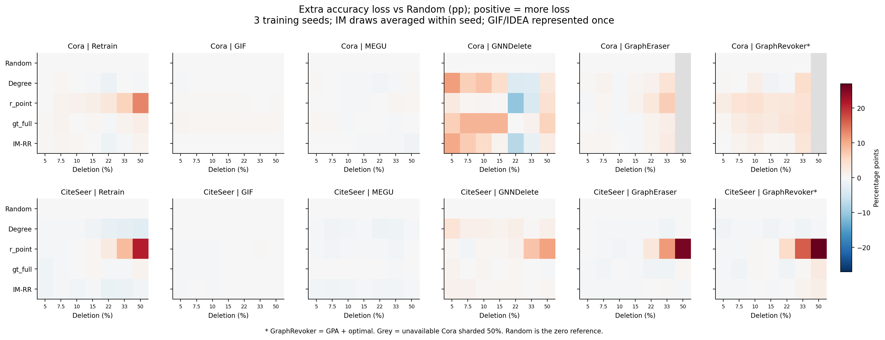
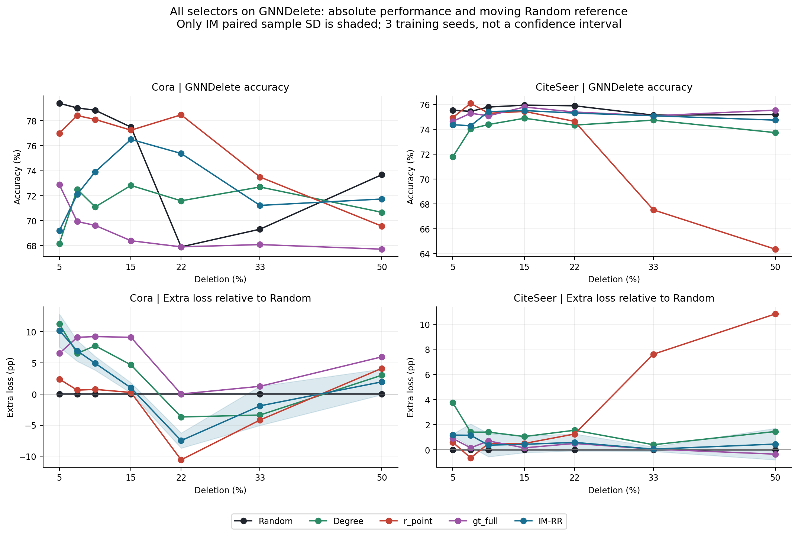
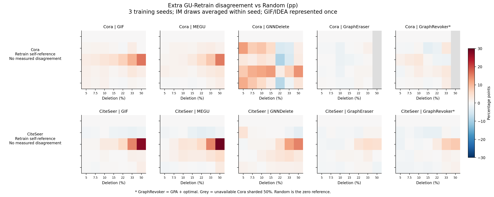

# EXP-080：五种策略放在一起，IM有没有响应模式？

2026-10-21 · 完整2,016条件 · [主报告](REPORT.html) · 现有数据重分析

**结论：可以辨认局部的“策略×GU×预算”响应，但没有证据把IM称为跨数据集、跨预算稳定的策略族指纹。** IM最明显的局部现象是Cora/GNNDelete的小预算额外损伤，随后相对Random发生转向；CiteSeer上这一强度未重现，Degree也有类似转向。与此同时，GIF/IDEA和MEGU的效用平稳，以及分片方法的高预算损失，更多表现为方法与数据集共同决定的响应。

这里的IM专指本批`im_rr_greedy`：RR=65,536，传播概率0.1，三个选点seed=11/22/33。没有比较CELF、其他RR规模或传播概率，因此能讨论本配置的pattern，不能归纳整个IM算法族。GIF/IDEA是遗忘方法轴，不能与IM选点策略混为一谈。

## 1. 先分开三件事：绝对强度、Random增量、GU相对响应

- 绝对accuracy曲线回答“模型最终表现怎样”，见主报告。
- 定义 **H=accuracy(Random)−accuracy(selector)**，同训练seed、同GU、同预算配对；正值表示比Random多损失，单位pp。Random本身随预算变化，H的符号变化不等于策略自身准确率出现同幅度转变。
- 定义 **Q=H(GU)−H(Retrain)**，作为对照的交互差：正值表示选点相对Random带来的损失更集中在GU。Q和H都不能直接证明遗忘是否充分，也不能混用各方法不同的before。
- 另看 **D_extra=D(selector)−D(Random)**，比较GU与各自同请求Retrain的不一致率增量；不同策略的Retrain也不同，因此不是GU预测间的直接距离。

所有图表保留五种策略；profile计算将GIF/IDEA合并为一个坐标。IM三次抽样先在每个训练seed内平均，再计算三训练seed的均值和样本SD。所有比例上Random和Degree各只有一个节点集合跨训练seed重用，IM各有三个集合；这些不是独立数据划分或九个独立训练seed。

## 2. 五种策略的作用对象和预算响应不同

统一色标：红色为比Random更差，蓝色为更好，灰色为未运行的Cora50%分片端点。颜色是均值，不是显著性。先看同一列中不同策略，再看同一行跨GU的变化；不要仅按整图平均值给策略排名。

共同具备全部方法的33%端点，H均值（pp）：

| 数据集 | 策略 | Retrain | GIF/IDEA | MEGU | GNNDelete | GraphEraser | GraphRevoker* |
| --- | --- | --- | --- | --- | --- | --- | --- |
| Cora | Random | +0.00 | +0.00 | +0.00 | +0.00 | +0.00 | +0.00 |
| Cora | Degree | -0.12 | -0.06 | -0.37 | -3.38 | +3.75 | +4.67 |
| Cora | r_point | +5.97 | +0.18 | +0.68 | -4.18 | +6.64 | +3.81 |
| Cora | gt_full | +0.86 | +0.43 | -0.25 | +1.23 | +1.85 | +4.12 |
| Cora | IM-RR | -0.23 | -0.10 | -0.57 | -1.91 | +2.15 | +3.26 |
| CiteSeer | Random | +0.00 | +0.00 | +0.00 | +0.00 | +0.00 | +0.00 |
| CiteSeer | Degree | -2.35 | +0.15 | -1.10 | +0.40 | -1.20 | -1.15 |
| CiteSeer | r_point | +8.46 | +0.30 | -0.65 | +7.61 | +11.56 | +16.37 |
| CiteSeer | gt_full | -0.25 | -0.00 | -0.45 | +0.05 | -1.15 | +0.35 |
| CiteSeer | IM-RR | -1.57 | +0.15 | -0.80 | +0.05 | +0.32 | +0.90 |

**Random：预算增加本身就会产生效用变化和预测偏离，必须保留为随预算变化的参照。** Cora/GNNDelete从15%到22%的accuracy由77.49%降至67.90%，约−9.59pp；IM同期76.51%降至75.38%，仅−1.13pp。IM在22%相对Random变好，主要体现两条曲线变化不同，不能讲成“提高预算后IM反而恢复了模型”。

**Degree：在CiteSeer上没有普遍强化损伤，在Cora低预算GNNDelete和高预算分片上却有明显作用。** CiteSeer50%时Retrain比Random高2.80pp；Cora5%的GNNDelete比Random低11.25pp，33%的GraphEraser/GraphRevoker分别低3.75/4.67pp。Degree并非一个始终弱于模型型策略的基线。

**r_point：高预算最明显地改变Retrain，并在CiteSeer连带造成GNNDelete和分片方法损失；GIF/MEGU仍保持较高accuracy。** 但Cora33%时GNNDelete平均比Random高4.18pp，而GraphEraser低6.64pp。即使同一强策略，也没有跨GU统一损伤排序。

**gt_full：更像局部GU响应，而不是一致削弱Retrain。** Cora50%时GNNDelete比Random低5.97pp，Retrain只低1.78pp，Q为+4.18pp；CiteSeer同条件GNNDelete反而比Random高0.35pp。Cora的作用对象不能直接迁移到CiteSeer。

**IM-RR：Cora小预算GNNDelete额外损伤明显，高预算分片有一定损失；CiteSeer总体更靠近Random，MEGU往往略优。** 因而不能说IM完全无效，也不能概括成持续增强的强攻击。它的局部作用见下一节。

## 3. IM有局部pattern，但三条证据限制了“稳定指纹”的说法

**第一，Cora/GNNDelete的小预算损伤在本次抽样网格上反复出现。** IM的H在5%、7.5%、10%分别为+10.21、+6.93、+4.94pp；每个比例的三个训练seed×三个IM抽样组合均比对应Random更差。22%时9个组合全部反向，IM更好；到50%时平均H又回到+1.95pp。33%只有1/9组合更差，但该组合的幅度较大，不能只看平均或方向计数。

| 数据集 | 预算 | IM H均值(pp) | 训练seed SD | H>0的组合数 | 九组合H范围(pp) |
| --- | --- | --- | --- | --- | --- |
| Cora | 5% | +10.21 | 2.64 | 9/9 | +4.06 至 +14.02 |
| Cora | 7.5% | +6.93 | 1.66 | 9/9 | +1.85 至 +11.81 |
| Cora | 10% | +4.94 | 1.11 | 9/9 | +2.95 至 +11.25 |
| Cora | 15% | +0.98 | 0.83 | 6/9 | -0.18 至 +3.32 |
| Cora | 22% | -7.48 | 1.22 | 0/9 | -11.44 至 -4.61 |
| Cora | 33% | -1.91 | 3.14 | 1/9 | -7.56 至 +9.96 |
| Cora | 50% | +1.95 | 2.06 | 6/9 | -3.69 至 +6.64 |
| CiteSeer | 5% | +1.17 | 0.08 | 7/9 | -0.15 至 +2.40 |
| CiteSeer | 7.5% | +1.15 | 0.91 | 7/9 | -1.50 至 +3.30 |
| CiteSeer | 10% | +0.37 | 0.93 | 6/9 | -1.20 至 +1.20 |
| CiteSeer | 15% | +0.43 | 0.66 | 6/9 | -0.90 至 +1.50 |
| CiteSeer | 22% | +0.58 | 0.68 | 6/9 | -0.75 至 +1.80 |
| CiteSeer | 33% | +0.05 | 0.18 | 5/9 | -0.75 至 +0.90 |
| CiteSeer | 50% | +0.45 | 1.25 | 7/9 | -2.25 至 +2.55 |

这些9格共享三个训练seed和固定Random请求，比例间还是嵌套节点前缀，**不能当作9个独立样本，更不能把各比例加总成独立重复**。Cora/GNNDelete在固定训练seed内的IM三抽样accuracy极差最大达到15.13pp（33%、seed212），说明平均后的曲线会掩盖请求敏感性。

**第二，该强模式没有在CiteSeer重现。** CiteSeer/GNNDelete的IM H均值在所有比例仅约+0.05～+1.17pp，九组合中也有相反方向。GIF/IDEA在两数据集的IM相对Random效用差都很小（全部预算绝对均值差不超过0.24pp）；MEGU没有持续额外损伤。IM不是普遍降低所有GU准确率的策略。

**第三，这个局部形状不是IM独有。** Degree在Cora/GNNDelete上也表现为小预算比Random更差、22%和33%均值反向、50%再次更差。IM和Degree是否能够被稳定区分，需要在独立数据或请求上验证，当前不能由“曲线看起来相似/不同”直接宣布族指纹。

高预算另有较弱的候选现象：IM相对Random在Cora33%的GraphEraser/GraphRevoker上多损失2.15/3.26pp；CiteSeer33%为0.32/0.90pp，50%为−0.28/+1.50pp。因此GraphRevoker较高预算的损伤在两数据集均值上出现，但GraphEraser并不一致，Degree和gt_full也可能产生分片损失。不能据此建立IM专属的分片攻击机制。

## 4. 预测不一致率提供另一个观察轴，但仍不是IM专属

IM在CiteSeer50%时，GIF与MEGU相对Random的D分别多2.07、2.65pp，但accuracy分别比Random高0.08、0.22pp；这是较小的“效用平稳、预测偏离增加”实例。Cora50%的MEGU也有D多2.05pp、accuracy高0.88pp。r_point的对应偏离大得多，而Degree、gt_full也能产生偏离；这支持额外观察预测对齐，不支持该现象是IM特有。

分片方法与共享单GCN Retrain存在模型家族差异；GraphRevoker*始终指原执行的GPA+optimal。高D、低accuracy和方法实现审计必须分别解释。

## 5. 用距离检查“形状”时，结果也依赖GU坐标

为避免仅凭肉眼判断，对5%～33%的共同范围，在每个训练seed/预算上计算IM与另一策略的GU向量RMS距离。原始距离保留整体强度，去均值距离先从各向量减去其GU均值，仅比较相对形状。单位pp。下面再对六个预算、三个训练seed取描述性平均，**这些相关条件不作为18个独立样本，不给p值或稳定性声明**。

| 数据集 | GU集合 | IM对照 | 原始RMS(pp) | 去均值RMS(pp) |
| --- | --- | --- | --- | --- |
| CiteSeer | five_GU | degree | 0.86 | 0.77 |
| CiteSeer | five_GU | gt_full | 0.79 | 0.73 |
| CiteSeer | five_GU | r_point | 2.53 | 1.86 |
| CiteSeer | five_GU | random | 0.70 | 0.64 |
| CiteSeer | without_GNNDelete | degree | 0.61 | 0.47 |
| CiteSeer | without_GNNDelete | gt_full | 0.76 | 0.68 |
| CiteSeer | without_GNNDelete | r_point | 2.58 | 1.92 |
| CiteSeer | without_GNNDelete | random | 0.64 | 0.49 |
| Cora | five_GU | degree | 1.69 | 1.52 |
| Cora | five_GU | gt_full | 2.61 | 2.22 |
| Cora | five_GU | r_point | 3.88 | 3.29 |
| Cora | five_GU | random | 2.83 | 2.51 |
| Cora | without_GNNDelete | degree | 0.91 | 0.77 |
| Cora | without_GNNDelete | gt_full | 1.26 | 1.07 |
| Cora | without_GNNDelete | r_point | 2.88 | 2.31 |
| Cora | without_GNNDelete | random | 1.06 | 0.89 |

five_GU包含GIF、MEGU、GNNDelete、GraphEraser、GraphRevoker，IDEA不重复计票；without_GNNDelete是删去该坐标的敏感性检查。不同GU集合的距离尺度和解释不同，只在同一集合内比较。距离小只表示这些已观察坐标接近，不能说明策略等价；是否能在未知数据上识别IM仍未验证。

五GU的去均值距离中，Cora的IM更接近Degree（1.52pp），而非Random（2.51pp）；CiteSeer则更接近Random（0.64pp），Degree与gt_full分别为0.77/0.73pp。删去GNNDelete后，Cora的IM–Random距离降至0.89pp，说明此前差异相当依赖该坐标；CiteSeer删去它后最近参照也从Random变为Degree，但两者距离仅0.49/0.47pp。**这是局部相似性的描述，不是可跨数据集识别的固定族结构。**

## 6. 现在可以写进结论的范围

> 五种删除策略没有统一的跨方法强弱排序。预算响应由选择策略、GU方法与数据集共同决定：r_point在高预算下明显改变重训练参照，gt_full与IM在部分Cora/GNNDelete条件下产生额外损伤，而Degree可以形成相近的局部响应。IM-RR在Cora小预算GNNDelete上的损伤具有本次抽样网格内的一致方向，但其Random相对效应随预算反转，且未以同等强度迁移到CiteSeer。因此当前证据支持条件性的响应结构，尚不足以支持IM策略族的稳定、独有指纹。

原始效用、相对Random增量、相对Retrain响应和预测对齐回答不同问题；不能选其中最有利的一条替代其他三条。固定split、三个训练seed、一种IM配置、有限请求重复和未校准的Retrain自然波动仍是边界。本次没有新增GPU作业或更改科学接受决定。

## 7. 数据和复现

- [全部逐seed对照与交互差](strategy_seed_contrasts.csv)、[均值和SD](strategy_summary.csv)。
- [IM未平均的三抽样对照](im_draw_contrasts.csv)、[固定训练seed内抽样极差](im_draw_ranges.csv)。
- [各预算独立节点集合数](strategy_request_counts.csv)、[逐seed/预算的profile距离](im_profile_distances.csv)、[距离描述性汇总](im_profile_distance_summary.csv)。
- [输入核验](statistics_validation.json)、[原始回传核验](verification.json)、[增量与形状的独立复算](strategy_statistics_validation.json)、[生成脚本](strategy_patterns.py)。

本脚本以已经独立核验的cells.csv哈希为输入门槛，从原始行重新分层统计。图中灰格不补零，Retrain的D不造测量值；PDF与PNG均可导出。HTML由同一Markdown生成。
